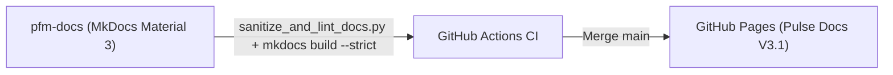

# Pulse Docs -- Portal Institucional de Documentacao Viva (V3.1)

[](CONTRIBUTING.md)
[](CHANGELOG.md)
[](https://sorobanerp.github.io/pfm-docs/)

---

## 1. Visao Geral e Governanca Editorial

Repositorio central de **Docs-as-Code** (MkDocs Material Design 3 + Mermaid.js) contendo Visao Executiva V3, Design System IDS "PFM Pulse", ADRs (ADR-001 a ADR-010), Modelo C4, Fluxos Criticos, PRD Core Banking (`RN01--RN06`, `UC-01--UC-08`), Backlog Scrum V3 (`US-01--US-15`), BDD Gherkin, Guia de Execucao Local e Manuais SRE/FinOps.

- **Repositorio:** `Sorobanerp/pfm-docs`
- **Skill de Governanca Editorial Permanente:** [.agent/skills/pulse-docs-editorial-standard/SKILL.md](.agent/skills/pulse-docs-editorial-standard/SKILL.md)
- **Validador Automatico ASCII e Tabelas:** `python3 scripts/sanitize_and_lint_docs.py`



---

## 2. Como Executar e Validar Localmente

```bash
# 1. Validar padronizacao 100% ASCII e integridade de tabelas Markdown
python3 scripts/sanitize_and_lint_docs.py

# 2. Build estrito (0 warnings e 0 erros)
NO_MKDOCS_2_WARNING=1 .venv/bin/mkdocs build --clean --strict

# 3. Subir servidor local de preview
NO_MKDOCS_2_WARNING=1 .venv/bin/mkdocs serve -a 127.0.0.1:8000
```

Consulte [CONTRIBUTING.md](CONTRIBUTING.md) para regras editoriais e Gitflow, e [CHANGELOG.md](CHANGELOG.md) para historico de versoes.
