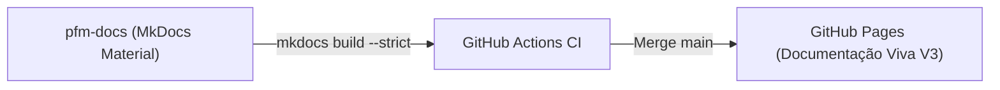

# PFM Docs — Portal de Documentação Viva (V3.0)

[](CONTRIBUTING.md)
[](CHANGELOG.md)
[](https://sorobanerp.github.io/pfm-docs/)

---

## 1. Visão Geral & Papel na Arquitetura

Repositório central de **Docs-as-Code** (MkDocs Material + Mermaid.js) contendo Visão Executiva V3, ADRs (ADR-001 a ADR-010), Modelo C4, Fluxos Críticos, PRD Core Banking (`RN01–RN06`, `UC-01–UC-08`), Backlog Scrum V3 (`US-01–US-15`), BDD Gherkin e Manuais SRE/FinOps.

- **Repositório:** `Sorobanerp/pfm-docs`
- **Vínculo com `pfm-docs`:** `ADR-001 a ADR-010 | US-01 a US-15`



---

## 2. Pré-requisitos & Variáveis de Ambiente

### Pré-requisitos
- Python 3.12+ e `pip`
- MkDocs Material (`requirements.txt`)

### Variáveis de Ambiente (Sem Segredos Hardcoded)
| Variável | Padrão Local | Descrição |
| :--- | :---: | :--- |
| `PORT` | `18000` | Porta local do servidor MkDocs (evita colisão com Portainer na `8000`) |
| `NO_MKDOCS_2_WARNING` | `1` | Suprime aviso informativo de ciclo futuro do MkDocs |

> **Segurança (Zero-Trust):** Nunca commite tokens, senhas, chaves AWS ou strings de conexão com credenciais reais. Utilize `.env` local (ignorado no `.gitignore`) ou AWS Secrets Manager / GitHub OIDC.

---

## 3. Como Executar Localmente

```bash
python3 -m venv .venv && source .venv/bin/activate
pip install -r requirements.txt
.venv/bin/mkdocs serve -a 0.0.0.0:18000
# Acesse: http://localhost:18000
```

---

## 4. Como Testar e Validar

```bash
# Build estrito (falha em links quebrados ou avisos)
NO_MKDOCS_2_WARNING=1 .venv/bin/mkdocs build --clean --strict
```

---

## 5. Como Provisionar / Validar na Nuvem

1. Fluxo Gitflow: `feat/*` $\rightarrow$ `develop` $\rightarrow$ `main` (apenas documentação estática, zero recursos cloud).
2. Pós-deploy: verificar job `Publicar no GitHub Pages` no GitHub Actions e acessar `https://sorobanerp.github.io/pfm-docs/`.

Consulte [CONTRIBUTING.md](CONTRIBUTING.md) para regras de Conventional Commits e [CHANGELOG.md](CHANGELOG.md) para histórico de versões.
