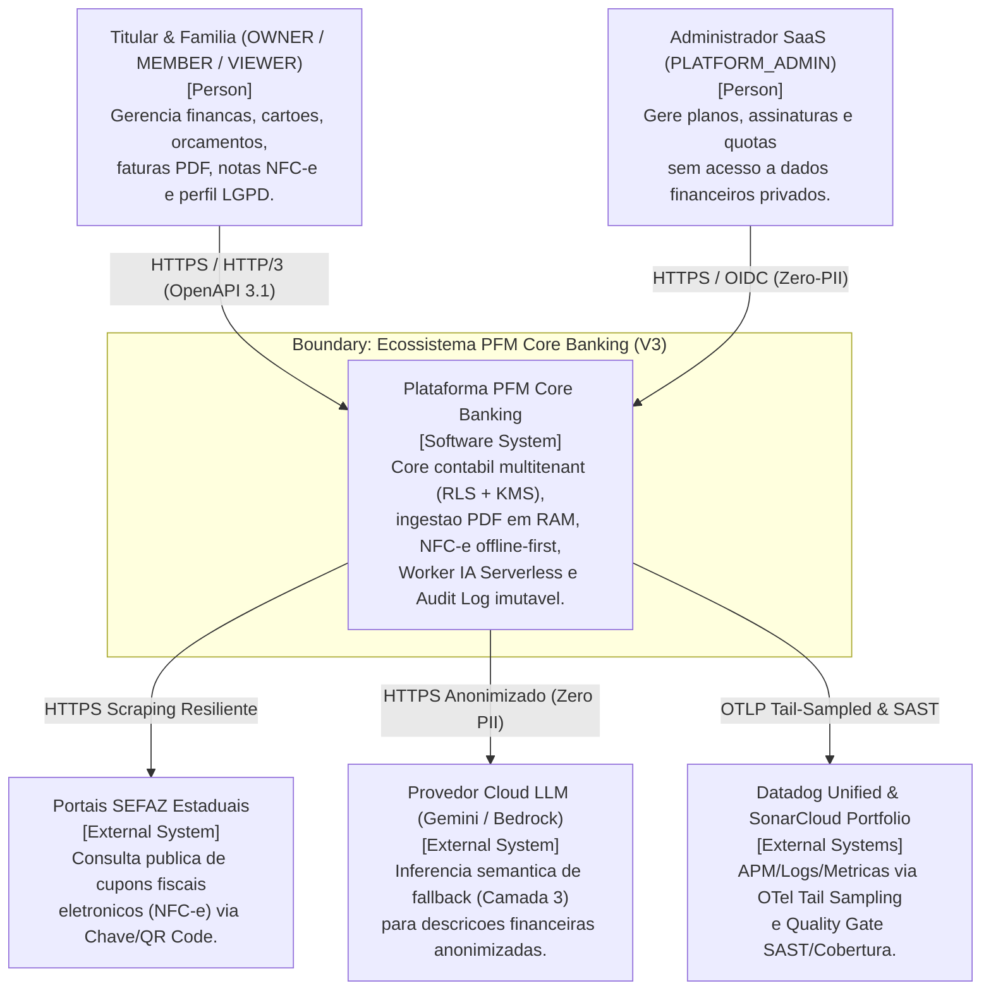
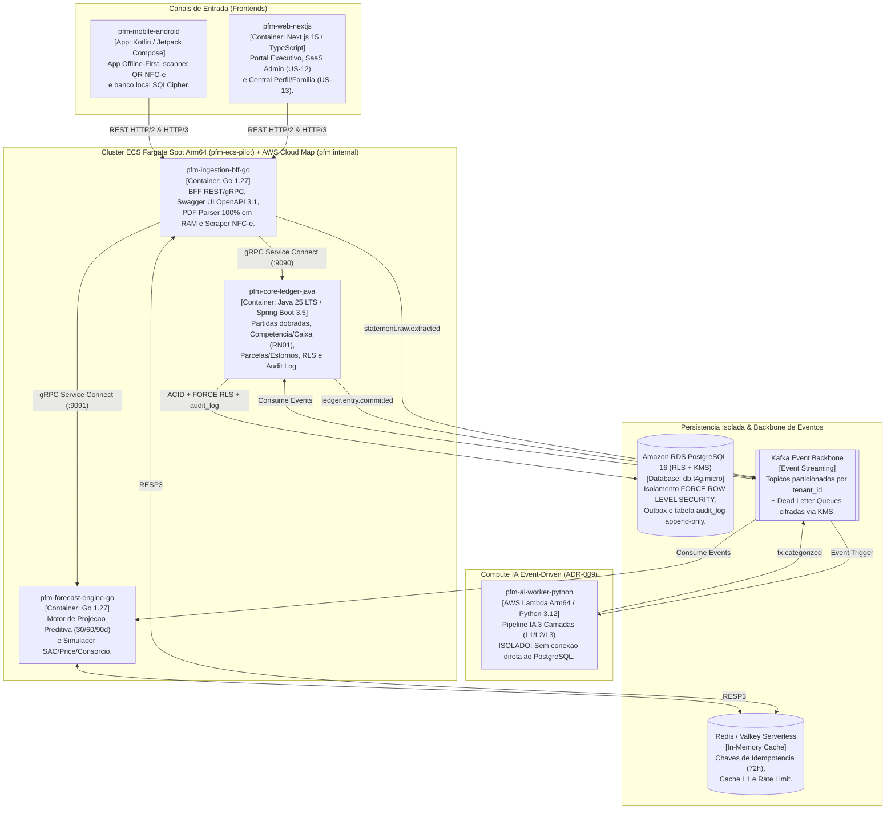
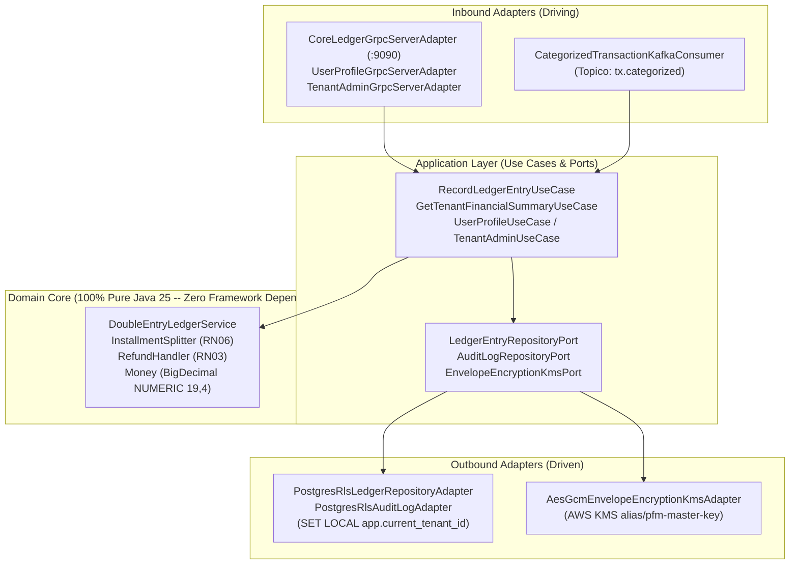

# 4.1. Arquitetura C4 (Niveis 1 a 3) e Catalogo dos 15 Repositorios

Artefato 03 - Modelo C4 &amp; Topologia Multi-Repo
Hexagonal Ports &amp; Adapters

Este documento apresenta a arquitetura de software da plataforma **PFM Core Banking (V3)** atraves do **Modelo C4 (Contexto, Conteineres e Componentes)** e o catalogo oficial dos **15 repositorios** na organizacao GitHub `Sorobanerp`.

!!! note "Governanca FinOps Centralizada"
    Todas as estimativas financeiras de infraestrutura cloud e comparativos de estagios operacionais estao consolidados exclusivamente em [5.3. FinOps & Custos Cloud](../05-visao-operacoes/finops-e-custos-cloud.md).

---

## 1. C4 Nivel 1 -- Diagrama de Contexto do Sistema

---

## 2. C4 Nivel 2 -- Diagrama de Conteineres (ECS Fargate Spot + Service Connect + Lambda IA)

---

## 3. C4 Nivel 3 -- Diagrama de Componentes Hexagonais (`pfm-core-ledger-java`)

---

## 4. Catalogo Oficial dos 15 Repositorios (`Sorobanerp`)

| # | Repositorio | Categoria | Stack Principal | Responsabilidade Arquitetural |
| :-: | :--- | :--- | :--- | :--- |
| **01** | `pfm-docs` | Governanca & Docs | MkDocs Material 3, Python | Portal Institucional Pulse Docs (5 Visoes Executivas, Linter ASCII e GitHub Pages). |
| **02** | `pfm-contracts` | Contratos & Schemas | Protobuf v1, OpenAPI 3.1 | Fonte unica da verdade para contratos gRPC e especificacao `openapi/openapi.yaml`. |
| **03** | `pfm-shared-infra` | Infra Compartilhada | OpenTofu, Docker Compose | VPC 2 AZs (`us-east-2a/b`, 0 NAT), Cluster ECS `pfm-ecs-pilot`, Cloud Map `pfm.internal`, RDS, KMS e S3. |
| **04** | `pfm-finops-manager-infra` | Automacao FinOps | Python 3.12 Arm64, OpenTofu | Lambda `pfm-finops-manager` (`stop`, `start`, `audit` e `cost_guardrails`) + EventBridge Schedules. |
| **05** | `pfm-core-ledger-java` | Core Banking | Java 25 LTS, Spring Boot 3.5 | Partidas dobradas, Competencia vs. Caixa (`RN01`), Parcelas/Estornos (`RN06`), RLS e gRPC `:9090`. |
| **06** | `pfm-core-ledger-infra` | Infra Dedicada 1:1 | OpenTofu (ECS Fargate Spot) | Task Definition Arm64, Service Connect, Auto Scaling e IAM Least Privilege do Core Ledger. |
| **07** | `pfm-ingestion-bff-go` | Ingestao & BFF | Go 1.27, HTTP/2, Swagger UI | Upload PDF em RAM (`Zero-Disk`), Scraper SEFAZ NFC-e, Bridge gRPC e Swagger `:8080`. |
| **08** | `pfm-ingestion-bff-infra` | Infra Dedicada 1:1 | OpenTofu (ECS Fargate Spot) | Task Definition Arm64, Service Connect e IAM de acesso ao bucket S3 compartilhado e KMS. |
| **09** | `pfm-forecast-engine-go` | Projecao & Contratos | Go 1.27, `shopspring/decimal` | Projecao Run-Rate (30/60/90d) e Simulador SAC/Price/Consorcio com gRPC Reflection `:9091`. |
| **10** | `pfm-forecast-engine-infra` | Infra Dedicada 1:1 | OpenTofu (ECS Fargate Spot) | Task Definition Arm64, Service Connect e IAM Least Privilege do Forecast Engine. |
| **11** | `pfm-ai-worker-python` | IA Serverless | Python 3.12, Pydantic v2 | Funil de categorizacao em 3 camadas sem conexao direta ao PostgreSQL (`ADR-009`). |
| **12** | `pfm-ai-worker-infra` | Infra Dedicada 1:1 | OpenTofu (AWS Lambda Arm64) | Funcao Serverless `pfm-ai-worker-python-prod`, fila SQS DLQ cifrada e Secrets Manager. |
| **13** | `pfm-web-nextjs` | Frontend Web | Next.js 15, React 19, Tailwind | Experiencia Web Full-Viewport com as 6 jornadas do IDS "PFM Pulse". |
| **14** | `pfm-web-infra` | Infra Dedicada 1:1 | OpenTofu (ECS Fargate Spot) | Task Definition Arm64 e infraestrutura dedicada do Portal Web. |
| **15** | `pfm-mobile-android` | Frontend Mobile | Kotlin 2.1, Jetpack Compose | Aplicativo Android Material 3 Offline-First com Scanner NFC-e e SQLCipher. |
