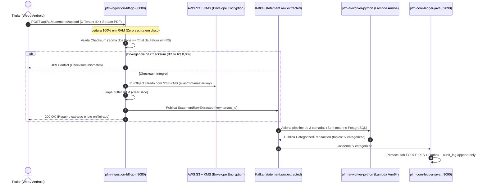
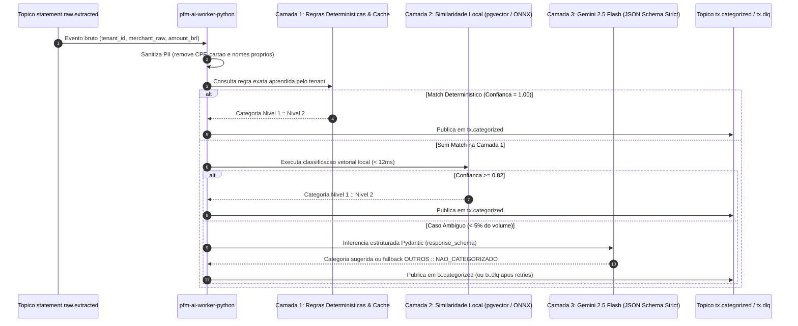
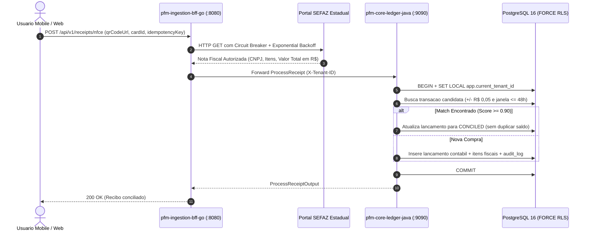
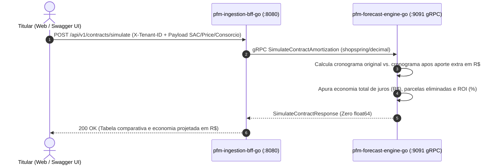

# 4.2. Fluxos de Sequencia Criticos (PDF em RAM, IA 3 Camadas, NFC-e e Contratos)

Artefato 04 - Fluxos de Sequencia
Zero-Disk RAM Parsing &amp; Event-Driven

Este documento apresenta os fluxogramas de sequencia ponta a ponta dos quatro fluxos arquiteturais criticos da plataforma **PFM Core Banking**.

---

## 1. Ingestao de Fatura PDF 100% em Memoria RAM (`Zero-Disk Persistence`)

Nenhum arquivo PDF de fatura repousa em disco nao-cifrado. O `pfm-ingestion-bff-go` le o stream em buffer volatil (`io.LimitReader` de 15 MB), valida o checksum matematico (`soma(itens) == total_declarado`), limpa o slice da memoria (`clear(rawBody)`) e publica o evento para categorizacao.

---

## 2. Pipeline de Categorizacao por IA em 3 Camadas (`pfm-ai-worker-python`)

---

## 3. Captura de Cupom Fiscal NFC-e e Conciliacao sem Duplicidade (`RN04`)

---

## 4. Simulacao Quantitativa de Amortizacao SAC, Price e Consorcio (`pfm-forecast-engine-go`)

