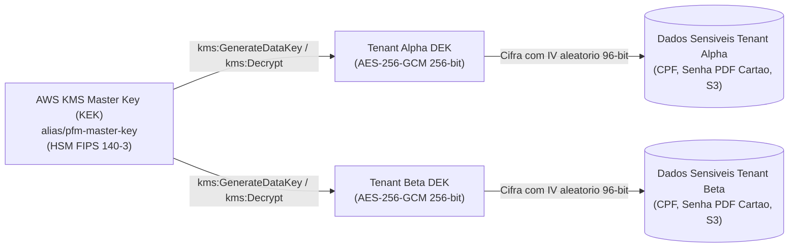

# 4.3. Seguranca Criptografica, Isolamento PostgreSQL 16 RLS e Conformidade LGPD

<span class="badge-green">Zero-Trust Multi-Tenancy</span>
<span class="badge-glow">AWS KMS Envelope Encryption</span>
<span class="badge-peach">Lei 13.709/2018 (LGPD Brasil)</span>

Este documento especifica a arquitetura de seguranca em profundidade da plataforma **PFM Core Banking**, detalhando a matriz criptografica com **AWS KMS (`alias/pfm-master-key`)**, o isolamento **PostgreSQL 16 Row-Level Security (`FORCE RLS`)**, a trilha de auditoria imutavel e o mecanismo de **Crypto-Shredding** para cumprimento do Art. 18 da LGPD.

---

## 1. Matriz de Controles Criptograficos e conformidade LGPD

| Artigo LGPD | Requisito Regulatorio | Implementacao Tecnica na Plataforma | Repositorio Responsavel |
| :--- | :--- | :--- | :--- |
| **Art. 6o, VII e Art. 46** | Seguranca e prevencao contra acessos nao autorizados | **PostgreSQL 16 `FORCE ROW LEVEL SECURITY`** em todas as tabelas (`tenants`, `ledger_entries`, `user_profiles`, `family_members`, `category_budgets`, `audit_log`) via `SET LOCAL app.current_tenant_id`. | `pfm-core-ledger-java` (`V1`, `V2`, `V3` Flyway) |
| **Art. 46 e Art. 49** | Criptografia de dados sensiveis em repouso e em transito | **Envelope Encryption (AWS KMS + AES-256-GCM)**: cada tenant possui sua chave DEK cifrada pela Master Key `alias/pfm-master-key` (`1fb3bdd0-5698-4f8c-95bb-46cf47f0479b` em `us-east-2`). | `pfm-shared-infra`, `pfm-core-ledger-java`, `pfm-ingestion-bff-go` |
| **Art. 6o, III (Necessidade)** | Minimizacao de dados e proibicao de retencao desnecessaria | **Zero-Persistence PDF Parsing**: faturas PDF sao lidas exclusivamente em buffer RAM (`bytes.Reader`) e zeradas (`clear(rawBody)`) imediatamente apos a extracao. | `pfm-ingestion-bff-go` |
| **Art. 18, V (Portabilidade)** | Exportacao estruturada dos dados do titular | Endpoint `POST /api/v1/profile/export` gerando pacote completo das transacoes e configuracoes do tenant em `JSON` ou `CSV`. | `pfm-core-ledger-java`, `pfm-ingestion-bff-go` |
| **Art. 18, VI (Eliminacao)** | Exclusao definitiva de dados pessoais a pedido do titular | **Crypto-Shredding (`POST /api/v1/profile/crypto-shred`)**: destruicao irreversivel da chave DEK do tenant no KMS e anonimizacao dos registros, tornando snapshots antigos indecifraveis. | `pfm-core-ledger-java` |
| **Art. 37 (Registro de Operacoes)** | Rastreabilidade e trilha de auditoria | Tabela **`audit_log` append-only** protegida por trigger `prevent_audit_log_mutation()` que bloqueia `UPDATE` e `DELETE` e encadeia hashes SHA-256 (`previous_hash -> entry_hash`). | `pfm-core-ledger-java` (`V3__immutable_audit_log.sql`) |

---

## 2. Arquitetura de Envelope Encryption (AWS KMS + DEK por Tenant)



---

## 3. Isolamento Fail-Closed com PostgreSQL 16 Row-Level Security (`FORCE RLS`)

O aplicativo conecta ao PostgreSQL 16 utilizando a role restrita `pfm_app_user` (`NOSUPERUSER NOCREATEDB NOCREATEROLE NOBYPASSRLS`). Antes de qualquer comando SQL, o interceptador transacional (`RlsTenantJdbcInterceptor`) executa:

```sql
BEGIN;
SET LOCAL app.current_tenant_id = '11111111-1111-1111-1111-111111111111';
-- Todas as queries subsequentes enxergam estritamente as linhas do Tenant Alpha
SELECT * FROM ledger_entries;
COMMIT;
```

Caso `app.current_tenant_id` nao esteja definido ou esteja vazio, a funcao `current_app_tenant_id()` retorna `NULL` e a politica RLS retorna **0 linhas (Fail-Closed)**.
