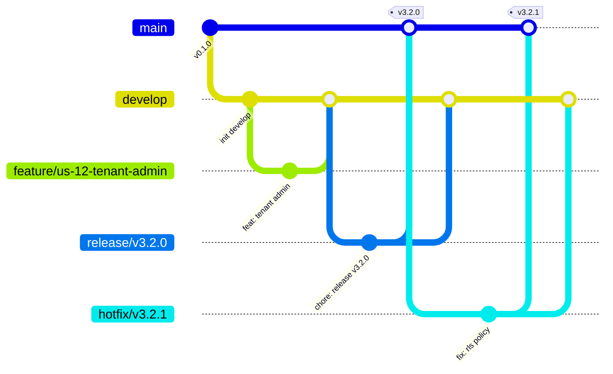
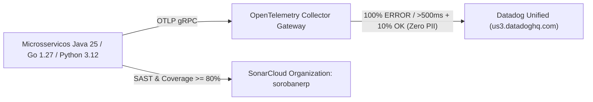

# 5.2. Governanca Gitflow Atlassian, CI/CD OpenTofu 1:1, Observabilidade OTel e SonarCloud

Artefato 07 - DevSecOps &amp; SRE
15 Repositorios Protegidos
OTel Tail-Based Sampling -&gt; Datadog

Este documento consolida o fluxo oficial **Atlassian Gitflow**, as regras de **Branch Protection** aplicadas nos 15 repositorios da organizacao `Sorobanerp`, a esteira de provisionamento **OpenTofu 1:1 via OIDC** e a arquitetura de observabilidade **OpenTelemetry -> Datadog (`us3.datadoghq.com`)** e qualidade **SonarCloud**.

---

## 1. Modelo Oficial Atlassian Gitflow e Branch Protection (15 Repositorios)

### Regras de Protecao Ativas (`main` e `develop`)
1. **Proibicao de Push Direto:** `enforce_admins: true`, `allow_force_pushes: false`, `allow_deletions: false`.
2. **Gitflow Branch Source Guard (`.github/workflows/gitflow-branch-guard.yml`):**
   - Pull Requests para `main` sao aceitos **exclusivamente** a partir de `release/*` ou `hotfix/*`.
   - Pull Requests para `develop` sao aceitos a partir de `feature/*`, `fix/*`, `docs/*`, `chore/*`, `refactor/*`, `release/*` ou `hotfix/*`.
3. **Conventional Commits Check (`.github/workflows/conventional-commits.yml`):** Valida semanticamente o titulo do PR e todos os commits da branch.

---

## 2. Esteira OpenTofu 1:1 com OIDC e Auto-Rollback S3

Os 7 repositorios de infraestrutura (`pfm-shared-infra`, `pfm-finops-manager-infra`, `pfm-core-ledger-infra`, `pfm-ingestion-bff-infra`, `pfm-forecast-engine-infra`, `pfm-ai-worker-infra`, `pfm-web-infra`) operam com:

- **Autenticacao Zero-Secret:** AWS IAM OIDC Role (`PFM-GitHubActions-OIDC-Role`) com bloqueio explicito `DenyAllEKS` na fase enxuta.
- **State Isolado por Repositorio:** Bucket S3 `sorobanerp-pfm-tfstate-us-east-2-366476833548` + tabela DynamoDB `pfm-tfstate-locks`.
- **Quality Gates IaC:** `tofu fmt -check -recursive`, `tofu validate` e `trivy config --exit-code 1 --severity CRITICAL,HIGH .`.
- **Pre-Apply Backup & Rollback Automatico:** Snapshot automatico do `terraform.tfstate.last-good` antes de qualquer `tofu apply` em `main`.

---

## 3. Observabilidade Multi-Cloud (OTel Tail-Based Sampling) e SonarCloud

### Garantias de Observabilidade (`ADR-010`)
- **Padronizacao de Atributos:** `service.name`, `deployment.environment`, `cloud.provider` (`aws|azure|gcp`) e `tenant.tier` (proibindo `tenant_id` como tag de metrica para evitar explosao de cardinalidade).
- **Redaction Processor (Zero-PII):** Mascaramento automatico de CPF, cartao de credito, e-mail e chaves antes da exportacao OTLP.
- **Tail-Based Sampling:** Retencao de **100% dos traces com erro (`ERROR`) ou latencia `> 500ms`** e amostragem de **10% dos traces `OK`**.

---

## 4. Matriz de SLIs e SLOs (Janela de 30 Dias)

| Fluxo / Servico Critico | SLI Mensurado | SLO Alvo (30d) |
| :--- | :--- | :---: |
| **Disponibilidade Global BFF & Core Ledger** | Taxa de requisicoes validas sem erro `5xx` | **99,95%** |
| **Escrita Sincrona no Ledger** | Latencia P95 / P99 | **P95 < 80ms** / **P99 < 180ms** |
| **Parsing de Fatura PDF em RAM** | Latencia P95 para faturas ate 10 paginas | **P95 < 1.200ms** |
| **Categorizacao IA (Camadas L1 + L2)** | Latencia P95 em cache/modelo local | **P95 < 15ms** |
| **Integridade Contabil e Isolamento RLS** | Divergencia de centavos ou vazamento cross-tenant | **100,00% (Zero Tolerancia)** |
