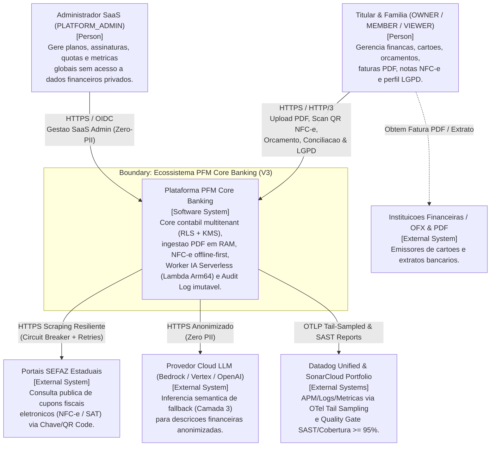
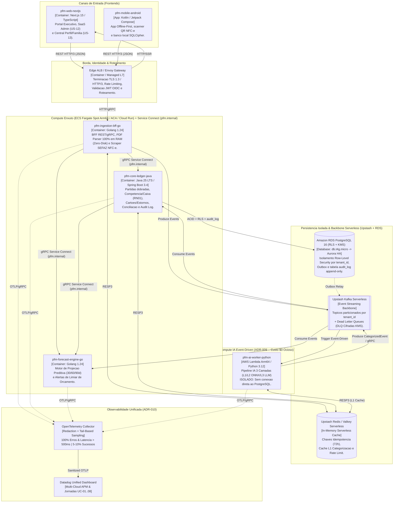
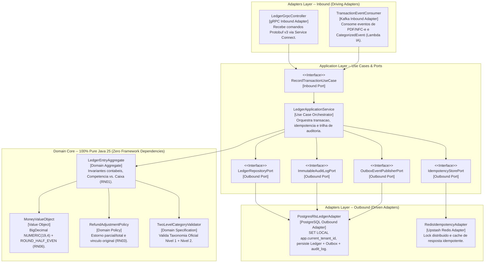

# Modelo C4 & Topologia Oficial Multi-Repo (V3)

Esta secao apresenta a arquitetura da plataforma **PFM Core Banking (Versao 3.0 -- Production-Ready FinOps & Multi-Cloud)** atraves do **Modelo C4 (Context, Containers, Components)**, a topologia oficial dos repositorios do ecossistema e a trilha evolutiva de computacao **Serverless/Containers Enxutos $\rightarrow$ Hiperescala Kubernetes**.

---

## 1. C4 Nivel 1 -- Diagrama de Contexto do Sistema

O diagrama de contexto ilustra como titulares, membros familiares e administradores SaaS interagem com a plataforma PFM Core Banking e como o sistema se integra de forma resiliente aos provedores externos (SEFAZ Estaduais, Provedores de IA/LLM, Emissores Bancarios, Datadog e SonarCloud).

---

## 2. C4 Nivel 2 -- Diagrama de Conteineres (Topologia V3 FinOps & Serverless)

O Nivel 2 detalha os conteineres e funcoes serverless da arquitetura V3, destacando o uso de **AWS ECS Fargate Spot (Arm64)** com **Service Connect (`pfm.internal`)**, o worker de IA como **AWS Lambda Arm64 Event-Driven (ADR-009)** sem conexao direta ao PostgreSQL, mensageria/cache em **Upstash Serverless** e coleta unificada via **OpenTelemetry Collector (ADR-010)**.

---

## 3. C4 Nivel 3 -- Diagrama de Componentes Hexagonais (`pfm-core-ledger-java`)

O Nivel 3 demonstra a estrutura interna padronizada utilizando **Arquitetura Hexagonal (Ports & Adapters)**, garantindo que o dominio contabil permaneca 100% livre de frameworks e SDKs de nuvem, enquanto os *Outbound Adapters* aplicam RLS, Envelope Encryption KMS e gravacao imutavel no `audit_log`.

---

## 4. Tabela Oficial dos Repositorios da Plataforma

A governanca de codigo da plataforma **PFM Core Banking** opera sob topologia Multi-Repo na organizacao GitHub [`Sorobanerp`](https://github.com/Sorobanerp), com mapeamento 1:1 entre servicos de aplicacao e modulos dedicados de infraestrutura (`*-infra`):

| # | Repositorio | Categoria | Stack / Tecnologia Principal | Responsabilidade Arquitetural & Escopo |
| :-: | :--- | :--- | :--- | :--- |
| **01** | `pfm-contracts` | Contratos & Schemas | OpenAPI 3.1, Protobuf v3, JSON Schema / Avro | Fonte unica da verdade (*Single Source of Truth*) para APIs REST, gRPC (`TenantAdminService`, `UserProfileService`, `LedgerService`) e eventos Kafka. |
| **02** | `pfm-core-ledger-java` | Core Banking | Java 25 LTS, Spring Boot 3.4, PostgreSQL RLS | Escrituracao contabil ACID, Competencia vs. Caixa (**RN01**), Parcelas/Estornos (**RN02/RN03/RN06**), Conciliacao (**RN04**), SaaS Admin, LGPD e `audit_log` append-only. |
| **03** | `pfm-ingestion-bff-go` | Ingestao & BFF | Golang 1.24+, HTTP/3, gRPC, `bytes.Reader` | API BFF, parsing de faturas PDF **100% em memoria RAM** (**ADR-006**) e Scraper SEFAZ NFC-e resiliente. |
| **04** | `pfm-forecast-engine-go` | Projecao & Alertas | Golang 1.24+, gRPC, Kafka | Motor preditivo de fluxo de caixa (30/60/90 dias), calculo de *burn rate* de orcamento e disparo de alertas (80% / 100%). |
| **05** | `pfm-ai-worker-python` | IA Serverless | Python 3.12+, AWS Lambda Arm64, ONNX, LLM | Pipeline de categorizacao em 3 camadas (L1 Redis $\rightarrow$ L2 ONNX $\rightarrow$ L3 LLM Anonimizado), **sem acesso direto ao PostgreSQL (ADR-009)**. |
| **06** | `pfm-web-nextjs` | Frontend Web | Next.js 15, React 19, TypeScript, TailwindCSS | Portal Web "Organic Financial Pulse", dashboards Competencia vs. Caixa, Painel SaaS Admin (`UC-07`) e Central Perfil/Familia (`UC-08`). |
| **07** | `pfm-mobile-android` | Frontend Mobile | Kotlin, Jetpack Compose, Room/SQLCipher, CameraX | App nativo **Offline-First** com leitor QR Code NFC-e instantaneo, cofre local cifrado e sincronizacao via WorkManager. |
| **08** | `pfm-shared-infra` | Infra Compartilhada | OpenTofu, AWS ECS Fargate Spot, Service Connect, RDS, KMS | Landing Zone VPC, Cluster ECS `pfm-pilot-prod`, Cloud Map `pfm.internal`, RDS PostgreSQL, KMS, S3 criptografado, Secrets Upstash e trilha EKS condicional. |
| **09** | `pfm-core-ledger-infra` | Infra Dedicada 1:1 | OpenTofu, ECS Service / Helm, Auto Scaling | Task Definition Arm64, Service Connect (`pfm-core-ledger-java.pfm.internal:18200`), IAM Least Privilege e Auto-Rollback S3. |
| **10** | `pfm-ingestion-bff-infra` | Infra Dedicada 1:1 | OpenTofu, ECS Service / Helm, Auto Scaling | Task Definition Arm64, Service Connect (`pfm-ingestion-bff-go.pfm.internal:18080`), IAM KMS/S3 e Auto-Rollback S3. |
| **11** | `pfm-forecast-engine-infra` | Infra Dedicada 1:1 | OpenTofu, ECS Service / Helm, Auto Scaling | Task Definition Arm64, Service Connect (`pfm-forecast-engine-go.pfm.internal:18110`) e Auto-Rollback S3. |
| **12** | `pfm-ai-worker-infra` | Infra Dedicada 1:1 | OpenTofu, AWS Lambda Arm64 / ECS (`desired=0`) | Provisionamento Serverless Event-Driven (custo $0 ocioso) e triggers Kafka/SQS + DLQ cifrada. |
| **13** | `pfm-web-infra` | Infra Dedicada 1:1 | OpenTofu, ECS Service / Helm, Auto Scaling | Task Definition Arm64, Service Connect (`pfm-web-nextjs.pfm.internal:3000`) e Auto-Rollback S3. |
| **14** | `pfm-finops-manager-infra` | Governanca FinOps | Python 3.12, AWS Lambda Arm64, EventBridge | Orquestracao automatica de `stop` (20h30 BRT), `start` (06h00 BRT), `audit` (run-rate USD) e *circuit-breaker* de orcamento. |
| **15** | `pfm-docs` | Governanca & Docs | MkDocs Material, Mermaid.js, GitHub Actions | Portal de **Docs-as-Code** V3 (Visao Executiva, ADRs V3, Modelo C4, Fluxos, PRD, Backlog BDD e SRE/FinOps). |

---

## 5. Topologia de Portas: Ambiente Local (Host) vs. Cloud

A plataforma adota o principio **12-Factor App (Port Binding via Environment Variables)** para evitar colisoes locais (ex.: Portainer na porta `8000`) e padronizar o roteamento em producao:

| Componente / Servico | Host Local | Cloud (`pfm.internal` / K8s) | Protocolo | Variavel de Ambiente (12-Factor) |
| :--- | :---: | :---: | :---: | :--- |
| **`pfm-docs`** (MkDocs) | `18000` | `8000` | HTTP | `PORT=18000` (`Makefile`) |
| **`pfm-web-nextjs`** | `18300` | `3000` | HTTP | `PORT=18300`, `NEXT_PUBLIC_API_URL` |
| **`pfm-envoy-gateway`** | `18080` | `8080` | HTTP/2, HTTP/3 | Mapeamento Docker `18080:8080` |
| **`pfm-ingestion-bff-go`** | `18100` | `18080` / `8080` | HTTP / gRPC | `SERVER_PORT=18100` |
| **`pfm-forecast-engine-go`** | `18110` | `18110` / `9090` | gRPC / HTTP | `GRPC_PORT=18110` |
| **`pfm-core-ledger-java` (HTTP)** | `18200` | `18200` / `8080` | HTTP | `SERVER_PORT=18200` |
| **`pfm-core-ledger-java` (gRPC)** | `18210` | `9090` | gRPC | `GRPC_SERVER_PORT=18210` |
| **`pfm-ai-worker-python`** | `18400` | `18090` / Lambda | Event / HTTP | `WORKER_PORT=18400` |
| **`postgres-core-ledger`** | `15432` | `5432` | TCP/SQL | `DB_URL` |
| **`pfm-redis`** (Valkey / Upstash) | `16379` | `6379` (TLS) | RESP3 | `REDIS_ADDR` |
| **`pfm-kafka`** (KRaft / Upstash) | `19092` | `9092` (SASL/TLS) | TCP | `KAFKA_BROKERS` |
| **`pfm-localstack`** | `14566` | AWS Endpoints | HTTP/HTTPS | `AWS_ENDPOINT_URL` |

---

## 6. Trilha Evolutiva Multi-Cloud: Producao Inicial $\rightarrow$ Hiperescala Kubernetes (ADR-008)

Gracas ao empacotamento em imagens **OCI Distroless (`linux/arm64`)** e protocolos abertos, a plataforma evolui sem reescrita de codigo em 3 estagios financeiros:

```mermaid
flowchart LR
    subgraph Stage1["Estagio 1: Piloto / Producao Inicial (US$ 12--24/mes)"]
        direction TB
        C1["AWS: ECS Fargate Spot (Arm64)<br/>Azure: Container Apps | GCP: Cloud Run"]
        AI1["AI Worker: AWS Lambda Arm64 ($0 ocioso)"]
        MSG1["Upstash Kafka & Redis Serverless"]
        DB1["RDS PostgreSQL db.t4g.micro (Park Noturno)"]
    end

    subgraph Stage2["Estagio 2: Escala 100 Tenants (~US$ 115/mes)"]
        direction TB
        C2["ECS Fargate Spot / ACA / Cloud Run (24x7 Ativo)"]
        AI2["Lambda Arm64 Concorrencia Reservada"]
        MSG2["Upstash Pro / Serverless Dedicated"]
        DB2["RDS Aurora Serverless v2 / Multi-AZ"]
    end

    subgraph Stage3["Estagio 3: Hiperescala 500+ Tenants (~US$ 420/mes)"]
        direction TB
        C3["Kubernetes: EKS / AKS / GKE<br/>+ Karpenter Spot + KEDA Autoscaling"]
        AI3["Lambda / Knative / KEDA Event Workers"]
        MSG3["Amazon MSK / Confluent / Strimzi Multi-AZ"]
        DB3["Aurora PostgreSQL Multi-AZ + Read Replicas"]
    end

    Stage1 -->|"OpenTofu Toggle<br/>Zero Mudanca de Codigo"| Stage2
    Stage2 -->|"compute_engine = 'eks'<br/>Helm Charts Ja Versionados"| Stage3
```

