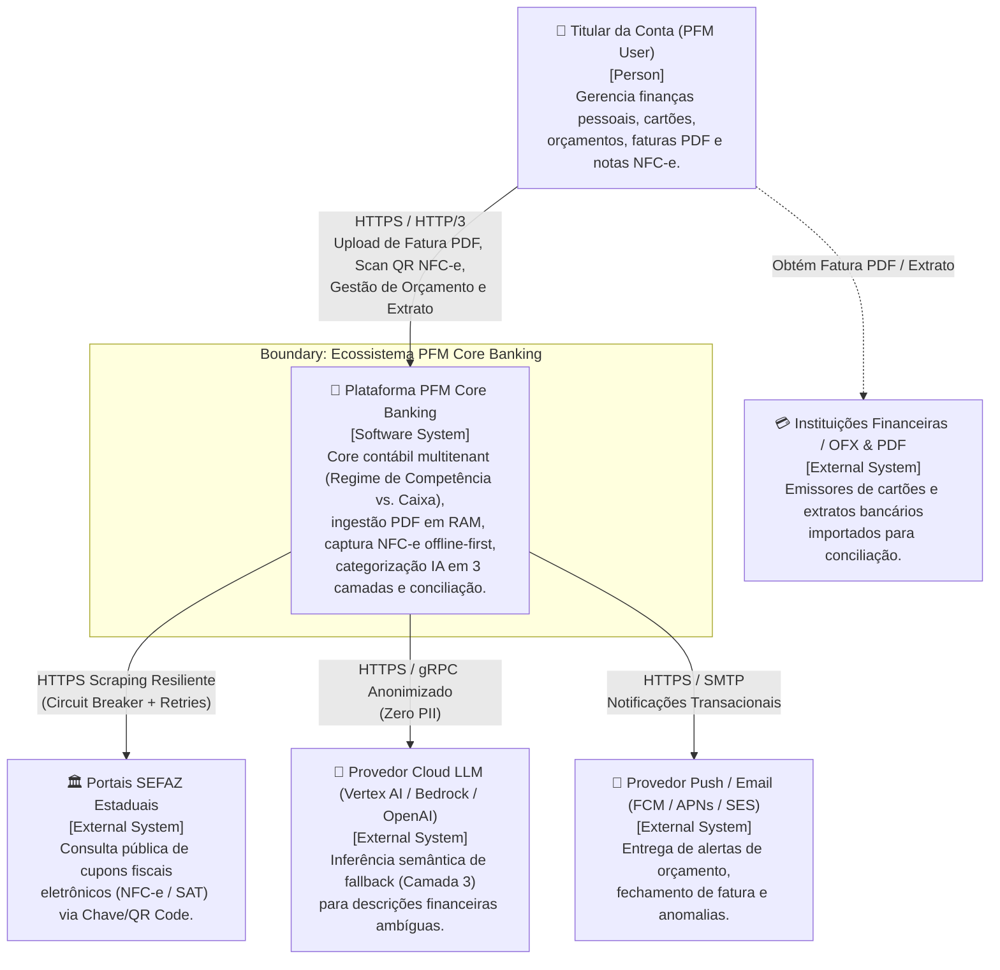
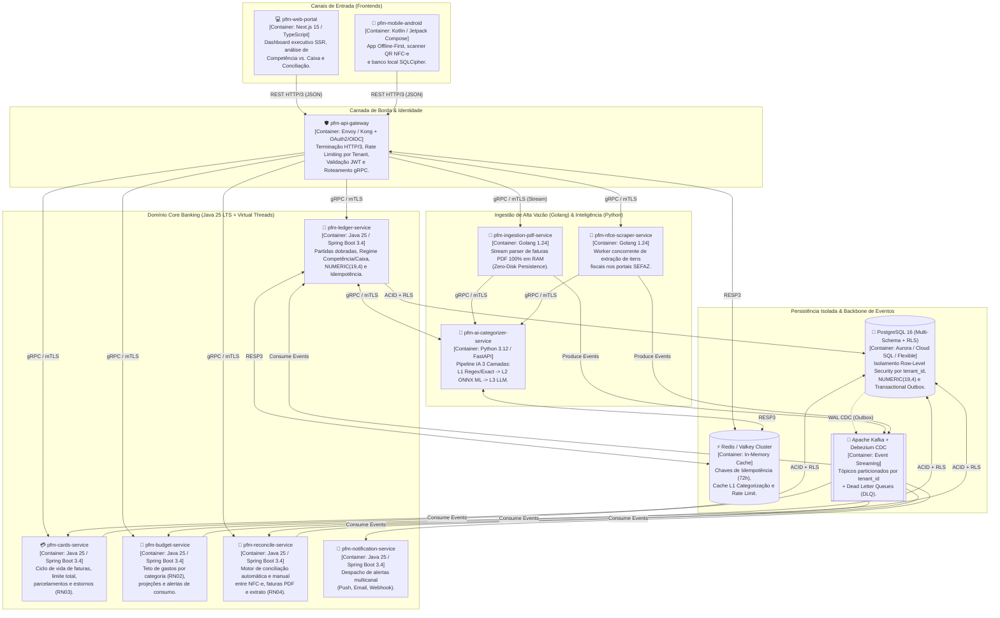
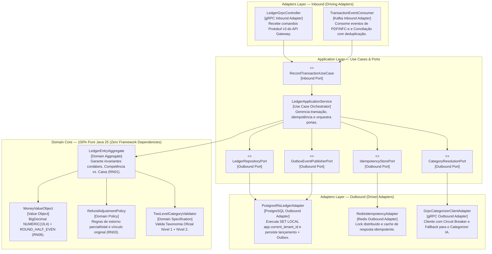
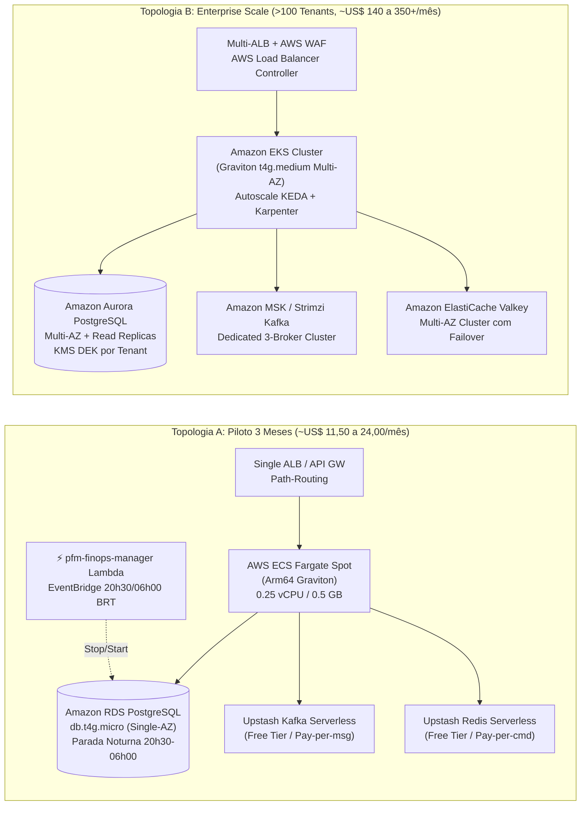

# Modelo C4 & Topologia Oficial Multi-Repo (14 Repositórios)

Esta seção apresenta a arquitetura da plataforma **PFM Core Banking** através do **Modelo C4 (Context, Containers, Components)** e a tabela oficial dos **14 repositórios** que compõem o ecossistema.

---

## 1. C4 Nível 1 — Diagrama de Contexto do Sistema

O diagrama de contexto ilustra como o titular da conta interage com a plataforma PFM Core Banking e como o sistema se integra de forma resiliente aos provedores externos (SEFAZ Estaduais, Provedores de IA/LLM, Emissores Bancários/Open Finance e Serviços de Mensageria Push/Email).

---

## 2. C4 Nível 2 — Diagrama de Contêineres (Topologia Multi-Repo)

O Nível 2 detalha os contêineres de execução mapeados diretamente para os repositórios da arquitetura Multi-Repo, destacando os protocolos de comunicação (`REST HTTP/3`, `gRPC mTLS` e `Apache Kafka`).

---

## 3. C4 Nível 3 — Diagrama de Componentes Hexagonais (`pfm-ledger-service`)

O Nível 3 demonstra a estrutura interna padronizada de um microsserviço da plataforma utilizando **Arquitetura Hexagonal (Ports & Adapters)**, exemplificada pelo `pfm-ledger-service`.

---

## 4. Tabela Oficial dos 14 Repositórios da Plataforma

A governança de código da plataforma **PFM Core Banking** é dividida exatamente nos **14 repositórios** abaixo, sob o namespace local `/home/dantas/workspace/pfm-platform/` e organização GitHub [`Sorobanerp`](https://github.com/Sorobanerp):

| # | Repositório | Categoria | Stack / Tecnologia Principal | Responsabilidade Arquitetural & Escopo |
| :-: | :--- | :--- | :--- | :--- |
| **01** | `pfm-contracts` | Contratos & Schemas | OpenAPI 3.1, Protobuf v3, JSON Schema / Avro | Fonte única da verdade (*Single Source of Truth*) para contratos REST, definições gRPC e esquemas de eventos Kafka com verificação de compatibilidade (*Buf / Schema Registry*). |
| **02** | `pfm-api-gateway` | Edge & Segurança | Envoy / Kong, Lua/Go Plugins, OAuth2/OIDC | Terminação TLS 1.3 / HTTP/3 (QUIC), validação de JWT, injeção segura de `X-Tenant-ID`, *Rate Limiting* e transcodificação REST-to-gRPC. |
| **03** | `pfm-ledger-service` | Core Banking | Java 25 LTS, Spring Boot 3.4, PostgreSQL RLS | Escrituração contábil imutável, gestão de Regime de Competência vs. Regime de Caixa (**RN01**), precisão `NUMERIC(19,4)` (**RN06**) e publicação via Transactional Outbox. |
| **04** | `pfm-cards-service` | Core Banking | Java 25 LTS, Spring Boot 3.4, PostgreSQL RLS | Gestão de cartões de crédito, controle de Limite Total vs. Limite Disponível (**RN02**), ciclos de fechamento/vencimento de fatura, desdobramento de parcelas e estornos (**RN03**). |
| **05** | `pfm-budget-service` | Core Banking | Java 25 LTS, Spring Boot 3.4, PostgreSQL RLS | Motor de orçamento mensal por categoria de 2 níveis (**RN02**), acompanhamento de *burn rate* por competência e disparo de eventos de limiar (80% / 100%). |
| **06** | `pfm-reconcile-service` | Core Banking | Java 25 LTS, Spring Boot 3.4, PostgreSQL RLS | Motor de conciliação determinística e nebulosa (*fuzzy matching* de data, valor e CNPJ/Estabelecimento) entre faturas PDF, notas NFC-e e lançamentos manuais (**RN04**). |
| **07** | `pfm-ingestion-pdf-service` | Ingestão High-Perf | Golang 1.24+, PDF Stream Parser, `tmpfs` (RAM) | Recebimento e parsing de faturas de cartão em PDF **100% em memória RAM** (Zero-Disk Persistence - **ADR-006**), extração de linhas transacionais e envio ao pipeline. |
| **08** | `pfm-nfce-scraper-service` | Ingestão High-Perf | Golang 1.24+, Goroutines, HTML/XML Parser | Extração resiliente de cupons fiscais eletrônicos (NFC-e) nos portais da SEFAZ a partir da chave de acesso de 44 dígitos ou URL de QR Code capturado offline. |
| **09** | `pfm-ai-categorizer-service` | Inteligência Artificial | Python 3.12+, FastAPI, ONNX Runtime, LLM SDK | Pipeline de categorização em 3 camadas (L1 Regras Exatas/CNPJ, L2 Modelo ML Local ONNX $<10\text{ms}$, L3 LLM Cloud Anonimizado) mapeado para a Taxonomia de 2 Níveis. |
| **10** | `pfm-notification-service` | Engajamento & Alertas | Java 25 LTS, Spring Boot 3.4, Kafka Consumer | Consumo de eventos de domínio para envio idempotente de notificações Push (FCM/APNs), e-mail transacional e alertas de segurança/orçamento. |
| **11** | `pfm-web-portal` | Frontend Web | Next.js 15, React 19, TypeScript, TailwindCSS | Portal Web executivo com visões comparativas de Competência vs. Caixa, painel de conciliação assistida, upload seguro de PDF e gráficos de orçamento. |
| **12** | `pfm-mobile-android` | Frontend Mobile | Kotlin, Jetpack Compose, Room/SQLCipher, CameraX | Aplicativo nativo **Offline-First** com leitor de QR Code NFC-e instantâneo, fila criptografada local e sincronização resiliente via WorkManager. |
| **13** | `pfm-infra-iac` | Infraestrutura & SRE | Terraform / OpenTofu, Helm, ArgoCD, OTel | Módulos IaC 1:1 multicloud (**AWS / Azure / GCP**), manifestos GitOps Kubernetes, configurações do OpenTelemetry Collector, Prometheus/Grafana e políticas KMS/RLS. |
| **14** | `pfm-docs` | Governança & Docs | MkDocs Material, Mermaid.js, GitHub Actions | Este repositório de **Docs-as-Code** contendo Visão Executiva, ADRs V2, Modelo C4, Fluxos de Sequência, PRD, Backlog BDD e Manual SRE/FinOps. |

---

## 5. Topologia de Portas: Ambiente Local (Host) vs. Cloud (Kubernetes)

Para garantir execução 100% livre de colisões com serviços pré-instalados na máquina do desenvolvedor (notadamente **Portainer** nas portas `8000`, `9000` e `9443`, além de instâncias locais de PostgreSQL `5432`, Redis `6379`, Kafka `9092` ou Envoy `8080`), a plataforma adota o princípio **12-Factor App (Port Binding via Environment Variables)**:

- **No Host Local:** Todos os serviços expostos e ferramentas utilizam a faixa canônica `1xxxx` (aplicações e gateways) e `14xxx`/`15xxx`/`16xxx`/`19xxx` (infraestrutura e bancos).
- **Nos Contêineres & Kubernetes (Cloud):** Os serviços escutam em suas portas canônicas internas padrão (`8080`, `9090`, `3000`, `5432`, `6379`, `9092`, `4566`).

| Componente / Serviço | Host Local | Container / K8s Cloud | Protocolo | Responsabilidade / Roteamento | Variável de Ambiente (Configuração 12-Factor) |
| :--- | :---: | :---: | :---: | :--- | :--- |
| **`pfm-docs`** (MkDocs) | `18000` | `8000` | HTTP | Servidor de documentação viva (preserva Portainer na `8000`) | `PORT=18000` (`Makefile`) |
| **`pfm-web-nextjs`** | `18300` | `3000` | HTTP | Portal Web Executivo (SSR/Next.js) | `PORT=18300`, `NEXT_PUBLIC_API_URL=http://localhost:18080` |
| **`pfm-envoy-gateway`** | `18080` | `8080` | HTTP/2, HTTP/3 | Edge API Gateway / Reverse Proxy | Mapeamento Docker `18080:8080` (Upstream -> `host.docker.internal:18100`) |
| **`pfm-ingestion-bff-go`** | `18100` | `8080` | HTTP | Ingestion BFF & Transações | `SERVER_PORT=18100` |
| **`pfm-forecast-engine-go`** | `18110` | `9090` | gRPC / HTTP | Motor de Projeção & Fluxo de Caixa | `GRPC_PORT=18110` (Health HTTP & gRPC) |
| **`pfm-core-ledger-java` (HTTP)** | `18200` | `8080` | HTTP | Actuator Health, Metrics & REST | `SERVER_PORT=18200` |
| **`pfm-core-ledger-java` (gRPC)** | `18210` | `9090` | gRPC | Core Ledger Engine (Double-entry) | `GRPC_SERVER_PORT=18210` |
| **`pfm-ai-worker-python`** | `18400` | `8080` | HTTP | Worker de Categorização & Healthcheck | `WORKER_PORT=18400` |
| **`postgres-core-ledger`** | `15432` | `5432` | TCP/SQL | Banco de Dados Core Ledger (RLS + Partidas) | `DB_URL=jdbc:postgresql://localhost:15432/pfm_core_ledger` |
| **`postgres-ai-rules`** | `15433` | `5432` | TCP/SQL | Banco de Regras e Taxonomia IA | `PFM_AI_RULES_DSN=postgresql://...:15433/pfm_ai_rules` |
| **`pfm-redis`** (Valkey) | `16379` | `6379` | RESP3 | Cache L1, Idempotência (72h) & Lock | `REDIS_ADDR=localhost:16379` |
| **`pfm-kafka`** (KRaft) | `19092` | `9092` | TCP | Event Streaming Backbone | `KAFKA_BROKERS=localhost:19092` / `KAFKA_BOOTSTRAP_SERVERS` |
| **`pfm-kafka-ui`** | `18085` | `8080` | HTTP | Console Web para inspeção de tópicos Kafka | Mapeamento Docker `18085:8080` |
| **`pfm-localstack`** | `14566` | `4566` | HTTP | Mock AWS S3, KMS & SecretsManager | `AWS_ENDPOINT_URL=http://localhost:14566` |
| **`pfm-mobile-android`** | `18080` | — | HTTP | App Android no emulador -> Envoy Gateway | `BuildConfig.API_BASE_URL="http://10.0.2.2:18080/"` |

---

## 6. Topologias de Implantação Cloud: Piloto 3 Meses vs. Enterprise Scale (ADR-007 / ADR-008)

A plataforma possui uma arquitetura desacoplada de container (100% OCI Distroless Arm64) que suporta duas topologias de implantação em nuvem sem alteração de código-fonte:

### Matriz Comparativa de Infraestrutura e Custos Mensais

| Dimensão Arquitetural | Topologia A — Piloto Enxuto 3 Meses (ADR-008) | Topologia B — Produção Enterprise (ADR-007) |
| :--- | :--- | :--- |
| **Público-Alvo / Escopo** | Piloto Familiar (5 a 20 usuários / 1 a 3 tenants) | Operação Comercial Multi-Tenant B2C (> 100 tenants) |
| **Orquestrador de Containers** | **AWS ECS Fargate Spot (Arm64)** | **Amazon EKS (Kubernetes 1.30+)** |
| **Custo do Control Plane** | **US$ 0,00 / mês** (Gerenciado AWS ECS) | **US$ 73,00 / mês** (Taxa fixa EKS $0,10/h) |
| **Nós / Computação** | Fargate Spot sob demanda (~US$ 3,50 a US$ 8,00/mês) | Node Group Graviton Spot/On-Demand (~US$ 35,00 a US$ 80,00/mês) |
| **Backbone Mensageria** | **Upstash Kafka Serverless** (~US$ 0,00 a US$ 2,00/mês) | **Amazon MSK ou Strimzi in-cluster** (~US$ 30,00 a US$ 90,00/mês) |
| **Cache & Idempotência** | **Upstash Redis Serverless** (~US$ 0,00 a US$ 1,50/mês) | **Amazon ElastiCache Valkey Multi-AZ** (~US$ 15,00 a US$ 35,00/mês) |
| **Banco Relacional (RLS)** | **RDS PostgreSQL `db.t4g.micro`** com Parada Noturna (~US$ 7,50 a US$ 12,00/mês) | **Amazon Aurora PostgreSQL Multi-AZ** (~US$ 45,00 a US$ 120,00/mês) |
| **Load Balancer & Borda** | Single ALB compartilhado ou HTTP API (~US$ 1,50 a US$ 3,50/mês) | Ingress NGINX + ALB Multi-AZ + AWS WAF (~US$ 25,00 a US$ 50,00/mês) |
| **Governança de Custos** | Lambda `pfm-finops-manager` (Park às 20h30 / Unpark às 06h00 BRT) | Karpenter + KEDA + Savings Plans 1-Year |
| **Custo Total Estimado** | **~US$ 11,50 a US$ 24,00 / mês** | **~US$ 140,00 a US$ 350,00+ / mês** |
| **Impacto no Código da Aplicação** | **Zero**. Mesmas imagens OCI Distroless `linux/arm64`. | **Zero**. Mesmas imagens OCI Distroless `linux/arm64`. |

