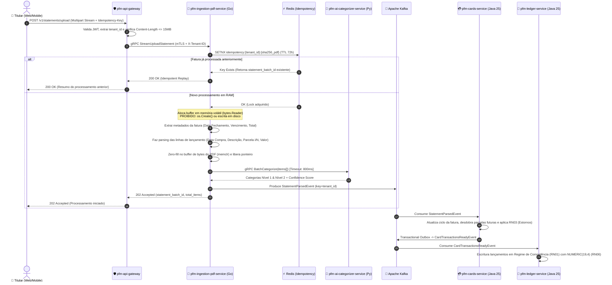
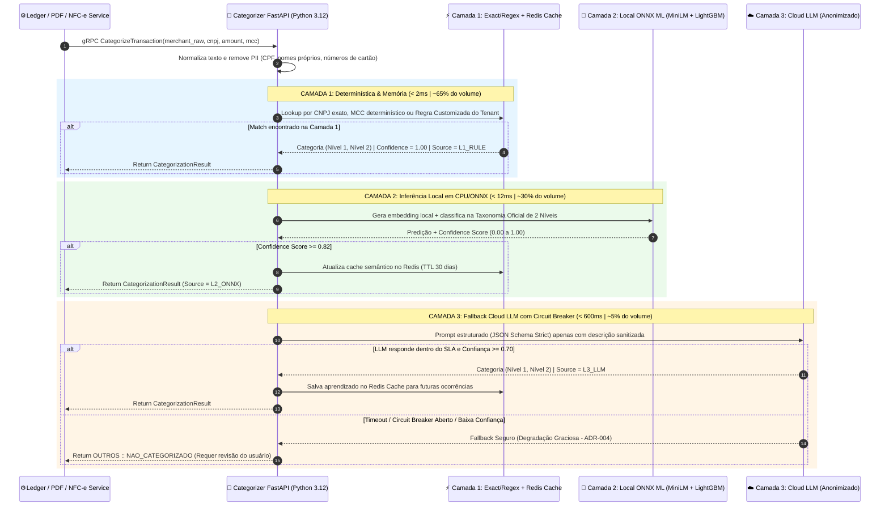
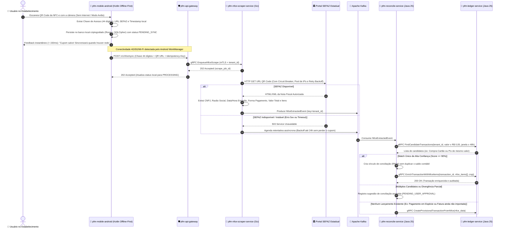

# Fluxos Críticos & Diagramas de Sequência

Esta seção documenta os três fluxos arquiteturais mais críticos da plataforma **PFM Core Banking**, detalhando a interação assíncrona e síncrona entre os microsserviços, garantias de segurança em memória e mecanismos de resiliência.

---

## 1. Ingestão de Fatura PDF 100% em RAM (`Zero-Disk Persistence`)

Em conformidade com o **ADR-006 (Privacidade & LGPD)**, nenhum arquivo PDF de fatura de cartão de crédito pode tocar discos persistentes (EBS, S3, discos locais de nós Kubernetes). Todo o ciclo de recepção, descriptografia de senha (se aplicável), extração tabular e descarte seguro (`zero-fill` do slice de bytes) ocorre estritamente em memória volátil (`bytes.Reader` / `tmpfs`).

### Garantias de Engenharia do Fluxo PDF

- **Zero-Disk Security**: O container do `pfm-ingestion-pdf-service` roda com `readOnlyRootFilesystem: true` no Kubernetes, impedindo a nível de Kernel qualquer tentativa acidental de gravação em disco.
- **Deduplicação Criptográfica**: O hash `SHA-256` do stream binário combinado ao `tenant_id` impede que o reenvio da mesma fatura duplique lançamentos no Ledger.

---

## 2. Pipeline de Categorização por IA em 3 Camadas (`pfm-ai-categorizer-service`)

Para equilibrar **baixa latência**, **custo operacional (FinOps)** e **alta acurácia semântica**, o serviço de categorização implementa uma arquitetura em funil de 3 camadas, mapeando toda transação obrigatoriamente para a **Taxonomia Oficial de 2 Níveis (Categoria Principal -> Subcategoria)**.

### Resumo de Performance e FinOps do Funil de IA

| Camada | Tecnologia | Latência Alvo (P95) | % Retenção Estimada | Custo Marginal por 1M Transações |
| :--- | :--- | :---: | :---: | :---: |
| **Camada 1 (L1)** | Redis Lookup (CNPJ / Histórico Tenant / Regex) | $< 2\text{ ms}$ | ~65% | $\approx \$0.00$ (Memória existente) |
| **Camada 2 (L2)** | ONNX Runtime CPU (`int8` quantized embedding) | $< 12\text{ ms}$ | ~30% | $\approx \$0.08$ (Compute K8s local) |
| **Camada 3 (L3)** | Cloud LLM Flash/Mini (JSON Schema Constrained) | $< 600\text{ ms}$ | ~5% | $\approx \$0.45$ (Apenas 5% chegam ao LLM) |

---

## 3. Captura Offline de NFC-e via QR Code & Conciliação Automática

O aplicativo `pfm-mobile-android` opera sob paradigma **Offline-First**. O usuário escaneia o QR Code de uma Nota Fiscal de Consumidor Eletrônica (NFC-e) no caixa do estabelecimento mesmo sem conexão 4G/Wi-Fi. Assim que a conectividade é restabelecida, a nota é sincronizada, raspada na SEFAZ e conciliada automaticamente com o lançamento do cartão ou conta corrente (**RN04**).

