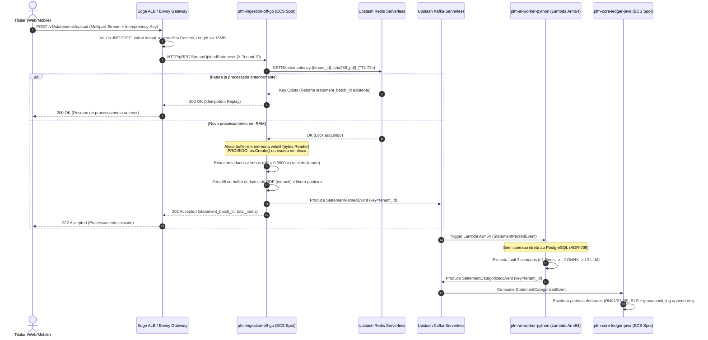
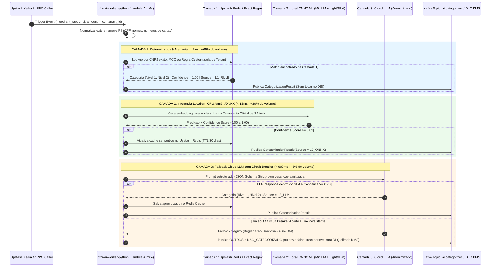
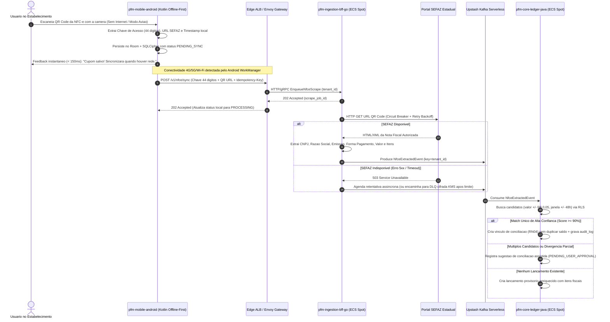
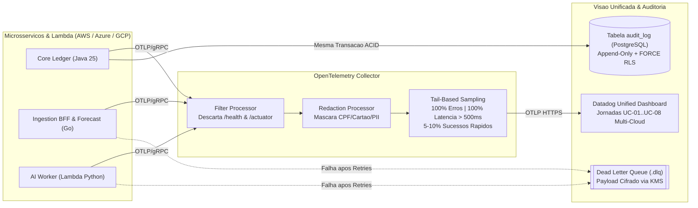

# Fluxos Criticos & Diagramas de Sequencia (V3)

Esta secao documenta os fluxos arquiteturais mais criticos da plataforma **PFM Core Banking V3**, detalhando a interacao entre os servicos em **ECS Fargate Spot / Service Connect**, a execucao **Serverless Event-Driven da Lambda IA Arm64 (ADR-009)**, a ingestao PDF em RAM (`Zero-Disk`) e o pipeline de **Observabilidade Tail-Sampled + Auditoria Imutavel (ADR-010)**.

---

## 1. Ingestao de Fatura PDF 100% em RAM (`Zero-Disk Persistence`)

Em conformidade com o **ADR-006 (Privacidade & LGPD)**, nenhum arquivo PDF de fatura de cartao de credito toca discos persistentes nao-cifrados. Todo o ciclo de recepcao, extracao tabular e descarte seguro (`memclr` do slice de bytes) ocorre estritamente em memoria volatil (`bytes.Reader`), sendo os metadados cifrados via KMS quando necessario.

### Garantias de Engenharia do Fluxo PDF

- **Zero-Disk Security**: O container `pfm-ingestion-bff-go` roda em modo `readonlyRootFilesystem`, impedindo qualquer escrita acidental no sistema de arquivos.
- **Deduplicacao Criptografica**: O hash `SHA-256` do stream binario combinado ao `tenant_id` impede que o reenvio da mesma fatura duplique lancamentos no Core Ledger.

---

## 2. Pipeline de Categorizacao por IA em 3 Camadas (`AWS Lambda Arm64`)

Em conformidade com o **ADR-009**, o `pfm-ai-worker-python` opera como **AWS Lambda Arm64 Event-Driven** (custo **US$ 0,00** quando ocioso), estritamente isolado via **Arquitetura Hexagonal** e **sem acesso direto ao PostgreSQL**. Os resultados retornam via Kafka ou gRPC ao Core Ledger.

### Resumo de Performance e FinOps do Funil de IA

| Camada | Tecnologia | Latencia Alvo (P95) | % Retencao Estimada | Custo Marginal por 1M Transacoes |
| :--- | :--- | :---: | :---: | :---: |
| **Camada 1 (L1)** | Upstash Redis Lookup (CNPJ / Regex) | $< 2\text{ ms}$ | ~65% | $\approx \$0.00$ (Cache Serverless) |
| **Camada 2 (L2)** | ONNX Runtime Arm64 (`int8` quantized) | $< 12\text{ ms}$ | ~30% | $\approx \$0.05$ (Lambda Arm64 ms) |
| **Camada 3 (L3)** | Cloud LLM Flash/Mini (JSON Strict) | $< 600\text{ ms}$ | ~5% | $\approx \$0.45$ (Apenas 5% chegam ao LLM) |

---

## 3. Captura Offline de NFC-e via QR Code & Conciliacao Automatica

O aplicativo `pfm-mobile-android` opera sob paradigma **Offline-First**. O usuario escaneia o QR Code de uma NFC-e no caixa mesmo sem rede; ao reconectar, o cupom e raspado na SEFAZ pelo `pfm-ingestion-bff-go` e conciliado automaticamente pelo `pfm-core-ledger-java` (**RN04**).

---

## 4. Observabilidade Multi-Cloud (OTel Tail-Sampling) & Auditoria Imutavel (ADR-010)

Para manter visibilidade completa de falhas e latencia entre AWS, Azure e GCP sem explodir custos de ingestao SaaS, todos os fluxos passam pelo pipeline **OTel Tail-Based Sampling $\rightarrow$ Datadog** e gravam trilha de auditoria imutavel no PostgreSQL:

