# PFM Core Banking V2 — Apresentação Executiva do MVP
**Da Planilha Fragmentada à Inteligência Financeira de Nível Bancário**

- **Arquitetura:** Hexagonal (Ports & Adapters) • Multi-Repo 1:1 IaC (14 Repositórios)
- **Motores:** Java 25 LTS (Virtual Threads + `ScopedValue`) • Golang (`shopspring/decimal`) • Python 3.12 (IA 3 Camadas) • Next.js 15 + Android Offline-First
- **Segurança & Precisão:** PostgreSQL 16 Row-Level Security (RLS) • `NUMERIC(19,4)` `HALF_EVEN`

---

## Slide 1 — O Problema das Planilhas e Apps Financeiros Comuns

1. **Confusão entre Competência e Caixa (RN01):**
   - Apps comuns somam compras no cartão **e** o pagamento da fatura (`CARD_PAYMENT_TRANSFER`), duplicando gastos do mês.
2. **A Ilusão "Limite Disponível = Orçamento" (RN02):**
   - Ter R$ 64.500,00 de limite somado em 4 cartões esconde o comprometimento futuro de parcelas (`M+1..M+12`) frente à renda líquida real (R$ 18.200,00).
3. **Cegueira em Faturas PDF e Cupons Fiscais (RN03 / RN04):**
   - Tarifas ocultas (*Itaú Avisa R$ 7,99*), estornos tratados erroneamente como receita (`-R$ 168,94`), nomes sujos de maquininhas (`JIM.COM*`, `MP *`) e inflação invisível nos itens de supermercado.

---

## Slide 2 — Arquitetura Hexagonal Multi-Repo V2 (14 Repositórios 1:1 IaC)

```mermaid
flowchart LR
    Web["pfm-web-nextjs (:3000)"] -->|HTTP/3 + ETag| Envoy["Envoy Gateway (:8080)"]
    Mob["pfm-mobile-android (Offline <100ms)"] -->|WorkManager Sync| Envoy
    Envoy --> BFF["pfm-ingestion-bff-go (:8081)"]
    BFF -->|RAM PDF Unlock + Kafka| K1[("statement.raw.extracted")]
    K1 --> AI["pfm-ai-worker-python (3-Layer AI)"]
    AI -->|pg_ai_rules :5433 RLS| K2[("tx.categorized")]
    K2 --> Ledger["pfm-core-ledger-java (:9090)"]
    BFF -->|gRPC ProcessReceipt| Ledger
    Ledger -->|ACID + Outbox :5432 RLS| K3[("ledger.entry.committed")]
    K3 --> Forecast["pfm-forecast-engine-go (:9091)"]
    Forecast -->|Read-Model <25ms| Redis[("Valkey / Redis :6379")]
```

- **Governança 1:1:** Cada microsserviço possui seu próprio repositório de código e seu repositório dedicado `-infra` (OpenTofu AWS/Azure/GCP, Helm, NetworkPolicy e CI/CD DevSecOps).

---

## Slide 3 — Os 6 Casos de Uso Homologados Ponta a Ponta (UC-01 a UC-06)

| Caso de Uso | Capacidade Entregue no MVP | Evidência Homologada |
|---|---|---|
| **UC-01** | **Ingestão PDF em RAM + Checksum Exato + Idempotência SHA-256** | Fatura Itaú `R$ 6.311,14` validada (`diff = 0.0000`), buffer RAM limpo via `defer` e `0` duplicatas na reimportação. |
| **UC-02 & UC-03** | **Scanner NFC-e Offline-First + Conciliação ±3 dias + Inflação EAN** | Cupom `R$ 313,01` conciliado sem dobrar gasto na categoria e alerta disparado para alta `>10%` por código EAN (`+17,50%`). |
| **UC-04** | **Simulador Imutável SAC, Tabela Price e Consórcio** | Cálculo exato `Half-Even` comparando Redução de Prazo (`-24 meses`) vs. Redução de Parcela e ROI líquido isento de IR. |
| **UC-05** | **Pipeline IA em 3 Camadas + Aprendizado Retroativo no Inbox** | Limpeza de prefixos (`JIM.COM*`, `MP *`), extração de cidade (`Acu / RN`), Circuit Breaker Gemini (8s) e reclassificação histórica. |
| **UC-06** | **Termômetro Run-Rate (`< 25ms`) + Isolamento Multitenant RLS** | Projeção atualizada no Valkey em `0,84 ms`, alerta `Limite ≠ Orçamento` e `0` registros vazados entre tenants no PostgreSQL 16. |

---

## Slide 4 — Engenharia de Performance: Piloto (5 Usuários) vs. Stress Tier-1 (1.000 VUs)

| Indicador Medido | Piloto Familiar (`5 VUs`) | Stress Tier-1 (`1.000 VUs` Rampa) | Meta SLO (Artefato 07 V2) |
|---|---|---|---|
| **Throughput Sustentado** | **`56,75 req/s`** | **`6.013,69 req/s`** (`82.016 reqs`) | `> 20 req/s` |
| **Disponibilidade (Regime Nominal)** | **`100,00%`** (`0` erros `5xx`) | Proteção ativa: `33.821` (`304 ETag`) + `24.080` (`429 Rate Limit`) | `>= 99,95%` |
| **Latência Dashboard (`p99`)** | **`15,94 ms`** (`p50 = 5,79 ms`) | `243,06 ms` (`p50 = 9,51 ms`) | **`< 150 ms`** (`9,4x` abaixo no piloto) |
| **Latência Forecast gRPC (`p99`)** | **`7,71 ms`** (`p50 = 3,86 ms`) | `390,11 ms` (`p50 = 20,94 ms`) | **`< 25 ms`** (`3,2x` abaixo no piloto) |
| **Latência NFC-e Ingest (`p99`)** | **`15,09 ms`** | `382,62 ms` | **`< 150 ms`** (`10x` abaixo no piloto) |
| **Saúde do Banco PostgreSQL 16** | `11 conexões` • `65,5 MiB` RAM | `11 conexões` • `0,00% CPU` (blindado pelo BFF) | Sem exaustão de conexões |

---

## Slide 5 — Viabilidade FinOps (Piloto de 5 Usuários) & Retorno sobre Investimento (ROI)

### Pegada Real Medida (`values-pilot-min.yaml`)
- **`pfm-forecast-engine-go`:** `22,4 MiB` RAM RSS (`0,6% CPU`)
- **`pfm-ingestion-bff-go`:** `27,2 MiB` RAM RSS (`4,1% CPU`)
- **`pfm-web-nextjs` (Standalone):** `91,8 MiB` RAM RSS (`4,7% CPU`)
- **`pfm-ai-worker-python` (KEDA Scale-to-Zero):** `0 pods` em repouso (escala apenas quando há faturas na fila Kafka)
- **`pfm-core-ledger-java` (Java 25 ZGC):** `192Mi–256Mi` RAM

### Custo Mensal Estimado para o Piloto (5 Usuários)
- **Google Cloud (Cloud Run / GKE Autopilot + Free Tier):** **~US\$ 8,00 / mês líquido**
- **AWS (EKS/ECS Graviton Spot + RDS Micro + S3):** **~US\$ 41,00 / mês**
- **ROI Direto para a Família:** A detecção automática de tarifas ocultas (*Itaú Avisa*), inflação de itens EAN (`>10%`) e otimização de amortização SAC gera economia anual superior a **15x o custo de nuvem da plataforma**.

---

## Slide 6 — Roadmap Evolutivo: Release 2.1

1. **Integração Open Finance Brasil (Fase 3 / Pluggy & Belvo):**
   - Sincronização automática de contas correntes, PIX e faturas em tempo real via webhook mTLS, mantendo o motor de Checksum e conciliação NFC-e.
2. **Agente Conversacional WhatsApp & Voz (Multimodal):**
   - Envio de foto/QR Code de cupom ou áudio pelo WhatsApp direto para o `pfm-ingestion-bff-go` e alertas proativos quando o Run-rate da semana cruzar `85%` (`YELLOW`).
3. **Consolidação Patrimonial Multi-Moeda (USD / EUR / BRL) & Renda Variável (B3 / Tesouro Direto):**
   - Marcação a mercado e projeção de independência financeira integrada ao `pfm-forecast-engine-go`.
