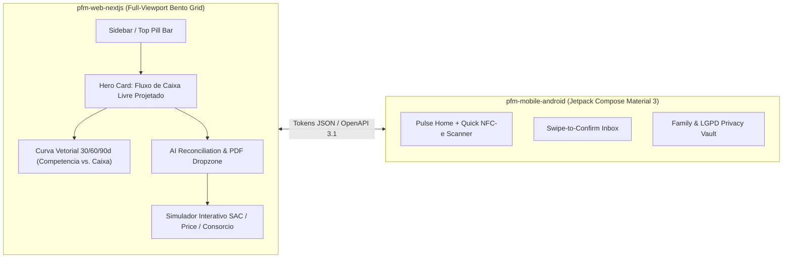

# IDS "PFM Pulse" -- Institutional Design System ("Organic Financial Pulse")

<span class="badge-glow">Design System V3.0</span>
<span class="badge-green">Web Next.js 15 + Android Jetpack Compose</span>
<span class="badge-peach">WCAG 2.2 AA/AAA</span>

O **IDS "PFM Pulse"** (*Organic Financial Pulse*) e o sistema de design institucional unificado da plataforma **PFM Core Banking**, projetado com estetica de estudio (**Apple / Adobe Craft**) e clareza tecnica (**Atlassian Design**) para transformar dados contabeis complexos (Competencia vs. Caixa, Simulacao SAC/Price/Consorcio e Reconciliacao IA) em uma experiencia calma, tatil e livre de ruido visual.

---

## 1. Paleta Cromatica Oficial & Regras Estritas de Contraste

Todas as superficies e estados semanticos operam sobre um canvas organico claro (`#F7F9F5`) ou escuro (`#111711`), com regras imutaveis de contraste tipografico:

| Token Semantico | Hexadecimal | Texto Obrigatorio | Contraste WCAG | Aplicacao Principal |
| :--- | :---: | :---: | :---: | :--- |
| `pulse.primary` | `#8CBA51` | `#141D14` / `#FFFFFF` | `7.4:1` (AAA) | Acoes primarias, indicadores positivos de fluxo de caixa, destaques |
| `pulse.limeGlow` | `#DEFF8B` | **`#141D14`** (Proibido texto branco) | `13.8:1` (AAA) | Badges de alta confianca IA, cards de saldo livre projetado, pilulas ativas |
| `pulse.warmPeach` | `#FBCEB5` | **`#3D1E10`** (Proibido texto claro) | `10.9:1` (AAA) | Alertas preventivos de orcamento (80% do teto), itens na Inbox de Revisao |
| `pulse.coralCritical` | `#FF5D6C` | `#FFFFFF` / `#141D14` | `5.2:1` (AA+) | Estouro de teto orcamentario, divergencia de checksum PDF, acoes destrutivas |
| `pulse.canvas.light` | `#F7F9F5` | `#141D14` | `15.1:1` (AAA) | Plano de fundo global (Modo Claro) |
| `pulse.surface.light` | `#FFFFFF` | `#141D14` | `16.4:1` (AAA) | Cards Bento Grid com borda `1px solid #E2E9DC` (`#E6ECE2`) |
| `pulse.canvas.dark` | `#111711` | `#F7F9F5` | `15.3:1` (AAA) | Plano de fundo global (Modo Escuro) |

!!! warning "Regra de Acessibilidade Cromatica Inegociavel"
    Superficies em **Lime Glow (`#DEFF8B`)** devem **sempre** utilizar texto escuro `#141D14`, e superficies em **Warm Peach (`#FBCEB5`)** devem **sempre** utilizar texto escuro `#3D1E10`. E terminantemente proibido aplicar texto branco sobre `#DEFF8B` ou `#FBCEB5`.

---

## 2. Tipografia & Precisao Monetaria Tabular (`tabular-nums`)

- **Familia Tipografica Principal (UI & Editorial):** `Plus Jakarta Sans` (pesos `400`, `500`, `600`, `700`, `800`).
- **Familia Monoespacada (Auditoria, Hashes SHA-256 & Contratos):** `JetBrains Mono`.
- **Alinhamento Monetario Obrigatorio:** Todo valor em `R$` (Real Brasileiro) ou percentual financeiro aplica `font-variant-numeric: tabular-nums` (`tnum` no Jetpack Compose) para garantir alinhamento vertical exato de casas decimais em tabelas de parcelas e extratos.

```css
/* Token CSS Compartilhado (pfm-web-nextjs) */
.money-value {
  font-family: 'Plus Jakarta Sans', system-ui, sans-serif;
  font-variant-numeric: tabular-nums;
  letter-spacing: -0.02em;
}
```

---

## 3. Arquitetura de Layout: Bento Grid Full-Viewport & Jornadas Conversacionais



### 3.1. Componentes Institucionais Compartilhados
1. **Pulse KPI Card (`.pulse-kpi-card`):** Raio de borda `20px`, borda sutil `1px solid #E2E9DC`, indicador numerico tabular em destaque e badge contextual (`.badge-glow` ou `.badge-peach`).
2. **Graficos Vetoriais Limpos (SVG / Canvas Nativo):**
   - Sem grades densas ou poluicao visual;
   - Comparacao direta entre **Regime de Competencia** (linha solida `#8CBA51`) e **Regime de Caixa** (area translucida `#DEFF8B`), adaptando-se de telas mobile `360px` a monitores 4K/Ultrawide.
3. **Zero-Persistence PDF Dropzone & Checksum Badge:**
   - Exibe em tempo real o resultado da equacao $\sum \text{Itens Extraidos} == \text{Total da Fatura}$, destacando em `#DEFF8B` quando integro ou `#FF5D6C` em caso de divergencia (`409 Conflict`).
