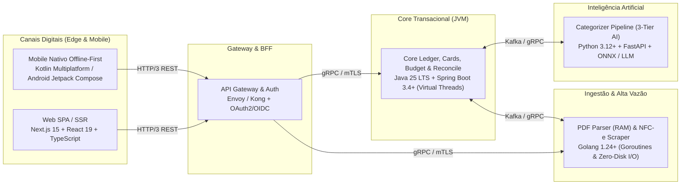

# PFM Core Banking — Visão Executiva da Plataforma

Bem-vindo ao Portal de Arquitetura, Produto e Engenharia de Confiabilidade (**SRE & Docs-as-Code**) da plataforma **PFM (Personal Financial Management) Core Banking**.

A plataforma foi projetada sob padrões **Tier-1 Cloud-Native Banking**, combinando rigor contábil de partidas dobradas e precisão decimal estrita com ingestão inteligente de documentos financeiros (faturas PDF em RAM e notas fiscais NFC-e via QR Code offline-first), categorização assistida por IA em 3 camadas e isolamento multitenant de nível bancário.

---

## 1. Pilares Estratégicos da Plataforma

| Pilar | Diretriz Arquitetural | Benefício Executivo & Técnico |
| :--- | :--- | :--- |
| **Rigor Contábil & Precisão** | `NUMERIC(19,4)`, `ROUND_HALF_EVEN` (ABNT NBR 5891), distinção estrita entre Regime de Competência e Regime de Caixa. | Zero divergência de centavos em parcelamentos, estornos e conciliação bancária. |
| **Poliglotismo Restrito & Hexagonal** | 5 stacks especializadas com **Ports & Adapters** e domínio 100% livre de frameworks em cada microsserviço. | Alta manutenibilidade, testabilidade unitária isolada e uso da linguagem certa para cada carga de trabalho. |
| **Topologia Multi-Repo (14 Repositórios)** | Isolamento 1:1 de ciclo de vida, CI/CD, versionamento SemVer e módulos Terraform dedicados. | Autonomia de squads, blast radius reduzido e governança clara de contratos (OpenAPI 3.1, Protobuf v3, Avro/JSON Schema). |
| **Segurança Zero-Trust & LGPD/BACEN** | PostgreSQL **Row-Level Security (RLS)**, **Envelope Encryption (KMS)** e parsing de faturas PDF 100% em RAM (`tmpfs`). | Proteção contra vazamento cross-tenant e conformidade com LGPD e Resolução BCB nº 4.893. |
| **Agnosticismo Multicloud** | Desenho aderente aos pilares **Well-Architected** para **AWS**, **Azure** e **GCP** sobre Kubernetes gerenciado. | Portabilidade real de cargas de trabalho, mitigação de *vendor lock-in* e otimização contínua de FinOps. |

---

## 2. Matriz Tecnológica — Poliglotismo Restrito

A plataforma adota o princípio de **Poliglotismo Restrito (ADR-001)**, selecionando estritamente a melhor tecnologia para cada perfil de carga computacional, concorrência e ecossistema:

### Detalhamento das Stacks Oficiais

1. **Java 25 LTS (Core Banking, Cartões, Orçamento e Conciliação)**
   - **Escopo**: `pfm-ledger-service`, `pfm-cards-service`, `pfm-budget-service`, `pfm-reconcile-service`, `pfm-notification-service`.
   - **Motivação**: Uso de *Virtual Threads* (Project Loom consolidado), *Scoped Values*, *Record Patterns*, tipagem monetária com `BigDecimal` (`MathContext.DECIMAL64`, `RoundingMode.HALF_EVEN`) e maturidade transacional ACID.
2. **Golang 1.24+ (Ingestão de Alta Performance & Parsing em RAM)**
   - **Escopo**: `pfm-ingestion-pdf-service`, `pfm-nfce-scraper-service`.
   - **Motivação**: Baixíssimo consumo de memória, *goroutines* leves para scraping resiliente de portais SEFAZ estaduais e manipulação de buffers de faturas PDF estritamente em memória (`bytes.Reader` / `memfd`), garantindo política **Zero-Disk Persistence**.
3. **Python 3.12+ (Pipeline de Categorização Inteligente em 3 Camadas)**
   - **Escopo**: `pfm-ai-categorizer-service`.
   - **Motivação**: Ecossistema nativo de Machine Learning e NLP (FastAPI, Pydantic v2, Scikit-Learn/ONNX Runtime para inferência local sub-10ms e integração com LLMs para casos ambíguos).
4. **Next.js 15 + TypeScript (Portal Web Executivo)**
   - **Escopo**: `pfm-web-portal`.
   - **Motivação**: React Server Components, renderização híbrida (SSR/Streaming), dashboards analíticos de orçamento vs. limite e conciliação interativa.
5. **Kotlin + Jetpack Compose + Room/SQLDelight (Mobile Offline-First)**
   - **Escopo**: `pfm-mobile-android`.
   - **Motivação**: Leitura de QR Code de NFC-e via CameraX + ML Kit no dispositivo sem dependência de rede, fila local criptografada (SQLCipher) e sincronização em background via WorkManager.

---

## 3. Arquitetura Hexagonal (Ports & Adapters)

Todos os microsserviços de backend seguem rigorosamente a **Arquitetura Hexagonal (Clean/Hexagonal Architecture)**, garantindo que a lógica de negócio e as regras contábeis (**RN01 a RN06**) nunca dependam de frameworks web, drivers de banco de dados ou SDKs de nuvem.

- **Domain Core (Núcleo Puro)**: Entidades imutáveis, Value Objects (`Money`, `TenantId`, `CompetencePeriod`), Domain Events e especificações de negócio. Zero anotações de ORM ou injeção de dependência externa.
- **Application Layer (Use Cases & Ports)**: Orquestração de casos de uso transacionais, portas de entrada (*Inbound/Driving Ports*) e portas de saída (*Outbound/Driven Ports*).
- **Adapters Layer (Infraestrutura)**:
  - *Inbound Adapters*: Controllers REST HTTP/3, servidores gRPC, consumidores Apache Kafka.
  - *Outbound Adapters*: Repositórios PostgreSQL (com ativação automática de RLS por `tenant_id`), produtores Transactional Outbox (Debezium/Kafka), clientes Redis e KMS.

---

## 4. Topologia Multi-Repo & Governança Multicloud

A plataforma é organizada em **14 repositórios independentes** (detalhados em [Modelo C4 & Topologia](architecture/c4-model.md)), garantindo separação clara entre contratos compartilhados, microsserviços de domínio, frontends, infraestrutura como código (Terraform/OpenTofu) e documentação executiva.

### Presença Multicloud (AWS / Azure / GCP)

| Camada da Plataforma | AWS (Referência Primária) | Microsoft Azure (Equivalente) | Google Cloud Platform (Equivalente) |
| :--- | :--- | :--- | :--- |
| **Orquestração de Contêineres** | Amazon EKS (Graviton4 / Karpenter) | Azure Kubernetes Service (AKS) | Google Kubernetes Engine (GKE Autopilot) |
| **Banco Relacional (ACID + RLS)** | Amazon Aurora PostgreSQL 16 | Azure Database for PostgreSQL Flexible | Cloud SQL Enterprise Plus / AlloyDB |
| **Mensageria & Streaming** | Amazon MSK (Apache Kafka) | Azure Event Hubs (Kafka API) / Confluent | Managed Service for Apache Kafka |
| **Cache & Idempotência** | Amazon ElastiCache (Valkey / Redis) | Azure Managed Redis | Cloud Memorystore for Redis |
| **Gestão de Chaves (Envelope KMS)** | AWS KMS | Azure Key Vault | Cloud KMS |
| **Observabilidade (OTel Native)** | Amazon Managed Prometheus / Grafana | Azure Monitor Managed Prometheus | Google Cloud Managed Service for Prometheus |

---

## 5. Mapa de Navegação Rápida

- **[ADRs V2 (Decisões Arquiteturais)](architecture/adrs.md)**: Registro formal das decisões ADR-001 a ADR-007 com contexto, alternativas avaliadas e trade-offs.
- **[Modelo C4 & Topologia (14 Repos)](architecture/c4-model.md)**: Diagramas Mermaid C4 Níveis 1, 2 e 3 + catálogo completo dos 14 repositórios da plataforma.
- **[Fluxos Críticos & Sequência](architecture/flows.md)**: Diagramas de sequência detalhados para Ingestão PDF em RAM, Pipeline IA de 3 Camadas, Captura Offline NFC-e e Conciliação.
- **[PRD Core Banking & Regras RN01–RN06](product/prd-core-banking.md)**: Regras contábeis de Competência vs. Caixa, Limite vs. Orçamento, Estornos, Conciliação, Multitenancy, Precisão Decimal e Taxonomia Oficial de 2 Níveis.
- **[Backlog Scrum & Especificações BDD](product/backlog-bdd.md)**: Contratos DoR/DoD V2, histórias de usuário US-01 a US-11 e cenários executáveis em Gherkin.
- **[SLOs, Observabilidade, DR & FinOps](operations/sre-finops.md)**: Engenharia de confiabilidade, OpenTelemetry, plano de Disaster Recovery (RPO < 5m, RTO < 30m) e comparativo de custos Multicloud.
