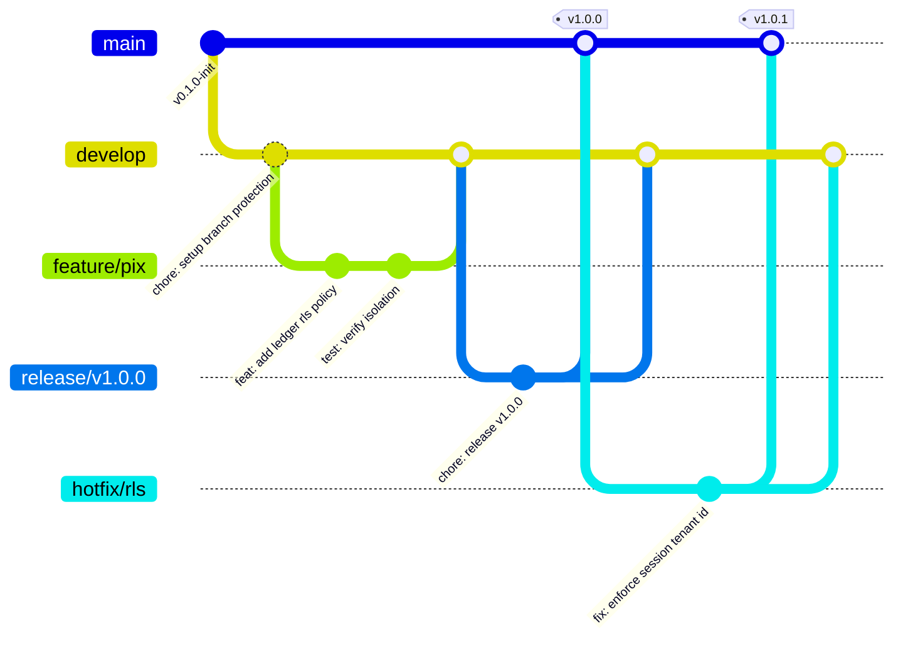

# Pulse Docs -- Plataforma PFM Core Banking

Portal institucional unificado de Produto, Design System (IDS PFM Pulse), Arquitetura Hexagonal Multi-Cloud (C4 e ADRs 001-010), Seguranca LGPD (PostgreSQL 16 RLS e KMS Envelope Encryption), Engenharia FinOps e Execucao Local da organizacao `Sorobanerp`.

[Explorar Arquitetura](architecture/c4-model.md){ .md-button .md-button--primary }
[Guia de Execucao Local](operations/local-development-guide.md){ .md-button }

---

## 1. Indicadores Executivos da Plataforma (Big Numbers)

-   15 Repositorios

    ---

    **Arquitetura Hexagonal Multi-Repo 1:1**

    Microsservicos desacoplados (Java 25, Go 1.27, Python 3.12, Next.js 15, Android) com repositorios OpenTofu dedicados.

-   &lt; USD 24/mes

    ---

    **FinOps ECS Fargate Spot + Lambda + Upstash**

    Topologia AWS `us-east-2` ultra-enxuta com 0 clusters EKS, 0 NAT Gateways e automacao `pfm-finops-manager`.

-   2 AZs (us-east-2a/b)

    ---

    **Topologia Enxuta Well-Architected**

    Alta disponibilidade regional com Service Connect / AWS Cloud Map (`pfm.internal`) para chamadas gRPC Leste-Oeste.

-   100% LGPD &amp; RLS

    ---

    **KMS Envelope Encryption + Audit Append-Only**

    Isolamento `FORCE ROW LEVEL SECURITY` no PostgreSQL 16, chaves DEK por tenant no AWS KMS e Crypto-Shredding.

---

## 2. Fluxo Gitflow Atlassian e Governanca de Releases

Todos os 15 repositorios operam com Branch Protection ativa em `main` e `develop`, validacao de Conventional Commits e bloqueio automatico de origem de branch (`Gitflow Branch Source Guard`).

---

## 3. Navegacao Institucional pelos 6 Pilares

-   **1. Produto & Regras de Negocio**

    ---

    Regras contabeis imutaveis (`RN01` Competencia vs. Caixa, `RN02` Limite != Orcamento, `RN03` Estorno na Categoria Original), Taxonomia de 2 Niveis e meta `< 5%` em Nao Categorizado.

    [Acessar PRD Core Banking V3 ->](product/prd-core-banking.md)

-   **2. IDS Design System (PFM Pulse)**

    ---

    Paleta institucional (`#8CBA51`, `#DEFF8B` com texto `#141D14`, `#FBCEB5` com texto `#3D1E10`, `#FF5D6C`), tipografia `Plus Jakarta Sans` + `JetBrains Mono` e tokens Web/Android.

    [Acessar IDS PFM Pulse ->](design/ids-pfm-pulse.md)

-   **3. Arquitetura C4 & ADRs (001-010)**

    ---

    Diagramas C4 (Contexto, Conteineres e Componentes), 10 ADRs consolidados e fluxos de sequencia ponta a ponta entre BFF Go, Core Ledger Java 25, Forecast Go e AI Worker Python.

    [Ver ADRs 001-010 ->](architecture/adrs.md) / [Modelo C4 ->](architecture/c4-model.md)

-   **4. Seguranca LGPD & FinOps**

    ---

    Envelope Encryption AWS KMS (`alias/pfm-master-key`), PostgreSQL 16 `FORCE ROW LEVEL SECURITY`, OTel Collector Tail-Based Sampling e automacao `pfm-finops-manager`.

    [Conformidade LGPD ->](security/lgpd-cryptography-compliance.md) / [SRE & FinOps ->](operations/sre-finops.md)

-   **5. Operacoes, Gitflow & Dev Local**

    ---

    Inicializacao local em comando unico (`./init-local-development.sh`), debug no IntelliJ IDEA e VS Code, Swagger UI OpenAPI 3.1, `grpcurl` e governanca Gitflow Atlassian.

    [Guia de Execucao Local ->](operations/local-development-guide.md) / [Gitflow ->](operations/gitflow-workflow.md)

-   **6. Qualidade, Backlog & Testes BDD**

    ---

    Epicos Scrum, User Stories (`US-01` a `US-13`), cenarios BDD Gherkin (`Dado / Quando / Entao`), relatorios de validacao E2E e roteiro de demonstracao executiva.

    [Backlog & BDD Gherkin ->](product/backlog-bdd.md) / [Validacao E2E ->](audit/RELATORIO_VALIDACAO_E2E.md)

---

## 4. Catalogo Oficial dos 15 Repositorios (`Sorobanerp`)

| # | Repositorio | Stack Principal | Responsabilidade |
| :-: | :--- | :--- | :--- |
| 01 | `pfm-docs` | MkDocs Material 3 | Portal Institucional Pulse Docs (Produto, IDS, Arquitetura, LGPD, SRE e DX) |
| 02 | `pfm-contracts` | Protobuf v1 + OpenAPI 3.1 | Contratos gRPC (`CoreLedger`, `Forecast`, `Profile`, `Admin`) e `openapi.yaml` |
| 03 | `pfm-shared-infra` | OpenTofu + Docker Compose | VPC 2 AZs (0 NAT), Cluster ECS `pfm-ecs-pilot`, Cloud Map `pfm.internal`, RDS, KMS, S3 |
| 04 | `pfm-finops-manager-infra` | Python 3.12 Arm64 + OpenTofu | Lambda `pfm-finops-manager` (`stop`, `start`, `audit` e `cost_guardrails`) |
| 05 | `pfm-core-ledger-java` | Java 25 LTS + Spring Boot 3.5 | Ledger Partidas Dobradas, Parcelamentos, RLS PostgreSQL 16 e gRPC `:9090` |
| 06 | `pfm-core-ledger-infra` | OpenTofu (ECS Fargate Spot) | Task Definition Arm64, Service Connect e IAM Least Privilege do Core Ledger |
| 07 | `pfm-ingestion-bff-go` | Go 1.27 + HTTP/2 & Swagger | Upload PDF em RAM, Scraper NFC-e, Bridge gRPC e Swagger UI `:8080` |
| 08 | `pfm-ingestion-bff-infra` | OpenTofu (ECS Fargate Spot) | Task Definition Arm64, Service Connect e IAM S3/KMS do BFF |
| 09 | `pfm-forecast-engine-go` | Go 1.27 + `shopspring/decimal` | Projecao Run-Rate (30/60/90d) e Simulador SAC/Price/Consorcio gRPC `:9091` |
| 10 | `pfm-forecast-engine-infra` | OpenTofu (ECS Fargate Spot) | Task Definition Arm64, Service Connect e IAM do Forecast Engine |
| 11 | `pfm-ai-worker-python` | Python 3.12 + Pydantic v2 | Categorizacao em 3 Camadas (Regras Locais -> pgvector -> Gemini 2.5 Flash) |
| 12 | `pfm-ai-worker-infra` | OpenTofu (AWS Lambda Arm64) | Funcao Serverless `pfm-ai-worker-python-prod`, SQS DLQ e KMS Secrets |
| 13 | `pfm-web-nextjs` | Next.js 15 + React 19 | Experiencia Web Full-Viewport com Design System IDS PFM Pulse |
| 14 | `pfm-web-infra` | OpenTofu (ECS Fargate Spot) | Task Definition Arm64 e infraestrutura dedicada do Frontend Web |
| 15 | `pfm-mobile-android` | Kotlin 2.1 + Jetpack Compose | Superapp Android Material 3 com Scanner NFC-e e Tokens IDS PFM Pulse |
