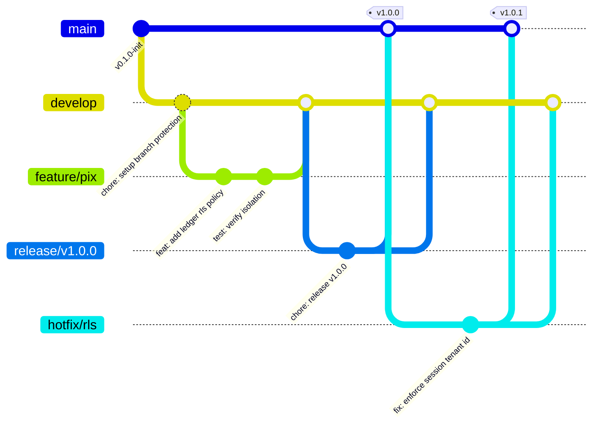

# Pulse Docs -- Plataforma PFM Core Banking

Estagio Atual: Planejamento &amp; Arquitetura Validados -&gt; Validacao Local -&gt; Implantacao Cloud
Release V3.2
Governanca Executiva 5 Visoes

Portal institucional unificado da plataforma **PFM Core Banking (PFM Pulse)** da organizacao `Sorobanerp`. Toda a documentacao esta estruturada em **5 Visoes Executivas por Audiencia** para Diretoria, Produto, Design UX/UI, Arquitetura de Software e Engenharia SRE/FinOps.

[1. Visao de Negocio](01-visao-negocio/proposta-valor-e-mercado.md){ .md-button .md-button--primary }
[4. Visao de Arquitetura](04-visao-arquitetura/arquitetura-c4-e-repos.md){ .md-button }
[5. Guia Dev Local &amp; FinOps](05-visao-operacoes/desenvolvimento-local-e-ides.md){ .md-button }

---

## 1. Indicadores Institucionais da Plataforma (Big Numbers)

-   15 Repositorios

    ---

    **Topologia Multi-Repo Hexagonal 1:1**

    Microsservicos desacoplados (Java 25, Go 1.27, Python 3.12, Next.js 15, Android) com infraestrutura OpenTofu dedicada.

-   &lt; 5% em Outros

    ---

    **Precisao de Categorizacao e Contabilidade**

    Funil de IA em 3 camadas e motor de partidas dobradas eliminando gastos invisiveis e erros de centavos (`RN01` a `RN06`).

-   2 AZs (us-east-2a/b)

    ---

    **Resiliencia Multi-AZ Well-Architected**

    Topologia regional com descoberta interna gRPC (`pfm.internal`) e trilha documentada de evolucao para Kubernetes.

-   100% LGPD &amp; RLS

    ---

    **KMS Envelope Encryption + Audit Append-Only**

    Isolamento `FORCE ROW LEVEL SECURITY` no PostgreSQL 16, chaves DEK por tenant e Crypto-Shredding (Art. 18 LGPD).

---

## 2. Mapa de Navegacao das 5 Visoes por Audiencia

-   **1. Visao de Negocio (Diretoria &amp; Investidores)**

    ---

    Tese do produto **PFM Pulse ("Big Numbers First")**, dores resolvidas, substituicao de planilhas, modelo de assinatura SaaS em Real (`FREE`, `INDIVIDUAL_PRO R$ 29,90/mes`, `FAMILY_PLUS R$ 49,90/mes`) e governanca LGPD.

    [Abrir Visao de Negocio ->](01-visao-negocio/proposta-valor-e-mercado.md)

-   **2. Visao de Produto (PMs, Analistas &amp; QA)**

    ---

    Regras de negocio imutaveis (`RN01` Competencia vs. Caixa, `RN02` Limite != Orcamento, `RN03` Estornos), taxonomia de 2 niveis, casos de uso (`UC-01` a `UC-08`) e Backlog Scrum com cenarios BDD Gherkin em `R$`.

    [PRD Core Banking ->](02-visao-produto/prd-core-banking.md) / [Casos de Uso ->](02-visao-produto/casos-de-uso.md) / [Backlog &amp; BDD ->](02-visao-produto/backlog-e-bdd.md)

-   **3. Visao do Usuario -- UX/UI (Designers &amp; Frontend/Mobile)**

    ---

    Design System **IDS "PFM Pulse"** ("10 segundos por dia"), filosofia *Big Numbers First + Progressive Disclosure*, tokens `#8CBA51`, `#DEFF8B`, `#FBCEB5`, `#FF5D6C`, 6 telas Web e 4 telas Android Material 3.

    [Abrir IDS Design System ->](03-visao-usuario/ids-design-system.md)

-   **4. Visao de Arquitetura (Staff Architects &amp; Tech Leads)**

    ---

    Modelo C4 completo (Niveis 1 a 3), catalogo dos 15 repositorios, fluxos de sequencia (PDF em RAM, NFC-e, Ledger, SAC/Price), matriz criptografica LGPD/RLS e `ADR-001` a `ADR-010`.

    [Arquitetura C4 ->](04-visao-arquitetura/arquitetura-c4-e-repos.md) / [Fluxos ->](04-visao-arquitetura/fluxos-de-sequencia.md) / [Seguranca LGPD ->](04-visao-arquitetura/seguranca-e-lgpd.md) / [ADRs ->](04-visao-arquitetura/decisoes-arquiteturais-adrs.md)

-   **5. Visao de Tecnologia &amp; Operacoes (DevEx, SRE &amp; FinOps)**

    ---

    Onboarding local (`./init-local-development.sh`, IntelliJ IDEA Java 25, VS Code Go/Python, Swagger UI e gRPC Reflection), esteira Gitflow/CI/CD e o **Centro Unico de Custos Cloud (USD + Estimativa BRL)**.

    [Dev Local &amp; IDEs ->](05-visao-operacoes/desenvolvimento-local-e-ides.md) / [Gitflow &amp; CI/CD ->](05-visao-operacoes/gitflow-cicd-e-qualidade.md) / [FinOps &amp; Custos Cloud ->](05-visao-operacoes/finops-e-custos-cloud.md)

-   **Estagio do Projeto &amp; Governanca de Moedas**

    ---

    - **Visoes 1, 2 e 3:** 100% em Real Brasileiro (`R$` / `BRL`).
    - **Visao 4:** Arquitetura pura, livre de precos dispersos.
    - **Visao 5 (FinOps):** Centro unico de custos cloud em **USD (`US$`) + Estimativa em BRL (`R$`)**.

    [Consultar Centro FinOps ->](05-visao-operacoes/finops-e-custos-cloud.md)

---

## 3. Governanca de Engenharia -- Fluxo Gitflow Atlassian (`Sorobanerp`)

Todos os 15 repositorios operam com Branch Protection ativa em `main` e `develop`, validacao automatica de Conventional Commits e bloqueio de origem de branch (`Gitflow Branch Source Guard`).

