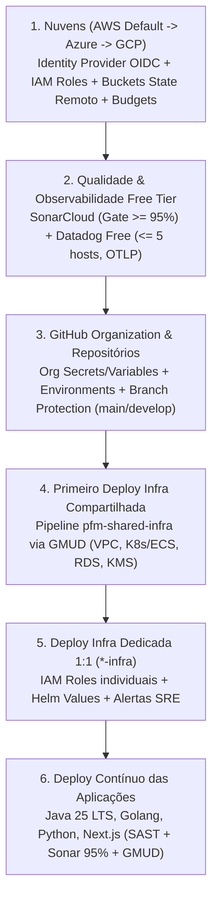

# Plano de Bootstrap Cloud, Observabilidade e Governança GitHub (Zero-Trust & FinOps)

Este documento estabelece o plano diretor e arquitetural para o **Bootstrap Multicloud**, a governança da organização GitHub [`Sorobanerp`](https://github.com/Sorobanerp), o pipeline de qualidade com **SonarCloud (Gate $\ge$ 95%)**, a observabilidade enxuta com **Datadog Free Tier ($\le$ 5 hosts)** e os pipelines de entrega contínua com **GMUD Automatizada** e **Zero-Trust OIDC**.

---

## 1. Diagrama de Dependências de Bootstrap (Zero-Trust)

A implantação segue uma esteira de pré-requisitos rígida e auditável, garantindo que nenhum recurso de infraestrutura ou aplicação seja provisionado sem que as camadas de identidade federada, governança orçamentária e gates de segurança estejam ativas:



---

## 2. Isolamento Multicloud, OIDC & FinOps Guardrails

Para garantir **Zero-Trust**, **nenhuma chave de acesso estática** (`AWS_ACCESS_KEY_ID`, `ARM_CLIENT_SECRET`, service account JSON) é persistida no GitHub. Toda a autenticação entre os runners do GitHub Actions e os provedores de nuvem ocorre via **OpenID Connect (OIDC)** com asserções criptográficas de curta duração (tokens temporários válidos apenas durante a execução do Job).

### 2.1. Arquitetura de Federação de Identidade OIDC

| Provedor de Nuvem | Provedor OIDC Configurado | Subject Claim Validado (`sub`) | Mecanismo de Assume Role |
| :--- | :--- | :--- | :--- |
| **AWS (Default)** | `https://token.actions.githubusercontent.com`<br/>(Audience: `sts.amazonaws.com`) | `repo:Sorobanerp/*:environment:pilot`<br/>`repo:Sorobanerp/*:environment:production` | `sts:AssumeRoleWithWebIdentity` restrito à role `arn:aws:iam::<ACCOUNT_ID>:role/github-actions-pfm-deployer` |
| **Microsoft Azure** | `https://token.actions.githubusercontent.com`<br/>(Audience: `api://AzureADTokenExchange`) | `repo:Sorobanerp/*:ref:refs/heads/main`<br/>`repo:Sorobanerp/*:environment:production` | Azure AD App Registration + Federated Identity Credentials associada à Role `Contributor` no Resource Group |
| **Google Cloud (GCP)**| `https://token.actions.githubusercontent.com` | `attribute.repository_owner/Sorobanerp` | Workload Identity Pool (`github-actions-pool`) + Service Account Impersonation |

### 2.2. Política de Tags Obrigatórias & Alocação de Custos

Nenhum recurso de computação, rede ou armazenamento pode ser criado sem as seguintes tags aplicadas em nível de provider OpenTofu/Terraform:

```hcl
default_tags {
  tags = {
    Project     = "pfm-core-banking"
    Environment = var.environment # "pilot" ou "production"
    Owner       = "finops@soroban.com"
    CostCenter  = "1040-fintech-core"
    ManagedBy   = "opentofu"
    Repository  = "Sorobanerp/${var.repo_name}"
    Compliance  = "LGPD-PCI-DSS-Ready"
  }
}
```

### 2.3. FinOps Guardrails & Dimensionamento de Custos Mínimos

A estratégia prioriza custos extremamente enxutos durante o Piloto Familiar (5 usuários), mantendo alta fidelidade técnica com a arquitetura de produção:

#### 1. AWS (Região Primária / Default — `us-east-2`): US\$ 12 a US\$ 24 / mês (Piloto V3 / ADR-008)
- **Storage de Estado Remoto:** S3 Bucket criptografado com SSE-KMS + DynamoDB Table para *State Locking* (US\$ 0,50/mês).
- **PostgreSQL Core Ledger & Audit Log:** Amazon RDS PostgreSQL 16 `db.t4g.micro` Single-AZ com 20 GB gp3 e parada noturna automatizada via `pfm-finops-manager` (US\$ 7,50–12,00/mês).
- **Computação (BFF, Ledger, Forecast, Web):** AWS ECS Fargate Spot (`linux/arm64` Graviton, `0.25 vCPU / 0.5 GB RAM`) com plano de controle gratuito e Service Connect `pfm.internal` (US\$ 3,50–8,00/mês).
- **Worker IA Serverless (`pfm-ai-worker-python`):** AWS Lambda Arm64 orientada a eventos Kafka/gRPC — **US\$ 0,00 ocioso** (ADR-009).
- **Event Streaming & Cache:** **Upstash Kafka & Redis Serverless** com TLS/SASL (Free Tier até 10.000 msgs/cmds dia — US\$ 0,00–3,50/mês).
- **FinOps Budget Alert:** Alerta preventivo em **US\$ 20,00/mês** e *Circuit-Breaker* automático em **US\$ 30,00/mês** via `pfm-finops-manager`.

#### 2. Microsoft Azure (Região Secundária DR — `brazilsouth` / `eastus`): Warm Standby
- **Backend de Estado:** Azure Storage Account (Blob Storage com Imutabilidade e Encriptação gerenciada) para `terraform.tfstate`.
- **Database:** Azure Database for PostgreSQL Flexible Server Burstable `B1ms` (`1 vCPU, 2 GB RAM`) com armazenamento de 32 GB.
- **Compute:** Azure Container Apps (ACA) com consumo *Serverless* configurado para escala a zero (*Scale-to-Zero*) quando o tráfego não estiver ativo no ambiente de Disaster Recovery.

#### 3. Google Cloud (Região Terciária — `southamerica-east1` / `us-central1`): ~US\$ 8 / mês líquidos
- **Backend de Estado:** Google Cloud Storage (GCS) Multi-Regional com Object Versioning.
- **Compute:** Cloud Run de 2ª Geração com cobrança estritamente orientada a eventos (CPU alocada apenas durante o processamento da requisição HTTP/gRPC).
- **Crédito & Free Tier:** Uso do Free Tier mensal (primeiros 2 milhões de requisições Cloud Run gratuitas e 1 GB de rede de saída).

---

## 3. Política de Governança Datadog Free Tier ($\le$ 5 Hosts)

A plataforma PFM Core Banking adota o plano **Datadog Free Tier**, que disponibiliza monitoramento completo de infraestrutura sem custo para até **5 hosts físicos ou nós virtuais**:

```mermaid
flowchart LR
    subgraph Microservices["Microsserviços PFM (Host / K8s / ECS)"]
        LEDGER["pfm-core-ledger-java"]
        BFF["pfm-ingestion-bff-go"]
        FORECAST["pfm-forecast-engine-go"]
        AI["pfm-ai-worker-python"]
        WEB["pfm-web-nextjs"]
    end

    subgraph OTelCollector["OpenTelemetry Collector Daemon / Sidecar"]
        REDACT["Redaction Processor<br/>(Anonimização CPF/PII)"]
        FILTER["Filter Processor<br/>(Exclui /health, /healthz, /actuator)"]
        EXPORT["Datadog Exporter<br/>(OTLP Datadog Intake)"]
    end

    subgraph Datadog["Datadog Free Tier (<= 5 Hosts)"]
        DASH["Dashboards RED & USE"]
        SLO["Monitors de Latência & Erro"]
    end

    Microservices -->|"OTLP gRPC (Porta 4317)"| REDACT
    REDACT --> FILTER
    FILTER --> EXPORT
    EXPORT -->|"HTTPS (API Key)"| Datadog
```



### Regras Inegociáveis de Governança Datadog:
1. **Limite Estrito de Hosts ($\le$ 5):** O agente ou OTel collector exporta métricas agregadas por nó/host físico, impedindo que tarefas efêmeras gerem *host overages*.
2. **Filtro de Ruído & Healthchecks:** O processador OTel descarta 100% dos traces e logs com destino aos endpoints de sonda (`/health`, `/healthz`, `/actuator/health`, `GET /`), preservando a cota mensal de ingestão apenas para fluxos de negócio reais (UC-01 a UC-06).
3. **Higienização LGPD / Zero PII:** O `redaction processor` do OpenTelemetry Collector substitui expressões regulares de CPF (`\d{3}\.\d{3}\.\d{3}-\d{2}`), números de cartão (`\b(?:\d{4}[ -]?){3}\d{4}\b`), e-mails e chaves de sessão pelo marcador `[REDACTED_PII]` antes de enviar qualquer dado para o backend Datadog.

---

## 4. Gitflow Fintech & Quality Gate Estrito (95% Cobertura)

### 4.1. Modelo de Branching & Ciclo de Mudança

```text
feature/PFM-xxx ──> PR com CI/SAST ──> develop ──> release/vX.Y.Z ──> PR com GMUD ──> main (vX.Y.Z Tag)
                                                                             │
                                                                             └──> Deploy Pilot / Prod
```

1. **`feature/*`:** Branch criada a partir de `develop` para desenvolvimento local.
2. **`develop`:** Branch de integração contínua. Protegida contra push direto. Exige 1 aprovação de Code Review e passagem de todos os testes unitários.
3. **`release/vX.Y.Z`:** Branch de homologação, congelamento de código e execução de testes de carga (k6) e E2E Playwright.
4. **`main`:** Branch de produção estrita. **Nenhum commit direto é permitido**. O merge só ocorre a partir de uma `release/*` via Pull Request contendo o formulário oficial de **GMUD (Gestão de Mudança)** preenchido e aprovado pelo Tech Lead / SRE.

### 4.2. Formulário Obrigatório de GMUD no Pull Request (`main`)

Todo PR para `main` deve conter o checklist de governança preenchido no corpo da Issue/PR:

```markdown
### 📋 Formulário de Gestão de Mudança (GMUD) — Release Oficial

- **Identificador da Release:** vX.Y.Z
- **Resumo Executivo da Mudança:** (Descrição objetiva do impacto aos titulares)
- **Plano de Rollback:**
  - [ ] Migração de banco é retrocompatível (Expand & Contract, sem DROP COLUMN imediato)
  - [ ] Imagem anterior do container documentada para reversão imediata via Helm/ECS
- **Evidências do Quality Gate:**
  - [ ] Semgrep SAST: 0 vulnerabilidades (CWE Top 25 e OWASP API)
  - [ ] Gitleaks: 0 segredos detectados
  - [ ] Trivy: 0 CVEs Críticas/Altas na imagem Distroless
  - [ ] SonarCloud: Cobertura de Testes >= 95.0% comprovada
- **Aprovadores:** @fcd007 (Lead Architect) & SRE On-call
```

### 4.3. Quality Gate Automatizado (CI Pipeline)

| Ferramenta | Etapa de Execução | Regra de Bloqueio (Quality Gate) |
| :--- | :--- | :--- |
| **Gitleaks** | Pré-commit & CI PR | Bloqueio imediato caso detecte chaves privadas, tokens AWS/GCP, senhas ou JWTs. |
| **Semgrep** | CI PR (`develop` & `main`) | Bloqueio em caso de vulnerabilidades OWASP Top 10 ou injeção SQL/XXE. |
| **Trivy** | Build de Imagem Docker | Falha o build se encontrar vulnerabilidades `CRITICAL` ou `HIGH` na imagem base Distroless. |
| **SonarCloud** | Análise Estática & Cobertura | **Gate $\ge$ 95% de Cobertura de Código Novo**, Duplicação de Código $< 3\%$, 0 *Bugs*, 0 *Security Hotspots* abertos. |

### 4.4. Versionamento SemVer 2.0.0, Conventional Commits & `CHANGELOG.md` Governado

Todos os repositórios da organização `Sorobanerp` seguem obrigatoriamente a especificação **Semantic Versioning 2.0.0 (`MAJOR.MINOR.PATCH`)** combinada ao padrão **Conventional Commits**:

- **`feat:`** $\rightarrow$ Incrementa `MINOR` (`0.x.0`), indicando nova funcionalidade retrocompatível.
- **`fix:` / `perf:` / `security:`** $\rightarrow$ Incrementa `PATCH` (`0.0.x`), indicando correção de bug ou melhoria sem quebra de contrato.
- **`BREAKING CHANGE:` / `feat!:`** $\rightarrow$ Incrementa `MAJOR` (`x.0.0`), exigindo nova versão major de contrato no `pfm-contracts`.
- **`docs:` / `chore:` / `ci:` / `refactor:`** $\rightarrow$ Governança interna e documentação sem impacto de API pública.

**Geração Automática de `CHANGELOG.md`:**
1. Ao abrir PR de `develop` para `release/vX.Y.Z`, o pipeline de release gera/atualiza o `CHANGELOG.md` agrupando automaticamente *Features*, *Bug Fixes* e *Security/FinOps* a partir dos Conventional Commits.
2. O merge da `release/vX.Y.Z` na `main` cria a Git Tag anotada `vX.Y.Z` e publica os artefatos auditáveis.

---

## 5. Backlog Estratégico de Bootstrap (`BOOT-01` a `BOOT-07`)

A tabela abaixo estabelece o roteiro de execução sequencial para levar a governança e o deploy multicloud ao ar:

| ID | Épico / História | Provedor / Ferramenta | Descrição Técnica & Escopo | Critérios de Pronto (Definition of Done - DoD) |
| :-: | :--- | :--- | :--- | :--- |
| **`BOOT-01`** | **Provedores OIDC & IAM Roles** | AWS, Azure, GCP | Criar os provedores OIDC para `token.actions.githubusercontent.com` e as IAM Roles de deploy com políticas de menor privilégio. | `gh workflow` assume credenciais efêmeras em AWS STS, Azure AD e GCP Workload Identity sem armazenar segredos estáticos no GitHub. |
| **`BOOT-02`** | **Buckets de Estado Remoto & Locking** | S3, Azure Blob, GCS | Provisionar buckets S3 (com versionamento e criptografia KMS) + DynamoDB para state locking nas 3 nuvens via OpenTofu. | Arquivo `terraform.tfstate` criptografado e bloqueio de concorrência testado com sucesso ao rodar `tofu init`. |
| **`BOOT-03`** | **Governança GitHub Org `Sorobanerp`** | GitHub CLI / API | Configurar Secrets e Variables da organização, criar os Environments `pilot` e `production`, e ativar Branch Protection Rules nas branches `main` e `develop`. | Branches `main` e `develop` rejeitam commits diretos e forçam aprovação de PR e status checks do CI (`SonarCloud`, `Trivy`). |
| **`BOOT-04`** | **SonarCloud Quality Gate (95%)** | SonarCloud | Vincular os repositórios da organização [`Sorobanerp`](https://github.com/Sorobanerp) ao SonarCloud e instituir o Quality Gate rígido de **95% de cobertura**. | PRs com cobertura inferior a 95% em novas linhas de código são bloqueados automaticamente com status `FAILED`. |
| **`BOOT-05`** | **Datadog Free Tier & OTLP Collector** | Datadog / OTel | Configurar a organização Datadog no plano Free Tier ($\le$ 5 hosts), com filtros de descarte para `/health` e sanitização LGPD/PII. | Métricas RED (Rate, Errors, Duration) e latências P95/P99 visualizadas no dashboard Datadog sem ultrapassar o limite de 5 nós. |
| **`BOOT-06`** | **Deploy Pipeline `pfm-shared-infra`** | GitHub Actions / OpenTofu | Criar o workflow de CI/CD para deploy da Landing Zone compartilhada (VPC, PostgreSQL 16 RLS, Valkey, Kafka e KMS) disparado via PR com GMUD. | Execução de `tofu plan` no PR e `tofu apply` após merge na `main` no ambiente `production`, com logs auditáveis. |
| **`BOOT-07`** | **Pipelines 1:1 dos Repositórios da Plataforma** | GitHub Actions / Docker | Configurar os workflows de CI/CD para os 5 microsserviços e seus respectivos 5 repositórios `-infra`, com compilação multi-stage Distroless. | Todos os 10 repositórios com pipelines verdes no GitHub Actions gerando imagens versionadas no GitHub Packages / ECR. |

---

## 6. Procedimento de Validação e Execução

Para iniciar o provisionamento do backlog `BOOT-01` a `BOOT-07`, utilize o script de bootstrap OIDC disponível em `pfm-shared-infra/terraform/modules/security-kms/` ou os manifests de automação correspondentes via GitHub CLI (`gh`).
