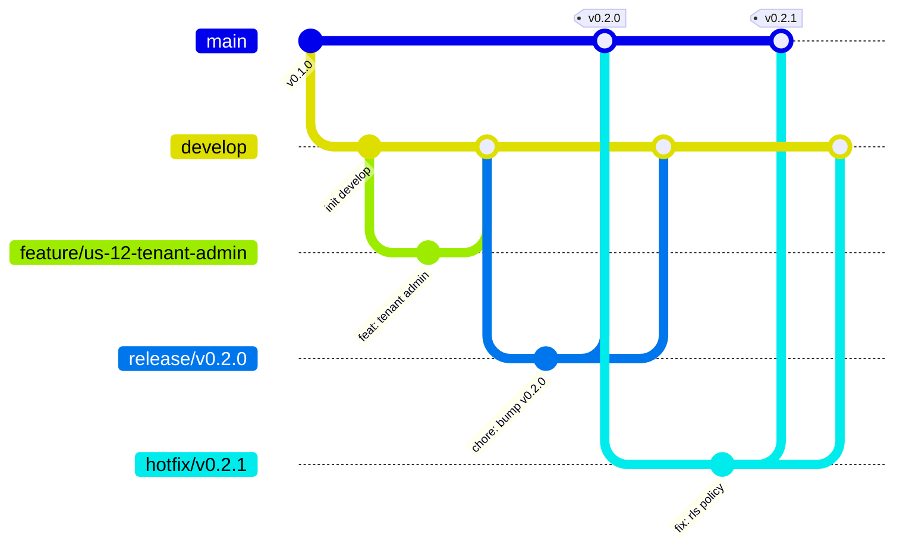

# Fluxo Oficial Gitflow (Padrao Atlassian) -- PFM Core Banking V3.0

Este documento define o modelo oficial de ramificacao, versionamento e governanca de mudancas aplicado a **todos os 15 repositorios** da organizacao `Sorobanerp`.

---

## 1. Visao Geral das Branches (Modelo Atlassian Gitflow)



### Branches Permanentes (Protegidas com `enforce_admins: true`)
| Branch | Proposito | Quem pode mesclar | Protecao Ativa |
| :--- | :--- | :--- | :--- |
| **`main`** | Producao oficial e tags de release (`vX.Y.Z`) | Apenas PRs vindos de `release/*` ou `hotfix/*` | PR obrigatorio, CI verde, `enforce_admins: true`, sem force-push/delete |
| **`develop`** | Linha de integracao continua (Staging/Piloto) | Apenas PRs vindos de `feature/*`, `fix/*`, `docs/*`, `chore/*`, `refactor/*`, `release/*`, `hotfix/*` | PR obrigatorio, CI verde, `enforce_admins: true`, sem force-push/delete |

### Branches Temporarias
| Prefixo | Origem | Destino | Proposito |
| :--- | :--- | :--- | :--- |
| `feature/*` | `develop` | `develop` | Novas funcionalidades e historias (`US-*` / `UC-*`) |
| `fix/*` | `develop` | `develop` | Correcoes de bugs encontrados em integracao |
| `docs/*` | `develop` | `develop` | Atualizacoes de documentacao e ADRs |
| `chore/*` | `develop` | `develop` | Manutencao de dependencias, CI/CD e governanca |
| `refactor/*` | `develop` | `develop` | Refatoracoes sem alteracao de contrato externo |
| `release/vX.Y.Z` | `develop` | `main` **e** `develop` | Congelamento de escopo, bump de `CHANGELOG.md` e geracao de release |
| `hotfix/vX.Y.Z+1` | `main` | `main` **e** `develop` | Correcao emergencial em producao |

---

## 2. Regras Obrigatorias de Governanca

1. **Proibicao de Push Direto:** Tanto `main` quanto `develop` possuem **GitHub Branch Protection** com `enforce_admins: true`, `allow_force_pushes: false`, `allow_deletions: false` e `required_status_checks.strict: true`.
2. **Branch Source Guard (`.github/workflows/gitflow-branch-guard.yml`):**
   - PRs para `main` sao **bloqueados** automaticamente se `github.head_ref` nao iniciar com `release/` ou `hotfix/`.
   - PRs para `develop` sao **bloqueados** automaticamente se `github.head_ref` nao iniciar com `feature/`, `fix/`, `docs/`, `chore/`, `refactor/`, `release/` ou `hotfix/`.
3. **Conventional Commits & SemVer 2.0.0:**
   - Todos os commits e titulos de PR devem seguir o padrao `<tipo>(<escopo>): <descricao>` (`feat`, `fix`, `docs`, `chore`, `refactor`, `test`, `ci`, `build`).
   - Breaking changes usam `!` ou rodape `BREAKING CHANGE:` (incremento `MAJOR`).

---

## 3. Exemplos Praticos de Comandos Git

### 3.1 Ciclo de Feature (`feature/*` -> `develop`)
```bash
git checkout develop && git pull origin develop
git checkout -b feature/us-13-family-rbac
# ... implementar codigo e testes (>= 95% cobertura) ...
git add -A
git commit -m "feat(ledger): add family RBAC role enforcement"
git push -u origin feature/us-13-family-rbac
gh pr create --base develop --title "feat(ledger): add family RBAC role enforcement"
```

### 3.2 Ciclo de Release (`develop` -> `release/vX.Y.Z` -> `main` + `develop`)
```bash
git checkout develop && git pull origin develop
git checkout -b release/v3.0.0
# Atualizar CHANGELOG.md e versao
git commit -am "chore(release): prepare v3.0.0"
git push -u origin release/v3.0.0
gh pr create --base main --title "release(v3.0.0): promote pilot release to production"
# Apos merge em main, sincronizar tag e back-merge em develop:
gh pr create --base develop --head release/v3.0.0 --title "chore(release): back-merge v3.0.0 into develop"
```

### 3.3 Ciclo de Hotfix (`main` -> `hotfix/vX.Y.Z+1` -> `main` + `develop`)
```bash
git checkout main && git pull origin main
git checkout -b hotfix/v3.0.1
# Corrigir incidente critico e adicionar teste de regressao
git commit -am "fix(security): harden tenant RLS check on audit endpoint"
git push -u origin hotfix/v3.0.1
gh pr create --base main --title "fix(security): hotfix v3.0.1"
gh pr create --base develop --head hotfix/v3.0.1 --title "fix(security): back-merge hotfix v3.0.1 into develop"
```
