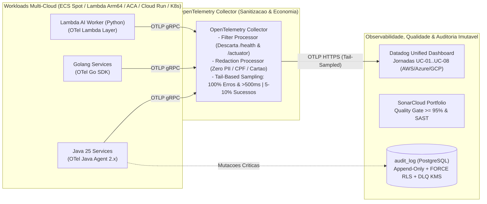
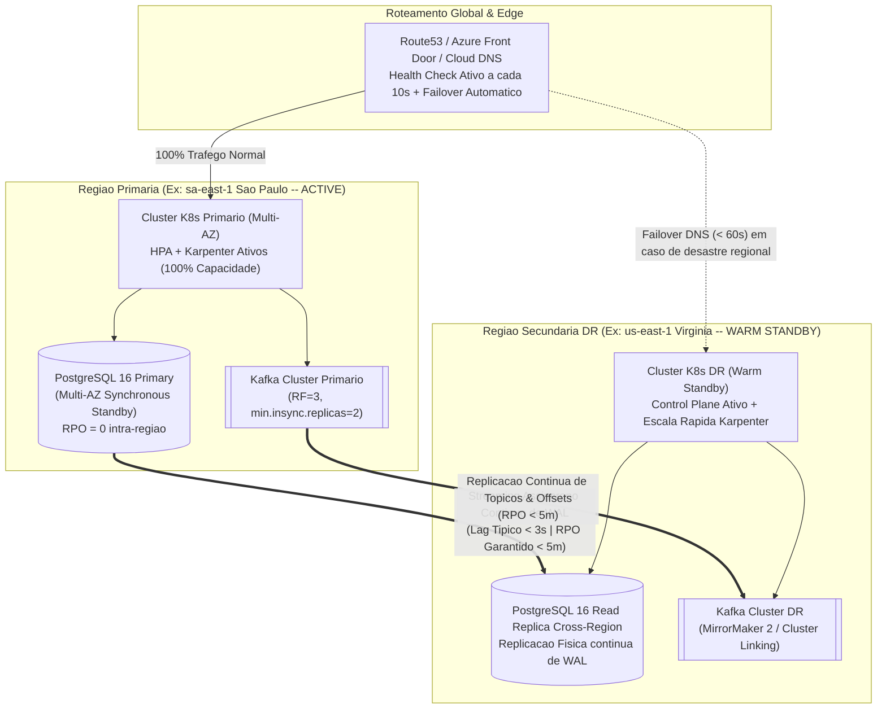
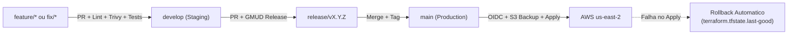

# Engenharia de Confiabilidade (SRE), Observabilidade, DR & FinOps Multicloud

Este documento define o modelo operacional de **Site Reliability Engineering (SRE)**, a arquitetura de telemetria unificada com **OpenTelemetry**, o plano de **Disaster Recovery (RPO < 5m, RTO < 30m)** e o comparativo **FinOps Multicloud (AWS / Azure / GCP)** da plataforma **PFM Core Banking**.

---

## 1. Matriz de SLIs, SLOs e Error Budgets

A plataforma opera sob gestao rigorosa de **Service Level Indicators (SLIs)** e **Service Level Objectives (SLOs)** mensurados em janelas rolantes de **30 dias** ($43.200\text{ minutos}$):

| Servico / Fluxo Critico | SLI (Indicador Mensurado) | SLO Alvo (30d) | Error Budget (30d) | Limiar de Alerta (Page P1) |
| :--- | :--- | :---: | :---: | :--- |
| **`pfm-api-gateway` & `pfm-ledger-service`** | Taxa de requisicoes validas sem erro `5xx` | **99,95%** | $21,6\text{ min/mes}$ | Burn rate $\ge 14.4\times$ (1h e 5m) |
| **Escrita Sincrona no Ledger (`RecordEntry`)** | Latencia no percentil **P95** / **P99** | **P95 < 80ms** / **P99 < 180ms** | 0,05% reqs acima do SLO | P99 > 250ms por 5 min consecutivos |
| **`pfm-ingestion-pdf-service` (RAM Parser)** | Latencia P95 para faturas ate 10 paginas | **P95 < 1.200ms** | 0,1% de falhas de parse | Uso de RAM do Pod > 80% ou OOMKill |
| **`pfm-ai-categorizer-service` (L1 + L2)** | Latencia P95 nas camadas deterministica/ONNX | **P95 < 15ms** | -- | Taxa de fallback para L3 LLM > 12% |
| **Pipeline Assincrono (Outbox $\rightarrow$ Kafka $\rightarrow$ Budget/Reconcile)** | End-to-End Event Lag (*Freshness*) | **P99 < 2,0s** | -- | Consumer Lag > 5.000 mensagens ou DLQ > 0 |
| **Integridade Contabil & Isolamento RLS** | Divergencia de centavos ou violacao RLS | **100,00% (Zero Tolerancia)** | **0 eventos** | Qualquer ocorrencia dispara SEV-0 imediato |

---

## 2. Observabilidade Multi-Cloud Unificada (OTel Tail-Sampling $\rightarrow$ Datadog) & Auditoria Imutavel

Em conformidade com o **ADR-010**, todos os repositorios utilizam o **OpenTelemetry SDK / Auto-Instrumentation** exportando via protocolo **OTLP/gRPC** para o **OpenTelemetry Collector**, que aplica higienizacao LGPD e **Tail-Based Sampling** antes de enviar ao **Datadog Unified Dashboard** (visao unica AWS / Azure / GCP por jornada de negocio `UC-01` a `UC-08`).



### Padrao de Correlacao e Sanitizacao de Logs (LGPD)

Todo log emitido em qualquer linguagem deve ser formatado em **JSON estruturado (uma linha por evento)** contendo obrigatoriamente os atributos de correlacao e **jamais** registrando dados pessoais (CPF, nome completo, numero de cartao ou conteudo bruto do PDF):

```json
{
  "timestamp": "2026-11-15T22:15:04.192Z",
  "level": "INFO",
  "service.name": "pfm-ledger-service",
  "service.version": "2.4.0",
  "trace_id": "4bf92f3577b34da6a3ce929d0e0e4736",
  "span_id": "00f067aa0ba902b7",
  "tenant_id": "01933000-0000-7000-8000-000000000001",
  "event.domain": "LEDGER_ENTRY_RECORDED",
  "idempotency_key": "01933011-a210-7b12-9c44-881122334455",
  "category.l1": "ALIMENTACAO",
  "category.l2": "SUPERMERCADO_MERCEARIA",
  "duration_ms": 14.2
}
```

---

## 3. Disaster Recovery (DR) -- RPO < 5 Minutos & RTO < 30 Minutos

A plataforma e projetada para resistir a queda completa de uma Zona de Disponibilidade (AZ) com **RPO = 0 e RTO < 30 segundos** (Multi-AZ Ativo-Ativo) e a queda catastrofica de uma Regiao inteira de nuvem com **RPO < 5 minutos e RTO < 30 minutos** (estrategia **Warm Standby Cross-Region**).



### Runbook Cronometrado de Recuperacao de Desastre Regional (RTO < 30m)

| Fase | Tempo Alvo | Acao Automatizada / Operacional |
| :--- | :---: | :--- |
| **1. Deteccao & Alerta** | $T + 02\text{ min}$ | Healthchecks sinteticos globais confirmam indisponibilidade regional da Regiao Primaria e acionam o plantao SRE. |
| **2. Promocao do Banco de Dados** | $T + 08\text{ min}$ | Execucao do workflow automatizado Terraform/CLI para promover a replica Cross-Region do PostgreSQL 16 a *Primary Standalone* (aplicando os ultimos segmentos de WAL recebidos, garantindo **RPO < 5m**). |
| **3. Escalonamento de Compute & Kafka** | $T + 15\text{ min}$ | Karpenter / Cluster Autoscaler na regiao secundaria provisiona os nos ARM64 ate 100% da capacidade nominal; consumidores Kafka apontam para os offsets espelhados pelo MirrorMaker 2. |
| **4. Smoke Tests & Verificacao RLS** | $T + 20\text{ min}$ | Job automatizado de validacao executa transacoes sinteticas de leitura/escrita e verifica politicas PostgreSQL RLS e KMS na regiao DR. |
| **5. Virada de Trafego Global (DNS/GSLB)** | $T + 25\text{ min}$ | Alteracao de peso no GSLB (Route53 / Front Door / Cloud Load Balancing) direcionando 100% do trafego de clientes para a Regiao Secundaria (**RTO Total $\le 25\text{ min} < 30\text{ min}$**). |

---

## 4. FinOps & ROI: Trilha Evolutiva de Custos + Comparativo Multicloud

### 4.1. Tabela Comparativa Consolidada por Estagio de Maturidade (V3)

| Dimensao Arquitetural | Estagio 1: Piloto / Producao Inicial | Estagio 2: Escala (100 Tenants) | Estagio 3: Hiperescala Kubernetes (500+ Tenants) |
| :--- | :--- | :--- | :--- |
| **Compute Principal** | **AWS ECS Fargate Spot (Arm64)** / (Equiv.: Azure Container Apps / GCP Cloud Run) | **ECS Fargate Spot / ACA / Cloud Run** (24x7 Multi-task) | **Kubernetes (EKS / AKS / GKE)** / + **Karpenter Spot** + **KEDA** |
| **Control Plane Orquestrador** | **US$ 0,00 / mes** (Gerenciado Serverless) | **US$ 0,00 / mes** | **US$ 73,00 / mes** (Control Plane EKS/AKS/GKE) |
| **Worker IA (`pfm-ai-worker`)** | **AWS Lambda Arm64** (Custo $0 ocioso) | **AWS Lambda Arm64** (Rajadas sob demanda) | **Lambda / KEDA Event Workers** |
| **Banco de Dados (PostgreSQL 16 + RLS)** | RDS `db.t4g.micro` Single-AZ / (Park Noturno 20h30--06h00 BRT) | RDS / Aurora Serverless v2 (Multi-AZ) | Aurora PostgreSQL Multi-AZ + Read Replicas |
| **Mensageria & Cache** | **Upstash Kafka & Redis Serverless** (Free/Pay-per-use) | **Upstash Pro** / MSK Serverless | **Amazon MSK / Confluent** + **ElastiCache Valkey** |
| **Observabilidade & Qualidade** | OTel Tail-Sampling $\rightarrow$ Datadog Free + SonarCloud | Datadog Pro Controlado + OTel Collector | Datadog / LGTM Multi-AZ + Audit Log Cross-Region |
| **Custo Mensal Total Estimado (USD)** | **US$ 12,00 -- US$ 24,00 / mes** | **~US$ 115,00 / mes** | **~US$ 420,00 / mes** |
| **Unit Economics (Custo / Tenant)** | Fase de Validacao / Bootstrapping | **~US$ 1,15 / tenant** | **< US$ 0,84 / tenant** (diluicao em escala) |

### 4.2. Comparativo FinOps Multicloud em Hiperescala (100.000 Tenants Ativos)

O dimensionamento de referencia considera um ambiente de Producao de alta disponibilidade (**Multi-AZ**) atendendo **100.000 usuarios ativos (tenants)**, processando ~15 milhoes de transacoes/mes, 250.000 faturas PDF/mes em RAM e 1,2 milhao de notas NFC-e/mes.

### Equivalencia de Servicos e Estimativa Mensal (USD) -- Cenario Com Comprometimento (1-Year Savings Plan / RI / CUD)

| Camada de Infraestrutura | Especificacao Base (Sizing) | AWS (`sa-east-1` / `us-east-1`) | Microsoft Azure (`brazilsouth` / `eastus`) | Google Cloud (`southamerica-east1` / `us-east1`) |
| :--- | :--- | :--- | :--- | :--- |
| **Kubernetes Compute (Core + Go + Python + Web)** | 6 nos `4 vCPU / 16 GB RAM` ARM64 (Graviton4 / Ampere Altra / Tau T2A) | Amazon EKS + EC2 `m8g.xlarge` / **\$540 / mes** | AKS + VMs `D4ps_v5` (ARM64) / **\$515 / mes** | GKE Standard/Autopilot `t2a-standard-4` / **\$495 / mes** |
| **Banco de Dados Relacional (PostgreSQL 16 + RLS)** | `4 vCPU / 32 GB RAM` Multi-AZ (HA) + 500 GB SSD IOPS + Wal Backup | Aurora PostgreSQL `db.r8g.xlarge` Multi-AZ / **\$680 / mes** | Azure DB for PostgreSQL Flexible HA / **\$640 / mes** | Cloud SQL PostgreSQL Enterprise HA / **\$620 / mes** |
| **Event Streaming (Apache Kafka)** | 3 Brokers gerenciados Multi-AZ + 500 GB Storage | Amazon MSK Provisioned (`kafka.m7g.large`) / **\$410 / mes** | Azure Event Hubs Premium / Confluent / **\$445 / mes** | Managed Service for Apache Kafka / **\$390 / mes** |
| **Cache & Idempotencia (Redis / Valkey)** | `8 GB RAM` Replicado Multi-AZ | Amazon ElastiCache for Valkey (`r7g.large`) / **\$135 / mes** | Azure Managed Redis Balanced / **\$150 / mes** | Cloud Memorystore for Redis HA / **\$145 / mes** |
| **Seguranca (KMS Envelope) & Ingress L7** | Rotacao de chaves + Load Balancer HTTP/3 + WAF basico | AWS KMS + ALB/NLB / **\$95 / mes** | Azure Key Vault + Application Gateway / **\$105 / mes** | Cloud KMS + Global Cloud Load Balancing / **\$90 / mes** |
| **Observabilidade & Reserva DR (Warm Standby)** | OTel Metrics/Logs/Traces + Replica DB Cross-Region minima | AMP/AMG + S3 + Replica DR / **\$320 / mes** | Azure Monitor + Blob + Replica DR / **\$335 / mes** | Cloud Ops + GCS + Replica DR / **\$300 / mes** |
| **TOTAL MENSAL ESTIMADO** | **100.000 Tenants Ativos** | **\$2.180 / mes** | **\$2.190 / mes** | **\$2.040 / mes** |
| **Custo Unitario por Tenant (Unit Economics)** | **Custo Infra / Tenant / Mes** | **\$0,0218 / tenant** | **\$0,0219 / tenant** | **\$0,0204 / tenant** |

---

### Alavancas de Otimizacao FinOps Implementadas na Arquitetura

1. **Adocao Nativa de Processadores ARM64 (`linux/arm64`)**:
   - Os compiladores de **Java 25 LTS**, **Golang 1.24** e **Python 3.12 (ONNX)** geram imagens multi-arquitetura otimizadas para AWS Graviton4, Azure Ampere Altra e GCP Tau T2A, entregando **reducao de 22% a 28% no custo por vCPU** e melhor eficiencia energetica.
2. **Zero-Disk PDF Parsing em RAM (`ADR-006`)**:
   - Alem do ganho de seguranca e conformidade LGPD, o nao armazenamento de centenas de milhares de arquivos PDF em Object Storage e blocos SSD economiza custos recorrentes de armazenamento, IOPS, replicacao cross-region e trafego de rede.
3. **Funil de IA em 3 Camadas (`L1 -> L2 -> L3`)**:
   - Ao resolver **~95% das categorizacoes** nas Camadas 1 (Redis/Regras) e 2 (ONNX Local em CPU) e enviar apenas **~5% de casos ambiguos** para o LLM na nuvem (Camada 3), o custo mensal de IA cai em **mais de 90%** em comparacao ao uso direto de LLM para todas as transacoes.
4. **Substituicao de Redis Proprietario por Valkey 8**:
   - Reducao de ate 20% na camada de cache em memoria mantendo 100% de compatibilidade de protocolo.

## 5. Mapa Canonico de Portas Locais & Estrategia 12-Factor App

### Estrategia de Isolamento 12-Factor (Port Binding via Environment)

Em conformidade com o **Principio VII do 12-Factor App (Port Binding)**, todos os servicos da plataforma PFM Core Banking sao completamente autossuficientes e exportam seus servicos HTTP/gRPC vinculando-se a portas declaradas por variaveis de ambiente.

- **Ambiente de Producao (Kubernetes / Cloud):** Os pods escutam em suas portas de rede padronizadas (`8080` para HTTP, `9090` para gRPC, `5432` para PostgreSQL, etc.). A resolucao de nomes entre servicos ocorre via Kubernetes CoreDNS e Services ClusterIP.
- **Ambiente de Desenvolvimento Local (Host):** Para evitar qualquer conflito com ferramentas de infraestrutura local previamente instaladas no sistema operacional (notadamente o **Portainer** nas portas `8000`, `9000` e `9443`, PostgreSQL local em `5432`, Redis em `6379` e Kafka em `9092`), o ecossistema PFM adota um particionamento estrito:
  - **Aplicacoes e Gateways no Host:** Faixa `18xxx` (`18000` a `18400`).
  - **Servicos de Infraestrutura Local (Docker Compose):** Faixas `14xxx` (LocalStack `14566`), `15xxx` (PostgreSQL `15432` / `15433`), `16xxx` (Redis `16379`) e `19xxx` (Kafka `19092`).

### Topologia Canonica de Portas

| Componente | Host (Local) | Container / K8s | Protocolo | Variavel de Ambiente | Descricao / Roteamento |
|---|:---:|:---:|:---:|---|---|
| `pfm-docs` (MkDocs) | `18000` | `8000` | HTTP | `PORT=18000` | Servidor de documentacao viva (preserva Portainer na `8000`) |
| `pfm-web-nextjs` | `18300` | `3000` | HTTP | `PORT=18300`, `NEXT_PUBLIC_API_URL` | Frontend Web (Next.js SSR) |
| `pfm-envoy-gateway` | `18080` | `8080` | HTTP/2, HTTP/3 | -- (mapeamento Docker) | Edge Gateway -> `host.docker.internal:18100` |
| `pfm-ingestion-bff-go` | `18100` | `8080` | HTTP | `SERVER_PORT=18100` | Ingestion BFF HTTP API |
| `pfm-forecast-engine-go` | `18110` | `9090` | gRPC / HTTP | `GRPC_PORT=18110` | Forecast Engine gRPC & Health HTTP |
| `pfm-core-ledger-java` HTTP | `18200` | `8080` | HTTP | `SERVER_PORT=18200` | Actuator Health, Metrics & REST |
| `pfm-core-ledger-java` gRPC | `18210` | `9090` | gRPC | `GRPC_SERVER_PORT=18210` | Core Ledger Engine gRPC |
| `pfm-ai-worker-python` | `18400` | `8080` | HTTP | `WORKER_PORT=18400` | Worker de Categorizacao & Healthcheck |
| `postgres-core-ledger` | `15432` | `5432` | TCP/SQL | `DB_URL` | PostgreSQL Core Banking (Partidas Dobradas + RLS) |
| `postgres-ai-rules` | `15433` | `5432` | TCP/SQL | `PFM_AI_RULES_DSN` | PostgreSQL Regras e Taxonomia IA |
| `pfm-redis` (Valkey) | `16379` | `6379` | RESP3 | `REDIS_ADDR` | Cache L1, Locks e Idempotencia (72h) |
| `pfm-kafka` (KRaft) | `19092` | `9092` | TCP | `KAFKA_BROKERS` / `KAFKA_BOOTSTRAP_SERVERS` | Event Streaming Backbone |
| `pfm-kafka-ui` | `18085` | `8080` | HTTP | -- (mapeamento Docker) | Interface Web de Inspecao Kafka |
| `pfm-localstack` | `14566` | `4566` | HTTP | `AWS_ENDPOINT_URL` | AWS S3, KMS & Secrets Manager emulados |
| Android Emulator -> Envoy | `10.0.2.2:18080` | -- | HTTP | `BuildConfig.API_BASE_URL` | Roteamento nativo Android Emulator -> Envoy Host |

### Matriz de Endpoints de Verificacao de Saude (Health Checks)

Todos os servicos expoem endpoints padronizados de sondagem liveness/readiness para validacao rapida no host ou pelos probes do Kubernetes (`livenessProbe` / `readinessProbe`):

```bash
# 1. Envoy API Gateway
curl -f -s http://localhost:18080/healthz
# Resposta esperada: {"status":"UP","gateway":"pfm-envoy-edge","routing":"/api/v1/* -> bff_go_cluster"}

# 2. Ingestion BFF (Go)
curl -f -s http://localhost:18100/health
# Resposta esperada: {"protocols":["HTTP/2","HTTP/3-QUIC-Ready","gRPC"],"service":"pfm-ingestion-bff-go","status":"UP"}

# 3. Forecast Engine (Go)
curl -f -s http://localhost:18110/health
# Resposta esperada: {"port":18110,"service":"pfm-forecast-engine-go","status":"UP"}

# 4. Core Ledger (Java 25 / Spring Boot 3.4)
curl -f -s http://localhost:18200/actuator/health
# Resposta esperada: {"status":"UP"}

# 5. AI Worker (Python)
curl -f -s http://localhost:18400/health
# Resposta esperada: {"service":"pfm-ai-worker-python","status":"UP"}

# 6. Web Portal (Next.js 15)
curl -f -s -I http://localhost:18300 | head -n 1
# Resposta esperada: HTTP/1.1 200 OK
```

---

## 6. Matriz Oficial de Ciclo de Vida & Politica de Operacao FinOps

Para assegurar controle financeiro rigoroso sem perda de agilidade de engenharia, a plataforma adota a **Matriz Oficial de Ciclo de Vida & Politica de Operacao**, implementada nos repositorios de infraestrutura e orquestrada pelo **Gitflow CI/CD** e pela **Lambda `pfm-finops-manager`**.

### 6.1. Matriz de Ambientes & Politicas de Execucao

| Ambiente | Proposito | Estrategia de Execucao | Politica de Ciclo de Vida / FinOps | Custo Alvo (USD) |
| :--- | :--- | :--- | :--- | :--- |
| **`pilot-prod`** | Operacao real do Piloto de 3 Meses (5 a 20 usuarios familiares). | **24x7 Enxuto com Parada Noturna Programada**: ECS Fargate Spot Arm64 + Upstash Serverless + RDS PostgreSQL `db.t4g.micro`. | A Lambda `pfm-finops-manager` executa parada automatica (`stop`) as **20h30 BRT** (escalando tarefas para 0 e suspendendo o RDS) e religamento (`start`) as **06h00 BRT**, economizando ~40% de computacao ociosa. | **US$ 11,50 a US$ 24,00 / mes** |
| **`sandbox` / `ephemeral`** | Testes de integracao E2E, homologacao de PRs e validacoes de carga. | **Sob Demanda (On-Demand)** disparado manualmente via `workflow_dispatch` com parametro `action=apply`. | Destruicao automatica obrigatoria (`action=destroy`) apos conclusao da suite de testes ou time-to-live (TTL) maximo de 4 horas via timer programado no GitHub Actions. | **US$ 0,00 fixo** (faturado apenas minutos de teste) |
| **`enterprise-prod`** (Pos-Piloto) | Expansao comercial multi-tenant (> 100 familias). | **Alta Disponibilidade Multi-AZ**: Amazon EKS Graviton + Amazon Aurora PostgreSQL + MSK/Strimzi + Valkey Multi-AZ. | Autoscaling reativo via **KEDA** (metricas de fila Kafka) e **Karpenter** (nos SPOT com consolidacao automatica de capacidade ociosa), coberto por Savings Plans de 1 ano. | **US$ 140 a US$ 350+ / mes** |

### 6.2. Fluxo de Promocao Gitflow & Criterios de Qualidade (Gates)

O ciclo de entrega segue o padrao Gitflow estrito automatizado com verificacao estatica, seguranca e protecao de branches:



1. **Gate 1 -- Feature/Fix (`develop`)**:
   - Validacoes locais e no runner: `pytest` / `go test` / `mvn test`, `tofu fmt -check`, `tofu validate` e escaneamento de vulnerabilidades IaC com **Trivy** (`--severity CRITICAL,HIGH --exit-code 1`).
2. **Gate 2 -- Release Candidate (`release/vX.Y.Z`)**:
   - Abertura de PR de GMUD formal para a branch `main`.
   - Execucao de `tofu plan` contra o ambiente real com postagem de plano detalhado no PR.
3. **Gate 3 -- Aplicacao em Producao (`main`)**:
   - Autenticacao sem credenciais estaticas via **AWS GitHub Actions OIDC Role** (`PFM-GitHubActions-OIDC-Role`).
   - **Pre-Apply Backup**: Copia do estado anterior no S3 para `backups/terraform.tfstate.last-good`.
   - **Timeout Controlado**: Aplicacao com timeout de 20 minutos (`timeout-minutes: 20`).
   - **Rollback Automatico**: Em caso de falha durante o `tofu apply`, restaura imediatamente o estado do snapshot `last-good`, garantindo integridade do backend DynamoDB/S3.

### 6.3. Governanca Ativa com `pfm-finops-manager` & Circuit-Breaker de Orcamento

A Lambda `pfm-finops-manager` (`arn:aws:lambda:us-east-2:366476833548:function:pfm-finops-manager`), construida em Python 3.12 Arm64, atua como sentinela de custos e garantidora do SLA financeiro:

1. **Ciclo Noturno Idempotente**:
   - EventBridge Schedule `pfm-finops-park-nightly-2030`: cron as `20:30` BRT (`America/Sao_Paulo`) aciona `{"action": "stop"}`.
   - EventBridge Schedule `pfm-finops-unpark-morning-0600`: cron as `06:00` BRT (`America/Sao_Paulo`) aciona `{"action": "start"}`.
   - Idempotencia total: se o banco ja estiver em transicao ou parado, a execucao registra `skipped_status_stopping` / `already_stopped` sem lancar erros 5xx.
2. **Circuit-Breaker de Orcamento (AWS Budgets Integration)**:
   - **Alerta Preventivo (80%)**: Se a projecao de gastos mensais em `us-east-2` ultrapassar **US$ 20,00 / mes**, a Lambda emite notificacao de alerta preventivo via SNS/Slack.
   - **Corte de Emergencia (100% / Circuit-Breaker)**: Caso o consumo atinja **US$ 30,00 / mes**, a Lambda ativa o modo de contencao estrita, reduzindo instancias e tarefas computacionais para escala zero ate aprovacao explicita do administrador FinOps.

---

## 7. Runbooks de Auditoria de Falhas Criticas (V3)

| Codigo | Cenario de Falha Critica | Severidade | Acao de Contencao & Auditoria Imutavel |
| :--- | :--- | :---: | :--- |
| **RB-01** | **Mensagens em DLQ Cifrada (`<topic>.dlq`)** | P1 (Alta) | 1. Verificar trace com `status=ERROR` no Datadog Unified via `trace_id`. / 2. Inspecionar metadados sem PII; decifrar payload via role auditada KMS apenas em ambiente seguro. / 3. Corrigir bug/contrato e executar replay idempotente com registro no `audit_log`. |
| **RB-02** | **Tentativa de Violacao RLS / Mutacao em `audit_log`** | **SEV-0 (Critica)** | 1. Bloqueio imediato pelo PostgreSQL (`FORCE ROW LEVEL SECURITY` / Role Append-Only). / 2. Alerta instantaneo no Datadog (`100%` retido pelo Tail-Based Sampling). / 3. Revogar sessao JWT/IAM suspeita e preservar snapshot forense. |
| **RB-03** | **Falha de `tofu apply` em Producao** | P1 (Alta) | 1. O workflow `infra-opentofu-ci-cd.yml` aciona automaticamente o rollback do state para `backups/terraform.tfstate.last-good`. / 2. Validar integridade dos servicos no ECS/Lambda e verificar `pfm-finops-manager` (`action=audit`). |
| **RB-04** | **Estouro de Orcamento FinOps (> US$ 30/mes)** | P2 (FinOps) | 1. `pfm-finops-manager` aciona `stop` emergencial (ECS `desired=0`, RDS parado). / 2. Analisar relatorio `audit` de run-rate e identificar loop de invocacao ou trafego anomalo. |

