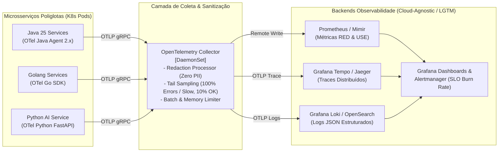
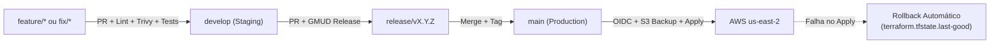

# Engenharia de Confiabilidade (SRE), Observabilidade, DR & FinOps Multicloud

Este documento define o modelo operacional de **Site Reliability Engineering (SRE)**, a arquitetura de telemetria unificada com **OpenTelemetry**, o plano de **Disaster Recovery (RPO < 5m, RTO < 30m)** e o comparativo **FinOps Multicloud (AWS / Azure / GCP)** da plataforma **PFM Core Banking**.

---

## 1. Matriz de SLIs, SLOs e Error Budgets

A plataforma opera sob gestão rigorosa de **Service Level Indicators (SLIs)** e **Service Level Objectives (SLOs)** mensurados em janelas rolantes de **30 dias** ($43.200\text{ minutos}$):

| Serviço / Fluxo Crítico | SLI (Indicador Mensurado) | SLO Alvo (30d) | Error Budget (30d) | Limiar de Alerta (Page P1) |
| :--- | :--- | :---: | :---: | :--- |
| **`pfm-api-gateway` & `pfm-ledger-service`** | Taxa de requisições válidas sem erro `5xx` | **99,95%** | $21,6\text{ min/mês}$ | Burn rate $\ge 14.4\times$ (1h e 5m) |
| **Escrita Síncrona no Ledger (`RecordEntry`)** | Latência no percentil **P95** / **P99** | **P95 < 80ms**<br/>**P99 < 180ms** | 0,05% reqs acima do SLO | P99 > 250ms por 5 min consecutivos |
| **`pfm-ingestion-pdf-service` (RAM Parser)** | Latência P95 para faturas até 10 páginas | **P95 < 1.200ms** | 0,1% de falhas de parse | Uso de RAM do Pod > 80% ou OOMKill |
| **`pfm-ai-categorizer-service` (L1 + L2)** | Latência P95 nas camadas determinística/ONNX | **P95 < 15ms** | — | Taxa de fallback para L3 LLM > 12% |
| **Pipeline Assíncrono (Outbox $\rightarrow$ Kafka $\rightarrow$ Budget/Reconcile)** | End-to-End Event Lag (*Freshness*) | **P99 < 2,0s** | — | Consumer Lag > 5.000 mensagens ou DLQ > 0 |
| **Integridade Contábil & Isolamento RLS** | Divergência de centavos ou violação RLS | **100,00% (Zero Tolerância)** | **0 eventos** | Qualquer ocorrência dispara SEV-0 imediato |

---

## 2. Observabilidade Full-Stack com OpenTelemetry (OTel)

Todos os 14 repositórios utilizam o **OpenTelemetry SDK / Auto-Instrumentation** exportando via protocolo **OTLP/gRPC** para o **OpenTelemetry Collector** implantado como *DaemonSet* no Kubernetes.



### Padrão de Correlação e Sanitização de Logs (LGPD)

Todo log emitido em qualquer linguagem deve ser formatado em **JSON estruturado (uma linha por evento)** contendo obrigatoriamente os atributos de correlação e **jamais** registrando dados pessoais (CPF, nome completo, número de cartão ou conteúdo bruto do PDF):

```json
{
  "timestamp": "2026-11-15T22:15:04.192Z",
  "level": "INFO",
  "service.name": "pfm-ledger-service",
  "service.version": "2.4.0",
  "trace_id": "4bf92f3577b34da6a3ce929d0e0e4736",
  "span_id": "00f067aa0ba902b7",
  "tenant_id": "01933000-0000-7000-8000-000000000001",
  "event.domain": "LEDGER_ENTRY_RECORDED",
  "idempotency_key": "01933011-a210-7b12-9c44-881122334455",
  "category.l1": "ALIMENTACAO",
  "category.l2": "SUPERMERCADO_MERCEARIA",
  "duration_ms": 14.2
}
```

---

## 3. Disaster Recovery (DR) — RPO < 5 Minutos & RTO < 30 Minutos

A plataforma é projetada para resistir à queda completa de uma Zona de Disponibilidade (AZ) com **RPO = 0 e RTO < 30 segundos** (Multi-AZ Ativo-Ativo) e à queda catastrófica de uma Região inteira de nuvem com **RPO < 5 minutos e RTO < 30 minutos** (estratégia **Warm Standby Cross-Region**).


### Runbook Cronometrado de Recuperação de Desastre Regional (RTO < 30m)

| Fase | Tempo Alvo | Ação Automatizada / Operacional |
| :--- | :---: | :--- |
| **1. Detecção & Alerta** | $T + 02\text{ min}$ | Healthchecks sintéticos globais confirmam indisponibilidade regional da Região Primária e acionam o plantão SRE. |
| **2. Promoção do Banco de Dados** | $T + 08\text{ min}$ | Execução do workflow automatizado Terraform/CLI para promover a réplica Cross-Region do PostgreSQL 16 a *Primary Standalone* (aplicando os últimos segmentos de WAL recebidos, garantindo **RPO < 5m**). |
| **3. Escalonamento de Compute & Kafka** | $T + 15\text{ min}$ | Karpenter / Cluster Autoscaler na região secundária provisiona os nós ARM64 até 100% da capacidade nominal; consumidores Kafka apontam para os offsets espelhados pelo MirrorMaker 2. |
| **4. Smoke Tests & Verificação RLS** | $T + 20\text{ min}$ | Job automatizado de validação executa transações sintéticas de leitura/escrita e verifica políticas PostgreSQL RLS e KMS na região DR. |
| **5. Virada de Tráfego Global (DNS/GSLB)** | $T + 25\text{ min}$ | Alteração de peso no GSLB (Route53 / Front Door / Cloud Load Balancing) direcionando 100% do tráfego de clientes para a Região Secundária (**RTO Total $\le 25\text{ min} < 30\text{ min}$**). |

---

## 4. Comparativo FinOps Multicloud (AWS vs. Azure vs. GCP)

O dimensionamento de referência considera um ambiente de Produção de alta disponibilidade (**Multi-AZ**) atendendo **100.000 usuários ativos (tenants)**, processando ~15 milhões de transações/mês, 250.000 faturas PDF/mês em RAM e 1,2 milhão de notas NFC-e/mês.

### Equivalência de Serviços e Estimativa Mensal (USD) — Cenário Com Comprometimento (1-Year Savings Plan / RI / CUD)

| Camada de Infraestrutura | Especificação Base (Sizing) | AWS (`sa-east-1` / `us-east-1`) | Microsoft Azure (`brazilsouth` / `eastus`) | Google Cloud (`southamerica-east1` / `us-east1`) |
| :--- | :--- | :--- | :--- | :--- |
| **Kubernetes Compute (Core + Go + Python + Web)** | 6 nós `4 vCPU / 16 GB RAM` ARM64 (Graviton4 / Ampere Altra / Tau T2A) | Amazon EKS + EC2 `m8g.xlarge`<br/>**\$540 / mês** | AKS + VMs `D4ps_v5` (ARM64)<br/>**\$515 / mês** | GKE Standard/Autopilot `t2a-standard-4`<br/>**\$495 / mês** |
| **Banco de Dados Relacional (PostgreSQL 16 + RLS)** | `4 vCPU / 32 GB RAM` Multi-AZ (HA) + 500 GB SSD IOPS + Wal Backup | Aurora PostgreSQL `db.r8g.xlarge` Multi-AZ<br/>**\$680 / mês** | Azure DB for PostgreSQL Flexible HA<br/>**\$640 / mês** | Cloud SQL PostgreSQL Enterprise HA<br/>**\$620 / mês** |
| **Event Streaming (Apache Kafka)** | 3 Brokers gerenciados Multi-AZ + 500 GB Storage | Amazon MSK Provisioned (`kafka.m7g.large`)<br/>**\$410 / mês** | Azure Event Hubs Premium / Confluent<br/>**\$445 / mês** | Managed Service for Apache Kafka<br/>**\$390 / mês** |
| **Cache & Idempotência (Redis / Valkey)** | `8 GB RAM` Replicado Multi-AZ | Amazon ElastiCache for Valkey (`r7g.large`)<br/>**\$135 / mês** | Azure Managed Redis Balanced<br/>**\$150 / mês** | Cloud Memorystore for Redis HA<br/>**\$145 / mês** |
| **Segurança (KMS Envelope) & Ingress L7** | Rotação de chaves + Load Balancer HTTP/3 + WAF básico | AWS KMS + ALB/NLB<br/>**\$95 / mês** | Azure Key Vault + Application Gateway<br/>**\$105 / mês** | Cloud KMS + Global Cloud Load Balancing<br/>**\$90 / mês** |
| **Observabilidade & Reserva DR (Warm Standby)** | OTel Metrics/Logs/Traces + Réplica DB Cross-Region mínima | AMP/AMG + S3 + Réplica DR<br/>**\$320 / mês** | Azure Monitor + Blob + Réplica DR<br/>**\$335 / mês** | Cloud Ops + GCS + Réplica DR<br/>**\$300 / mês** |
| **TOTAL MENSAL ESTIMADO** | **100.000 Tenants Ativos** | **\$2.180 / mês** | **\$2.190 / mês** | **\$2.040 / mês** |
| **Custo Unitário por Tenant (Unit Economics)** | **Custo Infra / Tenant / Mês** | **\$0,0218 / tenant** | **\$0,0219 / tenant** | **\$0,0204 / tenant** |

---

### Alavancas de Otimização FinOps Implementadas na Arquitetura

1. **Adoção Nativa de Processadores ARM64 (`linux/arm64`)**:
   - Os compiladores de **Java 25 LTS**, **Golang 1.24** e **Python 3.12 (ONNX)** geram imagens multi-arquitetura otimizadas para AWS Graviton4, Azure Ampere Altra e GCP Tau T2A, entregando **redução de 22% a 28% no custo por vCPU** e melhor eficiência energética.
2. **Zero-Disk PDF Parsing em RAM (`ADR-006`)**:
   - Além do ganho de segurança e conformidade LGPD, o não armazenamento de centenas de milhares de arquivos PDF em Object Storage e blocos SSD economiza custos recorrentes de armazenamento, IOPS, replicação cross-region e tráfego de rede.
3. **Funil de IA em 3 Camadas (`L1 -> L2 -> L3`)**:
   - Ao resolver **~95% das categorizações** nas Camadas 1 (Redis/Regras) e 2 (ONNX Local em CPU) e enviar apenas **~5% de casos ambíguos** para o LLM na nuvem (Camada 3), o custo mensal de IA cai em **mais de 90%** em comparação ao uso direto de LLM para todas as transações.
4. **Substituição de Redis Proprietário por Valkey 8**:
   - Redução de até 20% na camada de cache em memória mantendo 100% de compatibilidade de protocolo.

## 5. Mapa Canônico de Portas Locais & Estratégia 12-Factor App

### Estratégia de Isolamento 12-Factor (Port Binding via Environment)

Em conformidade com o **Princípio VII do 12-Factor App (Port Binding)**, todos os serviços da plataforma PFM Core Banking são completamente autossuficientes e exportam seus serviços HTTP/gRPC vinculando-se a portas declaradas por variáveis de ambiente.

- **Ambiente de Produção (Kubernetes / Cloud):** Os pods escutam em suas portas de rede padronizadas (`8080` para HTTP, `9090` para gRPC, `5432` para PostgreSQL, etc.). A resolução de nomes entre serviços ocorre via Kubernetes CoreDNS e Services ClusterIP.
- **Ambiente de Desenvolvimento Local (Host):** Para evitar qualquer conflito com ferramentas de infraestrutura local previamente instaladas no sistema operacional (notadamente o **Portainer** nas portas `8000`, `9000` e `9443`, PostgreSQL local em `5432`, Redis em `6379` e Kafka em `9092`), o ecossistema PFM adota um particionamento estrito:
  - **Aplicações e Gateways no Host:** Faixa `18xxx` (`18000` a `18400`).
  - **Serviços de Infraestrutura Local (Docker Compose):** Faixas `14xxx` (LocalStack `14566`), `15xxx` (PostgreSQL `15432` / `15433`), `16xxx` (Redis `16379`) e `19xxx` (Kafka `19092`).

### Topologia Canônica de Portas

| Componente | Host (Local) | Container / K8s | Protocolo | Variável de Ambiente | Descrição / Roteamento |
|---|:---:|:---:|:---:|---|---|
| `pfm-docs` (MkDocs) | `18000` | `8000` | HTTP | `PORT=18000` | Servidor de documentação viva (preserva Portainer na `8000`) |
| `pfm-web-nextjs` | `18300` | `3000` | HTTP | `PORT=18300`, `NEXT_PUBLIC_API_URL` | Frontend Web (Next.js SSR) |
| `pfm-envoy-gateway` | `18080` | `8080` | HTTP/2, HTTP/3 | — (mapeamento Docker) | Edge Gateway -> `host.docker.internal:18100` |
| `pfm-ingestion-bff-go` | `18100` | `8080` | HTTP | `SERVER_PORT=18100` | Ingestion BFF HTTP API |
| `pfm-forecast-engine-go` | `18110` | `9090` | gRPC / HTTP | `GRPC_PORT=18110` | Forecast Engine gRPC & Health HTTP |
| `pfm-core-ledger-java` HTTP | `18200` | `8080` | HTTP | `SERVER_PORT=18200` | Actuator Health, Metrics & REST |
| `pfm-core-ledger-java` gRPC | `18210` | `9090` | gRPC | `GRPC_SERVER_PORT=18210` | Core Ledger Engine gRPC |
| `pfm-ai-worker-python` | `18400` | `8080` | HTTP | `WORKER_PORT=18400` | Worker de Categorização & Healthcheck |
| `postgres-core-ledger` | `15432` | `5432` | TCP/SQL | `DB_URL` | PostgreSQL Core Banking (Partidas Dobradas + RLS) |
| `postgres-ai-rules` | `15433` | `5432` | TCP/SQL | `PFM_AI_RULES_DSN` | PostgreSQL Regras e Taxonomia IA |
| `pfm-redis` (Valkey) | `16379` | `6379` | RESP3 | `REDIS_ADDR` | Cache L1, Locks e Idempotência (72h) |
| `pfm-kafka` (KRaft) | `19092` | `9092` | TCP | `KAFKA_BROKERS` / `KAFKA_BOOTSTRAP_SERVERS` | Event Streaming Backbone |
| `pfm-kafka-ui` | `18085` | `8080` | HTTP | — (mapeamento Docker) | Interface Web de Inspeção Kafka |
| `pfm-localstack` | `14566` | `4566` | HTTP | `AWS_ENDPOINT_URL` | AWS S3, KMS & Secrets Manager emulados |
| Android Emulator -> Envoy | `10.0.2.2:18080` | — | HTTP | `BuildConfig.API_BASE_URL` | Roteamento nativo Android Emulator -> Envoy Host |

### Matriz de Endpoints de Verificação de Saúde (Health Checks)

Todos os serviços expõem endpoints padronizados de sondagem liveness/readiness para validação rápida no host ou pelos probes do Kubernetes (`livenessProbe` / `readinessProbe`):

```bash
# 1. Envoy API Gateway
curl -f -s http://localhost:18080/healthz
# Resposta esperada: {"status":"UP","gateway":"pfm-envoy-edge","routing":"/api/v1/* -> bff_go_cluster"}

# 2. Ingestion BFF (Go)
curl -f -s http://localhost:18100/health
# Resposta esperada: {"protocols":["HTTP/2","HTTP/3-QUIC-Ready","gRPC"],"service":"pfm-ingestion-bff-go","status":"UP"}

# 3. Forecast Engine (Go)
curl -f -s http://localhost:18110/health
# Resposta esperada: {"port":18110,"service":"pfm-forecast-engine-go","status":"UP"}

# 4. Core Ledger (Java 25 / Spring Boot 3.4)
curl -f -s http://localhost:18200/actuator/health
# Resposta esperada: {"status":"UP"}

# 5. AI Worker (Python)
curl -f -s http://localhost:18400/health
# Resposta esperada: {"service":"pfm-ai-worker-python","status":"UP"}

# 6. Web Portal (Next.js 15)
curl -f -s -I http://localhost:18300 | head -n 1
# Resposta esperada: HTTP/1.1 200 OK
```

---

## 6. Matriz Oficial de Ciclo de Vida & Política de Operação FinOps

Para assegurar controle financeiro rigoroso sem perda de agilidade de engenharia, a plataforma adota a **Matriz Oficial de Ciclo de Vida & Política de Operação**, implementada nos repositórios de infraestrutura e orquestrada pelo **Gitflow CI/CD** e pela **Lambda `pfm-finops-manager`**.

### 6.1. Matriz de Ambientes & Políticas de Execução

| Ambiente | Propósito | Estratégia de Execução | Política de Ciclo de Vida / FinOps | Custo Alvo (USD) |
| :--- | :--- | :--- | :--- | :--- |
| **`pilot-prod`** | Operação real do Piloto de 3 Meses (5 a 20 usuários familiares). | **24x7 Enxuto com Parada Noturna Programada**: ECS Fargate Spot Arm64 + Upstash Serverless + RDS PostgreSQL `db.t4g.micro`. | A Lambda `pfm-finops-manager` executa parada automática (`stop`) às **20h30 BRT** (escalando tarefas para 0 e suspendendo o RDS) e religamento (`start`) às **06h00 BRT**, economizando ~40% de computação ociosa. | **US$ 11,50 a US$ 24,00 / mês** |
| **`sandbox` / `ephemeral`** | Testes de integração E2E, homologação de PRs e validações de carga. | **Sob Demanda (On-Demand)** disparado manualmente via `workflow_dispatch` com parâmetro `action=apply`. | Destruição automática obrigatória (`action=destroy`) após conclusão da suíte de testes ou time-to-live (TTL) máximo de 4 horas via timer programado no GitHub Actions. | **US$ 0,00 fixo** (faturado apenas minutos de teste) |
| **`enterprise-prod`** (Pós-Piloto) | Expansão comercial multi-tenant (> 100 famílias). | **Alta Disponibilidade Multi-AZ**: Amazon EKS Graviton + Amazon Aurora PostgreSQL + MSK/Strimzi + Valkey Multi-AZ. | Autoscaling reativo via **KEDA** (métricas de fila Kafka) e **Karpenter** (nós SPOT com consolidação automática de capacidade ociosa), coberto por Savings Plans de 1 ano. | **US$ 140 a US$ 350+ / mês** |

### 6.2. Fluxo de Promoção Gitflow & Critérios de Qualidade (Gates)

O ciclo de entrega segue o padrão Gitflow estrito automatizado com verificação estática, segurança e proteção de branches:



1. **Gate 1 — Feature/Fix (`develop`)**:
   - Validações locais e no runner: `pytest` / `go test` / `mvn test`, `tofu fmt -check`, `tofu validate` e escaneamento de vulnerabilidades IaC com **Trivy** (`--severity CRITICAL,HIGH --exit-code 1`).
2. **Gate 2 — Release Candidate (`release/vX.Y.Z`)**:
   - Abertura de PR de GMUD formal para a branch `main`.
   - Execução de `tofu plan` contra o ambiente real com postagem de plano detalhado no PR.
3. **Gate 3 — Aplicação em Produção (`main`)**:
   - Autenticação sem credenciais estáticas via **AWS GitHub Actions OIDC Role** (`PFM-GitHubActions-OIDC-Role`).
   - **Pre-Apply Backup**: Cópia do estado anterior no S3 para `backups/terraform.tfstate.last-good`.
   - **Timeout Controlado**: Aplicação com timeout de 20 minutos (`timeout-minutes: 20`).
   - **Rollback Automático**: Em caso de falha durante o `tofu apply`, restaura imediatamente o estado do snapshot `last-good`, garantindo integridade do backend DynamoDB/S3.

### 6.3. Governança Ativa com `pfm-finops-manager` & Circuit-Breaker de Orçamento

A Lambda `pfm-finops-manager` (`arn:aws:lambda:us-east-2:366476833548:function:pfm-finops-manager`), construída em Python 3.12 Arm64, atua como sentinela de custos e garantidora do SLA financeiro:

1. **Ciclo Noturno Idempotente**:
   - EventBridge Schedule `pfm-finops-park-nightly-2030`: cron às `20:30` BRT (`America/Sao_Paulo`) aciona `{"action": "stop"}`.
   - EventBridge Schedule `pfm-finops-unpark-morning-0600`: cron às `06:00` BRT (`America/Sao_Paulo`) aciona `{"action": "start"}`.
   - Idempotência total: se o banco já estiver em transição ou parado, a execução registra `skipped_status_stopping` / `already_stopped` sem lançar erros 5xx.
2. **Circuit-Breaker de Orçamento (AWS Budgets Integration)**:
   - **Alerta Preventivo (80%)**: Se a projeção de gastos mensais em `us-east-2` ultrapassar **US$ 20,00 / mês**, a Lambda emite notificação de alerta preventivo via SNS/Slack.
   - **Corte de Emergência (100% / Circuit-Breaker)**: Caso o consumo atinja **US$ 30,00 / mês**, a Lambda ativa o modo de contenção estrita, reduzindo instâncias e tarefas computacionais para escala zero até aprovação explícita do administrador FinOps.

