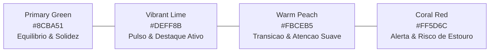

# PRD Core Banking V3 -- Regras de Negocio (RN01--RN06), Casos de Uso & Taxonomia Oficial

Este documento estabelece o **Product Requirements Document (PRD V3)** de engenharia de dominio da plataforma **PFM Core Banking**, especificando as invariantes contabeis obrigatorias (**RN01 a RN06**), a **Taxonomia Oficial de 2 Niveis**, os **Casos de Uso (`UC-01` a `UC-08`)** e os requisitos de governanca SaaS Admin, Familia e LGPD.

---

## 1. Regras de Negocio Fundamentais (RN01 a RN06)

### RN01 -- Segregacao Estrita entre Regime de Competencia e Regime de Caixa

!!! important "Regra de Ouro Contabil (RN01)"
    Toda transacao financeira possui dupla dimensao temporal obrigatoria: **Data de Competencia (`competence_date`)** e **Data de Caixa (`cash_date`)**. E proibido misturar ambos os regimes na apuracao de orcamentos ou fluxo de caixa.

1. **Regime de Competencia (*Accrual Basis*)**:
   - Reconhece o fato gerador no momento da compra/consumo (ou no mes de referencia de cada parcela $i/N$).
   - **Consumo de Orcamento Mensal**: Todo orcamento de categoria (`pfm-budget-service`) e calculado **exclusivamente pelo Regime de Competencia**.
   - **Compras Parceladas no Cartao**: Uma compra de $\text{R\$ } 1.200,00$ em $12\times$ sem juros realizada em 10/Novembro aloca $\text{R\$ } 100,00$ na competencia de Novembro e projeta 11 parcelas futuras de $\text{R\$ } 100,00$ nas competencias subsequentes.
2. **Regime de Caixa (*Cash Basis*)**:
   - Reconhece a saida ou entrada efetiva de liquidez na conta corrente/carteira no dia da liquidacao financeira.
   - **Pagamento da Fatura do Cartao**: A liquidacao da fatura em 10/Dezembro representa um evento de **Caixa** (transferencia entre Conta Corrente $\rightarrow$ Passivo Cartao de Credito), **jamais** devendo ser contabilizada novamente como despesa de orcamento para evitar dupla contagem (*double counting*).

---

### RN02 -- Limite de Cartao de Credito $\neq$ Orcamento Financeiro

!!! warning "Invariante de Produto (RN02)"
    O **Limite Total/Disponivel do Cartao de Credito** e uma linha de risco concedida pelo emissor bancario (gerida pelo `pfm-cards-service`), enquanto o **Orcamento (Budget)** e o teto de gastos planejado pelo usuario por categoria/competencia (gerido pelo `pfm-budget-service`).

| Dimensao | Limite do Cartao (`pfm-cards-service`) | Orcamento Mensal (`pfm-budget-service`) |
| :--- | :--- | :--- |
| **Natureza Contabil** | Capacidade de endividamento rotativo/parcelado no emissor | Meta de alocacao de renda mensal por categoria |
| **Impacto de Compra Parcelada ($\text{R\$ } 1.200$ em $12\times$)** | Consome **$\text{R\$ } 1.200,00$ imediatamente** do Limite Disponivel Total | Consome apenas **$\text{R\$ } 100,00$** no orcamento da competencia atual |
| **Recomposicao** | Recomposto proporcionalmente conforme o pagamento efetivo de cada fatura (Caixa) | Renovado a cada novo ciclo mensal de competencia (`YYYY-MM`) |
| **Alertas Associados** | Alerta de uso de limite de credito ($> 80\%$ do limite do cartao) | Alerta de estouro de orcamento da categoria ($80\%$ Warning / $100\%$ Critical) |

---

### RN03 -- Tratamento de Estornos, Cancelamentos e Chargebacks

Estornos (*refunds* / *chargebacks*) jamais apagam fisicamente (`DELETE`) a transacao original. O historico contabil e **imutavel (Append-Only Ledger)**:

1. **Vinculo Obrigatorio**: Todo estorno gera um lancamento de ajuste reverso (`entry_type = REFUND_CREDIT`) vinculado ao `original_transaction_id` quando identificavel, ou vinculado a categoria original da compra.
2. **Estorno em Fatura Aberta (Mesma Competencia)**:
   - Abate imediatamente o consumo do orcamento na competencia vigente e recompoe o limite disponivel do cartao.
3. **Estorno em Fatura Fechada (Competencia Posterior)**:
   - **Visao de Competencia Historica**: Preserva a rastreabilidade vinculando o credito redutor a categoria original, evitando distorcer artificialmente a renda do mes seguinte como se o estorno fosse "salario/receita".
   - **Visao de Fatura/Caixa**: Gera credito redutor no saldo a pagar da fatura aberta atual (ou saldo credor para a fatura seguinte caso o estorno supere os gastos do ciclo).
4. **Estorno de Compra Parcelada**:
   - Caso o emissor lance o credito integral antecipado ou cancele as parcelas vincendas, o `pfm-cards-service` reconcilia as parcelas futuras pendentes (`CANCELLED_BY_REFUND`) e recompoe o limite total do cartao.

---

### RN04 -- Conciliacao Multiconteudo sem Duplicidade Contabil

Um unico evento economico real (ex.: jantar em restaurante pago com cartao de credito) pode ingressar na plataforma por **ate 3 canais distintos**:
1. Captura do QR Code da **NFC-e** no momento da compra;
2. Lancamento manual ou notificacao no app;
3. Importacao da **Fatura PDF** ao final do ciclo mensal.

**Regras do Motor de Conciliacao (`pfm-reconcile-service`)**:

- **Proibicao de Duplicidade**: Quando a NFC-e e a linha da fatura PDF correspondem a mesma compra, o sistema funde os metadados em um **unico lancamento contabil ativo (`CONCILED`)**, preservando o valor financeiro da fatura/extrato e anexando o detalhamento de itens fiscais da NFC-e.
- **Criterios de Matching Automatico (Score $\ge 0.90$)**:
  - Igualdade de `tenant_id`;
  - Diferenca absoluta de valor $|\Delta V| \le \text{R\$ } 0,05$ (tolerancia para arredondamento de bomba de combustivel/balanca);
  - Diferenca temporal $|\Delta t| \le 48\text{ horas}$ entre a emissao da NFC-e e a data da transacao na fatura;
  - Similaridade de CNPJ raiz ou nome fantasia (*Jaro-Winkler / Trigram similarity* $\ge 0.75$).
- **Conciliacao Assistida**: Quando $0.60 \le \text{Score} < 0.90$, o registro entra na fila de revisao do usuario com sugestao em 1 clique no Portal Web / App Mobile.

---

### RN05 -- Multitenancy Estrito & Isolamento Zero-Trust

1. **Identidade Imutavel do Tenant**: O `tenant_id` (UUID v4/v7) nunca e aceito a partir do corpo da requisicao JSON enviada pelo cliente; ele e extraido exclusivamente da assinatura criptografica validada do token JWT (`sub`/`tenant_id` claim) no API Gateway e propagado via mTLS metadata.
2. **Isolamento no Banco de Dados (PostgreSQL RLS)**:
   - Todas as tabelas de todos os schemas possuem `tenant_id UUID NOT NULL` e politica `ROW LEVEL SECURITY` forcada (`FORCE ROW LEVEL SECURITY`).
   - Qualquer query executada sem `app.current_tenant_id` definido na sessao transacional retorna zero linhas ou lanca excecao de seguranca.
3. **Isolamento no Cache e Mensageria**:
   - Chaves Redis seguem o prefixo obrigatorio `tenant:{tenant_id}:{domain}:{key}`.
   - Topicos Kafka utilizam `tenant_id` como chave de particao e cabecalho autenticado, e chaves criptograficas DEK sao segregadas por tenant via Envelope Encryption (KMS).

---

### RN06 -- Precisao Decimal Bancaria e Distribuicao de Residuo em Parcelas

!!! danger "Proibicao Absoluta de Ponto Flutuante (IEEE 754)"
    E terminantemente proibido o uso de `float`, `double`, `FLOAT4`, `FLOAT8` ou `Number` (JavaScript sem biblioteca decimal) para representar valores monetarios, taxas ou percentuais de rateio em qualquer camada da plataforma.

1. **Representacao Persistente e em Memoria**:
   - **PostgreSQL**: Tipo `NUMERIC(19, 4)` para valores monetarios e `NUMERIC(19, 2)` para exibicao final em moeda fiduciaria (`BRL`).
   - **Java 25**: `java.math.BigDecimal` com escala explicita e `RoundingMode.HALF_EVEN` (Arredondamento Bancario ABNT NBR 5891).
   - **Golang**: Inteiros em centavos/ decimos de milesimo (`int64` scaled) ou `shopspring/decimal`.
   - **Python**: `decimal.Decimal` com contexto `ROUND_HALF_EVEN`.
2. **Formula de Desdobramento de Parcelas e Residuo de Centavos**:
   Seja $V_{\text{total}}$ o valor total de uma compra parcelada em $N$ parcelas ($N \ge 2$):
   - Valor base da parcela:
     $$V_{\text{base}} = \text{floor\_cents}\left(\frac{V_{\text{total}}}{N}\right)$$
   - Residuo aritmetico de centavos:
     $$R = V_{\text{total}} - (V_{\text{base}} \times N)$$
   - **Regra de Alocacao do Residuo**: O residuo $R$ e integralmente alocado na **1a parcela ($i = 1$)**, garantindo que a soma exata das parcelas seja sempre identica ao total da compra:
     $$V_1 = V_{\text{base}} + R, \quad V_i = V_{\text{base}} \;\;\forall i \in \{2, \dots, N\} \implies \sum_{i=1}^{N} V_i = V_{\text{total}}$$
   - *Exemplo Pratico*: Compra de $\text{R\$ } 100,00$ em $3\times$:
     - $1\text{a Parcela} = \text{R\$ } 33,34$
     - $2\text{a Parcela} = \text{R\$ } 33,33$
     - $3\text{a Parcela} = \text{R\$ } 33,33$
     - $\text{Soma} = \text{R\$ } 100,00$ (Zero perda ou criacao de centavos).

---

## 2. Taxonomia Oficial de 2 Niveis (Categorias & Subcategorias)

Toda movimentacao financeira na plataforma PFM Core Banking e classificada obrigatoriamente em uma estrutura hierarquica estrita de **2 Niveis**: **Categoria Principal (Nivel 1)** e **Subcategoria (Nivel 2)**. Nao sao permitidas transacoes orfas (sem Nivel 2) nem arvores de profundidade arbitraria que degradem a agregacao analitica.

| Codigo N1 | Categoria Principal (Nivel 1) | Natureza | Subcategorias Oficiais (Nivel 2) |
| :--- | :--- | :---: | :--- |
| **`MORADIA`** | Moradia & Utilidades | Despesa Essencial | `ALUGUEL_CONDOMINIO`, `FINANCIAMENTO_IMOBILIARIO`, `ENERGIA_ELETRICA`, `AGUA_SANEAMENTO`, `GAS_ENCANADO`, `INTERNET_TV_TELEFONIA`, `MANUTENCAO_REPAROS`, `IPTU_TAXAS_MUNICIPAIS` |
| **`ALIMENTACAO`** | Alimentacao & Supermercado | Despesa Essencial / Variavel | `SUPERMERCADO_MERCEARIA`, `PADARIA_FEIRA_ACOUGUE`, `RESTAURANTES_GASTRONOMIA`, `DELIVERY_APLICATIVOS`, `CAFE_LANCHES` |
| **`TRANSPORTE`** | Transporte & Mobilidade | Despesa Essencial / Variavel | `COMBUSTIVEL_ETANOL_GASOLINA`, `APLICATIVOS_MOBILIDADE`, `TRANSPORTE_PUBLICO`, `ESTACIONAMENTO_PEDAGIO`, `MANUTENCAO_VEICULAR`, `SEGURO_IPVA_LICENCIAMENTO` |
| **`SAUDE`** | Saude & Bem-Estar | Despesa Essencial | `PLANO_SAUDE`, `FARMACIA_MEDICAMENTOS`, `CONSULTAS_EXAMES`, `ODONTOLOGIA`, `TERAPIA_PSICOLOGIA`, `ACADEMIA_ATIVIDADE_FISICA` |
| **`EDUCACAO`** | Educacao & Desenvolvimento | Investimento Pessoal | `MENSALIDADE_ESCOLAR_FACULDADE`, `CURSOS_CERTIFICACOES`, `LIVROS_MATERIAL_DIDATICO`, `IDIOMAS` |
| **`LAZER`** | Lazer, Cultura & Estilo de Vida | Despesa Variavel / Estilo de Vida | `STREAMING_ASSINATURAS_DIGITAIS`, `VIAGENS_HOSPEDAGEM`, `PASSAGENS_AEREAS`, `CINEMA_SHOWS_EVENTOS`, `HOBBIES_JOGOS`, `VESTUARIO_CALCADOS`, `CUIDADOS_PESSOAIS_BELEZA`, `PETS_VETERINARIO` |
| **`FINANCEIRO`** | Servicos Financeiros & Impostos | Despesa Financeira | `IOF_IMPOSTOS_FINANCEIROS`, `ANUIDADE_TARIFAS_BANCARIAS`, `JUROS_ENCARGOS_ROTATIVO`, `SEGURO_VIDA_PATRIMONIAL`, `IRPF_TRIBUTOS_FEDERAIS` |
| **`RECEITAS`** | Receitas & Entradas | Entrada de Caixa / Competencia | `SALARIO_PRO_LABORE`, `BONUS_PLR_13_SALARIO`, `RENDIMENTOS_DIVIDENDOS`, `FREELANCE_PRESTACAO_SERVICOS`, `REEMBOLSO_CORPORATIVO`, `ESTORNO_CREDITO` |
| **`PATRIMONIO`** | Investimentos & Movimentacoes Neutras | Neutro (Patrimonial / Caixa) | `APORTE_RENDA_FIXA`, `APORTE_RENDA_VARIAVEL`, `RESERVA_EMERGENCIA`, `PAGAMENTO_FATURA_CARTAO`, `TRANSFERENCIA_MESMA_TITULARIDADE` |
| **`OUTROS`** | Outros & Pendencias de Classificacao | Transitorio / Diversos | `DOACOES_PRESENTES`, `DESPESAS_EVENTUAIS`, `NAO_CATEGORIZADO` |

---

## 3. Requisitos de Plataforma, Gestao de Acesso & Governanca de Tenants

### 3.1. Gestao de Tenants, Planos & Assinaturas SaaS (Painel SaaS Admin -- `US-12`)

A plataforma opera sob o modelo de **Software as a Service (SaaS) Multi-Tenant**, onde cada familia ou conta individual constitui um `tenant` logico isolado via **PostgreSQL Row-Level Security (RLS)** e chaves KMS exclusivas:

1. **Matriz de Planos & Quotas Operacionais**:
   - **`FREE`**: 1 membro familiar, 1 cartao de credito, ate 3 uploads de faturas PDF por mes, categorizacao deterministica (L1) e sem projecao preditiva.
   - **`INDIVIDUAL_PRO`**: 1 titular, cartoes e contas ilimitados, categorizacao IA completa (L1/L2/L3), conciliacao automatica com cupons NFC-e e projecao de fluxo de caixa em 90 dias.
   - **`FAMILY_PLUS`**: Ate 5 membros familiares, rateios entre membros, cartoes/contas ilimitados, tetos individuais de gastos, cofre de senhas de cartoes cifrado via KMS e exportacao fiscal completa.
2. **Ciclo de Vida da Assinatura**:
   - `TRIAL`: Periodo de experimentacao de 14 dias com recursos do plano `FAMILY_PLUS`.
   - `ACTIVE`: Assinatura adimplente com renovacao automatica via PIX ou Cartao.
   - `PAST_DUE`: Tolerancia de 5 dias corridos apos tentativa frustrada de cobranca, exibindo alerta suave no portal sem bloquear operacoes essenciais.
   - `SUSPENDED`: Acesso em modo somente leitura (*read-only*), permitindo exportacao dos dados contabeis pelo titular, mas bloqueando novas ingestoes e processamentos de IA.
3. **Isolamento Zero-Trust & Auditoria Imutavel no Painel SaaS Admin**:
   - Usuarios com o perfil `PLATFORM_ADMIN` visualizam metricas agregadas do sistema (quantidade total de tenants ativos, volume de transacoes por minuto, taxa de erro de chamadas, faturamento e quotas de IA).
   - **Garantia Arquitetural**: Sob nenhuma hipotese o `PLATFORM_ADMIN` tem permissao de consultar tabelas de lancamentos contabeis (`ledger_entries`), faturas (`card_statements`) ou orcamentos (`budget_plans`) pertencentes aos tenants, assegurando sigilo financeiro irrestrito garantido por RLS e criptografia KMS. Toda alteracao de plano ou suspensao grava registro na tabela `audit_log` append-only (ADR-010).

---

### 3.2. Central de Perfil, Familia & Controles do Usuario (`US-13`)

1. **Hierarquia e Funcoes de Acesso Familiar**:
   - **`OWNER` (Titular Financeiro)**: Responsavel legal e administrador da assinatura do tenant. Pode convidar/remover membros, configurar limites globais e por categoria, solicitar exportacao completa e gerenciar chaves.
   - **`MEMBER` (Membro Familiar Ativo)**: Pode registrar transacoes, escanear cupons NFC-e, fazer upload de suas proprias faturas e visualizar seu proprio consumo em relacao ao teto mensal atribuido.
   - **`VIEWER` (Membro Observador)**: Acesso exclusivo de visualizacao para acompanhamento educacional ou consultoria contabil familiar, sem permissao de mutacao de saldo ou alteracao de configuracoes.
2. **Cofre Criptografado de Cartoes e Contas**:
   - Gestao de metadados de cartoes de credito e contas com dados sensiveis (numeros de cartao, tokens bancarios) cifrados via **Envelope Encryption (KMS)** com a *Data Encryption Key (DEK)* exclusiva daquele `tenant_id`.
3. **Direitos do Titular sob a LGPD & Exclusao Criptografica (*Crypto-Shredding*)**:
   - **Exportacao de Dados**: Geracao sob demanda de pacote completo dos lancamentos contabeis em formato aberto (`JSON` e `CSV` estruturados) assinado digitalmente.
   - **Exclusao Criptografica (*Crypto-Shredding*)**: Em caso de solicitacao de encerramento definitivo de conta pelo titular, a plataforma destroi a DEK do tenant no KMS e marca os registros como expurgados. Mesmo que backups em fita ou snapshots historicos existam, os dados permanecem matematicamente indecifraveis para sempre.

---

## 4. Especificacao dos Casos de Uso Oficiais da Plataforma (`UC-01` a `UC-08`)

| Caso de Uso | Titulo do Caso de Uso | Ator Principal | Repositorios Centrais | Resumo Executivo & Invariantes de Negocio |
| :---: | :--- | :--- | :--- | :--- |
| **`UC-01`** | Ingestao PDF em RAM + Checksum + Idempotencia | Titular (`OWNER`) | `pfm-ingestion-bff-go`, `pfm-core-ledger-java` | Parsing de fatura de cartao 100% em memoria volatil (Zero-Disk), validacao de `diff = 0.0000` entre soma dos lancamentos e total declarado, e bloqueio de duplicatas via hash SHA-256. |
| **`UC-02`** | Desdobramento de Parcelas e Residuo Decimal Bancario | Titular (`OWNER`), Membro (`MEMBER`) | `pfm-core-ledger-java` | Compra parcelada em $N\times$ com alocacao do residuo de centavos na 1a parcela (`RN06`), sem uso de ponto flutuante IEEE 754, garantindo soma exata do valor original. |
| **`UC-03`** | Apuracao de Regime de Caixa vs. Regime de Competencia | Titular (`OWNER`) | `pfm-core-ledger-java` | Segregacao estrita entre data da compra (Competencia - afeta orcamento do mes) e data de pagamento da fatura (Caixa - afeta saldo em conta) conforme `RN01`. |
| **`UC-04`** | Categorizacao Inteligente em 3 Camadas (L1/L2/L3) | Sistema / Motor IA | `pfm-ai-worker-python` (Lambda Arm64), `pfm-core-ledger-java` | Classificacao na Taxonomia Oficial de 2 Niveis via Worker Serverless Event-Driven (ADR-009), sem conexao direta ao PostgreSQL: L1 Regex/Redis, L2 ONNX $<12\text{ms}$ e L3 Cloud LLM anonimizado. |
| **`UC-05`** | Projecao Preditiva de Fluxo de Caixa (Forecast) | Titular (`OWNER`) | `pfm-forecast-engine-go` | Simulacao de liquidez futura para os proximos 30, 60 e 90 dias com base em gastos recorrentes, parcelas contratadas e sazonalidade historica. |
| **`UC-06`** | Notificacao Proativa de Limiar de Orcamento e Anomalias | Sistema / Alertas | `pfm-forecast-engine-go`, `pfm-web-nextjs` | Disparo automatico de alertas quando o consumo de uma categoria atinge 80% e 100% do teto, ou quando uma despesa foge do padrao historico da familia. |
| **`UC-07`** | Painel SaaS Admin (Gestao de Tenants, Planos e Quotas) | Administrador (`PLATFORM_ADMIN`) | `pfm-core-ledger-java`, `pfm-web-nextjs` | Monitoramento global de tenants, status de assinatura (`TRIAL`, `ACTIVE`, `SUSPENDED`), consumo de quotas de IA e storage sem expor dados financeiros privados dos clientes. |
| **`UC-08`** | Central de Perfil, Gestao Familiar e Crypto-Shredding | Titular (`OWNER`) | `pfm-core-ledger-java`, `pfm-ingestion-bff-go` | Convidar membros familiares com papeis (`MEMBER`, `VIEWER`), definir tetos de gastos por membro, exportar historico contabil (LGPD) e executar expurgo criptografico irrecuperavel. |

---

## 5. Arquitetura de Experiencia & Design System ("Organic Financial Pulse" -- `US-14`)

A experiencia visual e de interacao da plataforma PFM Core Banking e concebida sob o conceito **"Organic Financial Pulse"**, combinando precisao contabil bancaria com o refinamento artesanal de interfaces dos ecossistemas Apple e Adobe Craft:

### 5.1. Paleta de Cores Oficial ("Organic Financial Pulse")

- **`#8CBA51` (Organic Olive/Green -- Primaria)**: Cor estrutural para barras de navegacao, status de saude financeira positiva, saldos consolidados e indicadores de metas atingidas.
- **`#DEFF8B` (Vibrant Lime/Pulse -- Secundaria / Accent Ativo)**: Ponto de luz e vibracao para micro-interacoes, botoes de acao primaria (CTA), badges de novidade e *pulso* de sincronizacao em tempo real.
- **`#FBCEB5` (Warm Peach -- Atencao Suave / Transicao)**: Indicacao de aviso preventivo (consumo entre 80% e 99% do orcamento), vencimento proximo de fatura (`D-3`) e itens pendentes de conciliacao.
- **`#FF5D6C` (Coral Red -- Alerta Critico / Debito)**: Indicacao clara de limite estourado, saldo devedor atrasado, parcelas com juros rotativos e erros de validacao financeira.

### 5.2. Principios de Layout & Tipografia (Apple/Adobe Craft)

1. **Layout Responsivo *Fluid Full-Width***:
   - Em desktops widescreen (telas 1080p, 1440p e 4K), o dashboard aproveita a amplitude horizontal de forma balanceada sem espacos mortos excessivos nem barras de rolagem horizontais.
   - Em smartphones (mobile web e PWA), os componentes se reorganizam fluidamente em cards verticais com gestos de toque (*swipe to categorize*, *pull to sync*).
2. **Tipografia Refinada & Legibilidade Numerica**:
   - Fonte primaria: Familia tipografica *San Francisco (SF Pro)* no iOS/macOS e *Inter* nos demais sistemas operacionais, com variantes mono-espacadas (`SF Mono` / `JetBrains Mono`) para todos os valores monetarios `NUMERIC(19,4)`.
   - Alinhamento decimal obrigatorio a direita em tabelas financeiras para leitura instantanea de ordens de grandeza.
3. **Mapeamento das Jornadas Guiadas (`UC-01` a `UC-08`)**:
   - Cada caso de uso e estruturado como uma **jornada conversacional e visual guiada**: por exemplo, no `UC-01`, o usuario arrasta o PDF da fatura, visualiza a animacao de conferencia em tempo real dos centavos contra o total declarado e recebe o selo de conciliacao verde instantaneo.

