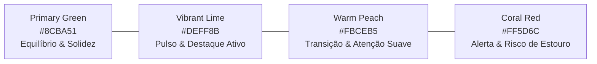

# PRD Core Banking V3 — Regras de Negócio (RN01–RN06), Casos de Uso & Taxonomia Oficial

Este documento estabelece o **Product Requirements Document (PRD V3)** de engenharia de domínio da plataforma **PFM Core Banking**, especificando as invariantes contábeis obrigatórias (**RN01 a RN06**), a **Taxonomia Oficial de 2 Níveis**, os **Casos de Uso (`UC-01` a `UC-08`)** e os requisitos de governança SaaS Admin, Família e LGPD.

---

## 1. Regras de Negócio Fundamentais (RN01 a RN06)

### RN01 — Segregação Estrita entre Regime de Competência e Regime de Caixa

!!! important "Regra de Ouro Contábil (RN01)"
    Toda transação financeira possui dupla dimensão temporal obrigatória: **Data de Competência (`competence_date`)** e **Data de Caixa (`cash_date`)**. É proibido misturar ambos os regimes na apuração de orçamentos ou fluxo de caixa.

1. **Regime de Competência (*Accrual Basis*)**:
   - Reconhece o fato gerador no momento da compra/consumo (ou no mês de referência de cada parcela $i/N$).
   - **Consumo de Orçamento Mensal**: Todo orçamento de categoria (`pfm-budget-service`) é calculado **exclusivamente pelo Regime de Competência**.
   - **Compras Parceladas no Cartão**: Uma compra de $\text{R\$ } 1.200,00$ em $12\times$ sem juros realizada em 10/Novembro aloca $\text{R\$ } 100,00$ na competência de Novembro e projeta 11 parcelas futuras de $\text{R\$ } 100,00$ nas competências subsequentes.
2. **Regime de Caixa (*Cash Basis*)**:
   - Reconhece a saída ou entrada efetiva de liquidez na conta corrente/carteira no dia da liquidação financeira.
   - **Pagamento da Fatura do Cartão**: A liquidação da fatura em 10/Dezembro representa um evento de **Caixa** (transferência entre Conta Corrente $\rightarrow$ Passivo Cartão de Crédito), **jamais** devendo ser contabilizada novamente como despesa de orçamento para evitar dupla contagem (*double counting*).

---

### RN02 — Limite de Cartão de Crédito $\neq$ Orçamento Financeiro

!!! warning "Invariante de Produto (RN02)"
    O **Limite Total/Disponível do Cartão de Crédito** é uma linha de risco concedida pelo emissor bancário (gerida pelo `pfm-cards-service`), enquanto o **Orçamento (Budget)** é o teto de gastos planejado pelo usuário por categoria/competência (gerido pelo `pfm-budget-service`).

| Dimensão | Limite do Cartão (`pfm-cards-service`) | Orçamento Mensal (`pfm-budget-service`) |
| :--- | :--- | :--- |
| **Natureza Contábil** | Capacidade de endividamento rotativo/parcelado no emissor | Meta de alocação de renda mensal por categoria |
| **Impacto de Compra Parcelada ($\text{R\$ } 1.200$ em $12\times$)** | Consome **$\text{R\$ } 1.200,00$ imediatamente** do Limite Disponível Total | Consome apenas **$\text{R\$ } 100,00$** no orçamento da competência atual |
| **Recomposição** | Recomposto proporcionalmente conforme o pagamento efetivo de cada fatura (Caixa) | Renovado a cada novo ciclo mensal de competência (`YYYY-MM`) |
| **Alertas Associados** | Alerta de uso de limite de crédito ($> 80\%$ do limite do cartão) | Alerta de estouro de orçamento da categoria ($80\%$ Warning / $100\%$ Critical) |

---

### RN03 — Tratamento de Estornos, Cancelamentos e Chargebacks

Estornos (*refunds* / *chargebacks*) jamais apagam fisicamente (`DELETE`) a transação original. O histórico contábil é **imutável (Append-Only Ledger)**:

1. **Vínculo Obrigatório**: Todo estorno gera um lançamento de ajuste reverso (`entry_type = REFUND_CREDIT`) vinculado ao `original_transaction_id` quando identificável, ou vinculado à categoria original da compra.
2. **Estorno em Fatura Aberta (Mesma Competência)**:
   - Abate imediatamente o consumo do orçamento na competência vigente e recompõe o limite disponível do cartão.
3. **Estorno em Fatura Fechada (Competência Posterior)**:
   - **Visão de Competência Histórica**: Preserva a rastreabilidade vinculando o crédito redutor à categoria original, evitando distorcer artificialmente a renda do mês seguinte como se o estorno fosse "salário/receita".
   - **Visão de Fatura/Caixa**: Gera crédito redutor no saldo a pagar da fatura aberta atual (ou saldo credor para a fatura seguinte caso o estorno supere os gastos do ciclo).
4. **Estorno de Compra Parcelada**:
   - Caso o emissor lance o crédito integral antecipado ou cancele as parcelas vincendas, o `pfm-cards-service` reconcilia as parcelas futuras pendentes (`CANCELLED_BY_REFUND`) e recompõe o limite total do cartão.

---

### RN04 — Conciliação Multiconteúdo sem Duplicidade Contábil

Um único evento econômico real (ex.: jantar em restaurante pago com cartão de crédito) pode ingressar na plataforma por **até 3 canais distintos**:
1. Captura do QR Code da **NFC-e** no momento da compra;
2. Lançamento manual ou notificação no app;
3. Importação da **Fatura PDF** ao final do ciclo mensal.

**Regras do Motor de Conciliação (`pfm-reconcile-service`)**:

- **Proibição de Duplicidade**: Quando a NFC-e e a linha da fatura PDF correspondem à mesma compra, o sistema funde os metadados em um **único lançamento contábil ativo (`CONCILED`)**, preservando o valor financeiro da fatura/extrato e anexando o detalhamento de itens fiscais da NFC-e.
- **Critérios de Matching Automático (Score $\ge 0.90$)**:
  - Igualdade de `tenant_id`;
  - Diferença absoluta de valor $|\Delta V| \le \text{R\$ } 0,05$ (tolerância para arredondamento de bomba de combustível/balança);
  - Diferença temporal $|\Delta t| \le 48\text{ horas}$ entre a emissão da NFC-e e a data da transação na fatura;
  - Similaridade de CNPJ raiz ou nome fantasia (*Jaro-Winkler / Trigram similarity* $\ge 0.75$).
- **Conciliação Assistida**: Quando $0.60 \le \text{Score} < 0.90$, o registro entra na fila de revisão do usuário com sugestão em 1 clique no Portal Web / App Mobile.

---

### RN05 — Multitenancy Estrito & Isolamento Zero-Trust

1. **Identidade Imutável do Tenant**: O `tenant_id` (UUID v4/v7) nunca é aceito a partir do corpo da requisição JSON enviada pelo cliente; ele é extraído exclusivamente da assinatura criptográfica validada do token JWT (`sub`/`tenant_id` claim) no API Gateway e propagado via mTLS metadata.
2. **Isolamento no Banco de Dados (PostgreSQL RLS)**:
   - Todas as tabelas de todos os schemas possuem `tenant_id UUID NOT NULL` e política `ROW LEVEL SECURITY` forçada (`FORCE ROW LEVEL SECURITY`).
   - Qualquer query executada sem `app.current_tenant_id` definido na sessão transacional retorna zero linhas ou lança exceção de segurança.
3. **Isolamento no Cache e Mensageria**:
   - Chaves Redis seguem o prefixo obrigatório `tenant:{tenant_id}:{domain}:{key}`.
   - Tópicos Kafka utilizam `tenant_id` como chave de partição e cabeçalho autenticado, e chaves criptográficas DEK são segregadas por tenant via Envelope Encryption (KMS).

---

### RN06 — Precisão Decimal Bancária e Distribuição de Resíduo em Parcelas

!!! danger "Proibição Absoluta de Ponto Flutuante (IEEE 754)"
    É terminantemente proibido o uso de `float`, `double`, `FLOAT4`, `FLOAT8` ou `Number` (JavaScript sem biblioteca decimal) para representar valores monetários, taxas ou percentuais de rateio em qualquer camada da plataforma.

1. **Representação Persistente e em Memória**:
   - **PostgreSQL**: Tipo `NUMERIC(19, 4)` para valores monetários e `NUMERIC(19, 2)` para exibição final em moeda fiduciária (`BRL`).
   - **Java 25**: `java.math.BigDecimal` com escala explícita e `RoundingMode.HALF_EVEN` (Arredondamento Bancário ABNT NBR 5891).
   - **Golang**: Inteiros em centavos/ décimos de milésimo (`int64` scaled) ou `shopspring/decimal`.
   - **Python**: `decimal.Decimal` com contexto `ROUND_HALF_EVEN`.
2. **Fórmula de Desdobramento de Parcelas e Resíduo de Centavos**:
   Seja $V_{\text{total}}$ o valor total de uma compra parcelada em $N$ parcelas ($N \ge 2$):
   - Valor base da parcela:
     $$V_{\text{base}} = \text{floor\_cents}\left(\frac{V_{\text{total}}}{N}\right)$$
   - Resíduo aritmético de centavos:
     $$R = V_{\text{total}} - (V_{\text{base}} \times N)$$
   - **Regra de Alocação do Resíduo**: O resíduo $R$ é integralmente alocado na **1ª parcela ($i = 1$)**, garantindo que a soma exata das parcelas seja sempre idêntica ao total da compra:
     $$V_1 = V_{\text{base}} + R, \quad V_i = V_{\text{base}} \;\;\forall i \in \{2, \dots, N\} \implies \sum_{i=1}^{N} V_i = V_{\text{total}}$$
   - *Exemplo Prático*: Compra de $\text{R\$ } 100,00$ em $3\times$:
     - $1\text{ª Parcela} = \text{R\$ } 33,34$
     - $2\text{ª Parcela} = \text{R\$ } 33,33$
     - $3\text{ª Parcela} = \text{R\$ } 33,33$
     - $\text{Soma} = \text{R\$ } 100,00$ (Zero perda ou criação de centavos).

---

## 2. Taxonomia Oficial de 2 Níveis (Categorias & Subcategorias)

Toda movimentação financeira na plataforma PFM Core Banking é classificada obrigatoriamente em uma estrutura hierárquica estrita de **2 Níveis**: **Categoria Principal (Nível 1)** e **Subcategoria (Nível 2)**. Não são permitidas transações órfãs (sem Nível 2) nem árvores de profundidade arbitrária que degradem a agregação analítica.

| Código N1 | Categoria Principal (Nível 1) | Natureza | Subcategorias Oficiais (Nível 2) |
| :--- | :--- | :---: | :--- |
| **`MORADIA`** | Moradia & Utilidades | Despesa Essencial | `ALUGUEL_CONDOMINIO`, `FINANCIAMENTO_IMOBILIARIO`, `ENERGIA_ELETRICA`, `AGUA_SANEAMENTO`, `GAS_ENCANADO`, `INTERNET_TV_TELEFONIA`, `MANUTENCAO_REPAROS`, `IPTU_TAXAS_MUNICIPAIS` |
| **`ALIMENTACAO`** | Alimentação & Supermercado | Despesa Essencial / Variável | `SUPERMERCADO_MERCEARIA`, `PADARIA_FEIRA_ACOUGUE`, `RESTAURANTES_GASTRONOMIA`, `DELIVERY_APLICATIVOS`, `CAFE_LANCHES` |
| **`TRANSPORTE`** | Transporte & Mobilidade | Despesa Essencial / Variável | `COMBUSTIVEL_ETANOL_GASOLINA`, `APLICATIVOS_MOBILIDADE`, `TRANSPORTE_PUBLICO`, `ESTACIONAMENTO_PEDAGIO`, `MANUTENCAO_VEICULAR`, `SEGURO_IPVA_LICENCIAMENTO` |
| **`SAUDE`** | Saúde & Bem-Estar | Despesa Essencial | `PLANO_SAUDE`, `FARMACIA_MEDICAMENTOS`, `CONSULTAS_EXAMES`, `ODONTOLOGIA`, `TERAPIA_PSICOLOGIA`, `ACADEMIA_ATIVIDADE_FISICA` |
| **`EDUCACAO`** | Educação & Desenvolvimento | Investimento Pessoal | `MENSALIDADE_ESCOLAR_FACULDADE`, `CURSOS_CERTIFICACOES`, `LIVROS_MATERIAL_DIDATICO`, `IDIOMAS` |
| **`LAZER`** | Lazer, Cultura & Estilo de Vida | Despesa Variável / Estilo de Vida | `STREAMING_ASSINATURAS_DIGITAIS`, `VIAGENS_HOSPEDAGEM`, `PASSAGENS_AEREAS`, `CINEMA_SHOWS_EVENTOS`, `HOBBIES_JOGOS`, `VESTUARIO_CALCADOS`, `CUIDADOS_PESSOAIS_BELEZA`, `PETS_VETERINARIO` |
| **`FINANCEIRO`** | Serviços Financeiros & Impostos | Despesa Financeira | `IOF_IMPOSTOS_FINANCEIROS`, `ANUIDADE_TARIFAS_BANCARIAS`, `JUROS_ENCARGOS_ROTATIVO`, `SEGURO_VIDA_PATRIMONIAL`, `IRPF_TRIBUTOS_FEDERAIS` |
| **`RECEITAS`** | Receitas & Entradas | Entrada de Caixa / Competência | `SALARIO_PRO_LABORE`, `BONUS_PLR_13_SALARIO`, `RENDIMENTOS_DIVIDENDOS`, `FREELANCE_PRESTACAO_SERVICOS`, `REEMBOLSO_CORPORATIVO`, `ESTORNO_CREDITO` |
| **`PATRIMONIO`** | Investimentos & Movimentações Neutras | Neutro (Patrimonial / Caixa) | `APORTE_RENDA_FIXA`, `APORTE_RENDA_VARIAVEL`, `RESERVA_EMERGENCIA`, `PAGAMENTO_FATURA_CARTAO`, `TRANSFERENCIA_MESMA_TITULARIDADE` |
| **`OUTROS`** | Outros & Pendências de Classificação | Transitório / Diversos | `DOACOES_PRESENTES`, `DESPESAS_EVENTUAIS`, `NAO_CATEGORIZADO` |

---

## 3. Requisitos de Plataforma, Gestão de Acesso & Governança de Tenants

### 3.1. Gestão de Tenants, Planos & Assinaturas SaaS (Painel SaaS Admin — `US-12`)

A plataforma opera sob o modelo de **Software as a Service (SaaS) Multi-Tenant**, onde cada família ou conta individual constitui um `tenant` lógico isolado via **PostgreSQL Row-Level Security (RLS)** e chaves KMS exclusivas:

1. **Matriz de Planos & Quotas Operacionais**:
   - **`FREE`**: 1 membro familiar, 1 cartão de crédito, até 3 uploads de faturas PDF por mês, categorização determinística (L1) e sem projeção preditiva.
   - **`INDIVIDUAL_PRO`**: 1 titular, cartões e contas ilimitados, categorização IA completa (L1/L2/L3), conciliação automática com cupons NFC-e e projeção de fluxo de caixa em 90 dias.
   - **`FAMILY_PLUS`**: Até 5 membros familiares, rateios entre membros, cartões/contas ilimitados, tetos individuais de gastos, cofre de senhas de cartões cifrado via KMS e exportação fiscal completa.
2. **Ciclo de Vida da Assinatura**:
   - `TRIAL`: Período de experimentação de 14 dias com recursos do plano `FAMILY_PLUS`.
   - `ACTIVE`: Assinatura adimplente com renovação automática via PIX ou Cartão.
   - `PAST_DUE`: Tolerância de 5 dias corridos após tentativa frustrada de cobrança, exibindo alerta suave no portal sem bloquear operações essenciais.
   - `SUSPENDED`: Acesso em modo somente leitura (*read-only*), permitindo exportação dos dados contábeis pelo titular, mas bloqueando novas ingestões e processamentos de IA.
3. **Isolamento Zero-Trust & Auditoria Imutável no Painel SaaS Admin**:
   - Usuários com o perfil `PLATFORM_ADMIN` visualizam métricas agregadas do sistema (quantidade total de tenants ativos, volume de transações por minuto, taxa de erro de chamadas, faturamento e quotas de IA).
   - **Garantia Arquitetural**: Sob nenhuma hipótese o `PLATFORM_ADMIN` tem permissão de consultar tabelas de lançamentos contábeis (`ledger_entries`), faturas (`card_statements`) ou orçamentos (`budget_plans`) pertencentes aos tenants, assegurando sigilo financeiro irrestrito garantido por RLS e criptografia KMS. Toda alteração de plano ou suspensão grava registro na tabela `audit_log` append-only (ADR-010).

---

### 3.2. Central de Perfil, Família & Controles do Usuário (`US-13`)

1. **Hierarquia e Funções de Acesso Familiar**:
   - **`OWNER` (Titular Financeiro)**: Responsável legal e administrador da assinatura do tenant. Pode convidar/remover membros, configurar limites globais e por categoria, solicitar exportação completa e gerenciar chaves.
   - **`MEMBER` (Membro Familiar Ativo)**: Pode registrar transações, escanear cupons NFC-e, fazer upload de suas próprias faturas e visualizar seu próprio consumo em relação ao teto mensal atribuído.
   - **`VIEWER` (Membro Observador)**: Acesso exclusivo de visualização para acompanhamento educacional ou consultoria contábil familiar, sem permissão de mutação de saldo ou alteração de configurações.
2. **Cofre Criptografado de Cartões e Contas**:
   - Gestão de metadados de cartões de crédito e contas com dados sensíveis (números de cartão, tokens bancários) cifrados via **Envelope Encryption (KMS)** com a *Data Encryption Key (DEK)* exclusiva daquele `tenant_id`.
3. **Direitos do Titular sob a LGPD & Exclusão Criptográfica (*Crypto-Shredding*)**:
   - **Exportação de Dados**: Geração sob demanda de pacote completo dos lançamentos contábeis em formato aberto (`JSON` e `CSV` estruturados) assinado digitalmente.
   - **Exclusão Criptográfica (*Crypto-Shredding*)**: Em caso de solicitação de encerramento definitivo de conta pelo titular, a plataforma destrói a DEK do tenant no KMS e marca os registros como expurgados. Mesmo que backups em fita ou snapshots históricos existam, os dados permanecem matematicamente indecifráveis para sempre.

---

## 4. Especificação dos Casos de Uso Oficiais da Plataforma (`UC-01` a `UC-08`)

| Caso de Uso | Título do Caso de Uso | Ator Principal | Repositórios Centrais | Resumo Executivo & Invariantes de Negócio |
| :---: | :--- | :--- | :--- | :--- |
| **`UC-01`** | Ingestão PDF em RAM + Checksum + Idempotência | Titular (`OWNER`) | `pfm-ingestion-bff-go`, `pfm-core-ledger-java` | Parsing de fatura de cartão 100% em memória volátil (Zero-Disk), validação de `diff = 0.0000` entre soma dos lançamentos e total declarado, e bloqueio de duplicatas via hash SHA-256. |
| **`UC-02`** | Desdobramento de Parcelas e Resíduo Decimal Bancário | Titular (`OWNER`), Membro (`MEMBER`) | `pfm-core-ledger-java` | Compra parcelada em $N\times$ com alocação do resíduo de centavos na 1ª parcela (`RN06`), sem uso de ponto flutuante IEEE 754, garantindo soma exata do valor original. |
| **`UC-03`** | Apuração de Regime de Caixa vs. Regime de Competência | Titular (`OWNER`) | `pfm-core-ledger-java` | Segregação estrita entre data da compra (Competência - afeta orçamento do mês) e data de pagamento da fatura (Caixa - afeta saldo em conta) conforme `RN01`. |
| **`UC-04`** | Categorização Inteligente em 3 Camadas (L1/L2/L3) | Sistema / Motor IA | `pfm-ai-worker-python` (Lambda Arm64), `pfm-core-ledger-java` | Classificação na Taxonomia Oficial de 2 Níveis via Worker Serverless Event-Driven (ADR-009), sem conexão direta ao PostgreSQL: L1 Regex/Redis, L2 ONNX $<12\text{ms}$ e L3 Cloud LLM anonimizado. |
| **`UC-05`** | Projeção Preditiva de Fluxo de Caixa (Forecast) | Titular (`OWNER`) | `pfm-forecast-engine-go` | Simulação de liquidez futura para os próximos 30, 60 e 90 dias com base em gastos recorrentes, parcelas contratadas e sazonalidade histórica. |
| **`UC-06`** | Notificação Proativa de Limiar de Orçamento e Anomalias | Sistema / Alertas | `pfm-forecast-engine-go`, `pfm-web-nextjs` | Disparo automático de alertas quando o consumo de uma categoria atinge 80% e 100% do teto, ou quando uma despesa foge do padrão histórico da família. |
| **`UC-07`** | Painel SaaS Admin (Gestão de Tenants, Planos e Quotas) | Administrador (`PLATFORM_ADMIN`) | `pfm-core-ledger-java`, `pfm-web-nextjs` | Monitoramento global de tenants, status de assinatura (`TRIAL`, `ACTIVE`, `SUSPENDED`), consumo de quotas de IA e storage sem expor dados financeiros privados dos clientes. |
| **`UC-08`** | Central de Perfil, Gestão Familiar e Crypto-Shredding | Titular (`OWNER`) | `pfm-core-ledger-java`, `pfm-ingestion-bff-go` | Convidar membros familiares com papéis (`MEMBER`, `VIEWER`), definir tetos de gastos por membro, exportar histórico contábil (LGPD) e executar expurgo criptográfico irrecuperável. |

---

## 5. Arquitetura de Experiência & Design System ("Organic Financial Pulse" — `US-14`)

A experiência visual e de interação da plataforma PFM Core Banking é concebida sob o conceito **"Organic Financial Pulse"**, combinando precisão contábil bancária com o refinamento artesanal de interfaces dos ecossistemas Apple e Adobe Craft:

### 5.1. Paleta de Cores Oficial ("Organic Financial Pulse")

- **`#8CBA51` (Organic Olive/Green — Primária)**: Cor estrutural para barras de navegação, status de saúde financeira positiva, saldos consolidados e indicadores de metas atingidas.
- **`#DEFF8B` (Vibrant Lime/Pulse — Secundária / Accent Ativo)**: Ponto de luz e vibração para micro-interações, botões de ação primária (CTA), badges de novidade e *pulso* de sincronização em tempo real.
- **`#FBCEB5` (Warm Peach — Atenção Suave / Transição)**: Indicação de aviso preventivo (consumo entre 80% e 99% do orçamento), vencimento próximo de fatura (`D-3`) e itens pendentes de conciliação.
- **`#FF5D6C` (Coral Red — Alerta Crítico / Débito)**: Indicação clara de limite estourado, saldo devedor atrasado, parcelas com juros rotativos e erros de validação financeira.

### 5.2. Princípios de Layout & Tipografia (Apple/Adobe Craft)

1. **Layout Responsivo *Fluid Full-Width***:
   - Em desktops widescreen (telas 1080p, 1440p e 4K), o dashboard aproveita a amplitude horizontal de forma balanceada sem espaços mortos excessivos nem barras de rolagem horizontais.
   - Em smartphones (mobile web e PWA), os componentes se reorganizam fluidamente em cards verticais com gestos de toque (*swipe to categorize*, *pull to sync*).
2. **Tipografia Refinada & Legibilidade Numérica**:
   - Fonte primária: Família tipográfica *San Francisco (SF Pro)* no iOS/macOS e *Inter* nos demais sistemas operacionais, com variantes mono-espaçadas (`SF Mono` / `JetBrains Mono`) para todos os valores monetários `NUMERIC(19,4)`.
   - Alinhamento decimal obrigatório à direita em tabelas financeiras para leitura instantânea de ordens de grandeza.
3. **Mapeamento das Jornadas Guiadas (`UC-01` a `UC-08`)**:
   - Cada caso de uso é estruturado como uma **jornada conversacional e visual guiada**: por exemplo, no `UC-01`, o usuário arrasta o PDF da fatura, visualiza a animação de conferência em tempo real dos centavos contra o total declarado e recebe o selo de conciliação verde instantâneo.

